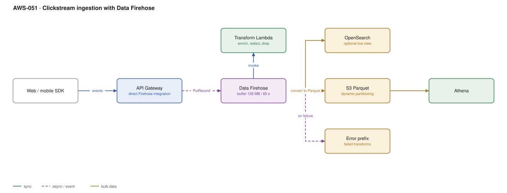

# AWS-051 · Clickstream ingestion with Data Firehose

> **Category:** [06 · Streaming & Real-Time](readme.md#06) · **Maturity:** Production · **Effort:** S

## The problem

Millions of small events — page views, taps, feature usage, application logs — need to end
up in S3 as query-ready Parquet, partitioned sensibly, without you operating anything.
Firehose is the zero-ops path: you point producers at it, and it buffers, transforms,
converts format, partitions and delivers.

**Use it when** the destination is S3, OpenSearch, Redshift or a supported third party and
you do not need per-record processing with ordering guarantees.

**Don't use it when** you need replay, ordering, or multiple independent consumers — that is
Kinesis Data Streams ([`aws-047`](aws-047-kinesis-lambda.md)). Firehose is a delivery
pipeline, not a log.

## Firehose vs Data Streams

| | Firehose | Data Streams |
|---|---|---|
| Replay | **No** | Yes |
| Ordering | No guarantee | Per partition key |
| Consumers | One destination | Many independent |
| Format conversion | **Built in** (Parquet/ORC) | Build it yourself |
| Scaling | **Automatic** | Shards (or on-demand) |
| Latency | 60 s+ buffer | Sub-second |
| Cost at 1 TB/day | ~$870/mo | ~$1,100/mo + consumers |

## Components

| Service | Role | The setting that actually matters |
|---|---|---|
| Firehose delivery stream | Buffer, transform, deliver | **Buffer size and interval** — the latency/cost/file-size trade-off |
| Transformation Lambda | Enrich, redact, filter | Must return every record with a status; 3-minute timeout |
| Record format conversion | JSON → Parquet | Needs a **Glue table** to supply the schema |
| Dynamic partitioning | `s3://.../customer=X/dt=Y/` | Partition keys from record content, billed per GB |
| Error output prefix | Failed records | Configure it, or failures are lost |
| Destination | S3, OpenSearch, Redshift, Splunk, HTTP | S3 is by far the cheapest |

## Flow

1. Producers call `PutRecord`/`PutRecordBatch` — directly, from API Gateway, or from a
   Kinesis stream as the source.
2. Firehose buffers until either the size (1–128 MB) or interval (60–900 s) threshold is met.
3. The transformation Lambda is invoked per buffered batch to enrich, redact or drop records.
4. Record format conversion turns JSON into Parquet using the schema from a Glue table.
5. Dynamic partitioning extracts partition values from record content and writes to the
   corresponding prefix.
6. Delivery failures and transformation failures are written to the error prefix with the
   reason attached.
7. Athena queries the result immediately, with partition pruning.

## Cost (us-east-1 — order of magnitude)

| Line item | Small · 10 GB/day | Medium · 500 GB/day | Large · 5 TB/day |
|---|---|---|---|
| Firehose ingestion @ $0.029/GB | $8.70 | $435.00 | $4,350.00 |
| Format conversion @ $0.018/GB | $5.40 | $270.00 | $2,700.00 |
| Dynamic partitioning @ $0.020/GB + $0.005/1K objects | $7.00 | $320.00 | $3,200.00 |
| Transformation Lambda | $2.00 | $60.00 | $550.00 |
| S3 storage (Parquet, ~5× compressed, 90 days) | $1.30 | $65.00 | $650.00 |
| **Total** | **~$24** | **~$1,150** | **~$11,450** |

**Cost cliff:** **the add-ons cost more than the ingestion.** Format conversion plus dynamic
partitioning roughly **doubles** the per-GB price. They are usually worth it — Parquet with
partitioning cuts Athena scan costs by 95% ([`aws-039`](aws-039-athena-federated.md)) — but
enable them because you measured the downstream saving, not by default.

**Biggest lever:** buffer size. A 128 MB buffer produces well-sized Parquet files and fewer
S3 PUTs; a 1 MB buffer produces the small-file problem that makes every downstream query
slow and expensive. Unless you need sub-minute freshness, buffer large.

## Failure modes

| Failure | Symptom | Mitigation |
|---|---|---|
| Small buffer | Thousands of tiny Parquet files, slow expensive queries | Buffer 128 MB / 300 s unless freshness demands otherwise |
| Transformation Lambda drops records | Silent data loss | Return every record with `Ok`/`Dropped`/`ProcessingFailed`; monitor dropped counts |
| No error prefix | Failed records vanish | Always configure it, and alarm on objects appearing there |
| Schema drift | Format conversion fails for every record | Glue table schema must match; version it with the producer contract |
| Too many dynamic partitions | Per-object charges explode, tiny files | Partition on low-cardinality fields; never on user id |
| Expecting replay | A downstream bug means the data is gone | Use Data Streams as the source if you may need to reprocess |

## Security notes

- Server-side encryption on the delivery stream, and SSE-KMS on the destination bucket.
- The transformation Lambda is the right place to redact personal data **before** it lands —
  far easier than deleting it from a lake later.
- Producers need only `firehose:PutRecord*` on the specific stream.
- A VPC endpoint for Firehose keeps high-volume ingestion off the NAT gateway, which at 5
  TB/day is a substantial saving.
- The error prefix contains raw unprocessed records, including anything the transform would
  have redacted. Secure it to the same standard as the main destination.

## What people miss

- **A Kinesis Data Stream can be the Firehose source.** That gives you replay and multiple
  consumers *and* zero-ops delivery to S3 — one stream, a Flink consumer for real-time, and
  Firehose for the lake copy. This combination is the usual right answer and is often missed
  as an either/or choice.
- **Dynamic partitioning is billed per GB and per object.** Partitioning by a high-cardinality
  field creates millions of tiny objects and a surprising bill.
- **The transformation Lambda has a 3-minute limit and sees batches**, not single records.
  Code written for a per-record Lambda shape will time out at volume.
- **Firehose can deliver to Iceberg tables** directly now, which removes a compaction-shaped
  problem from the design ([`aws-041`](aws-041-iceberg-tables.md)).
- **Buffer interval is a latency contract.** Telling stakeholders data is "real time" when the
  buffer is 900 seconds is how trust in a platform is lost.

## See also

- [`aws-047`](aws-047-kinesis-lambda.md) — the stream to put in front of this
- [`aws-037`](aws-037-s3-data-lake.md) — where the output lands
- [`aws-039`](aws-039-athena-federated.md) — why Parquet and partitioning pay for themselves
- [`aws-068`](aws-068-centralized-logging.md) — the same pattern applied to logs
