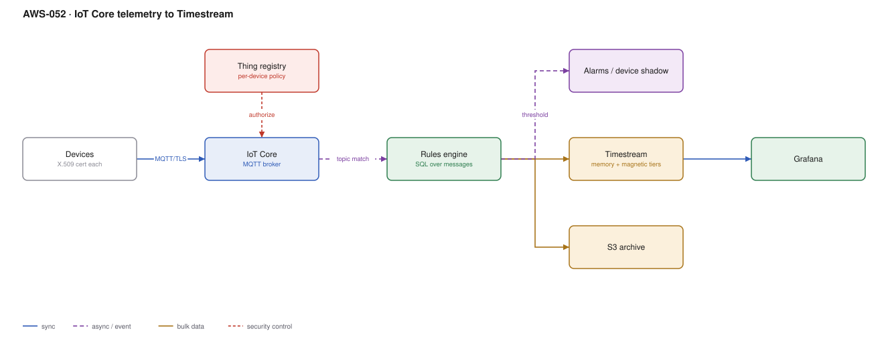

# AWS-052 · IoT Core telemetry to Timestream

> **Category:** [06 · Streaming & Real-Time](readme.md#06) · **Maturity:** Specialist · **Effort:** M

## The problem

A hundred thousand devices each send a reading every ten seconds. They are on flaky
networks, they have no human to re-authenticate them, some are offline for days, and the
data is time-series — appended constantly, queried by time range, and worthless at full
resolution after a month. Three distinct problems: device identity at scale, lightweight
transport, and a store that does not fall over.

**Use it when** you have many devices, constrained connectivity, or per-device credentials.

**Don't use it when** you have a dozen servers sending metrics — that is CloudWatch or
Prometheus ([`aws-067`](aws-067-otel-adot.md)). And note that IoT Core is a perfectly good
general-purpose MQTT broker even when there is no "thing" involved — see below.

## Components

| Service | Role | The setting that actually matters |
|---|---|---|
| IoT Core | MQTT broker, device gateway | **Per-device X.509 certificates**, never a shared credential |
| Thing registry + policies | Device identity and authorisation | Policy variables (`${iot:Connection.Thing.ThingName}`) so one policy serves every device |
| Rules engine | SQL over the message stream | Routes to 20+ targets with no compute of your own |
| Device shadow | Last-known and desired state | Lets you address an offline device |
| Timestream | Time-series store | **Memory store retention** vs magnetic — the whole cost model |
| Grafana / QuickSight | Visualisation | Managed Grafana has a native Timestream data source |

## Flow

1. Each device authenticates with its own X.509 certificate over MQTT/TLS and connects to
   IoT Core.
2. An IoT policy using policy variables permits it to publish only to its own topic
   (`devices/${iot:Connection.Thing.ThingName}/telemetry`).
3. The rules engine matches topics with a SQL statement, optionally filtering and
   transforming inline.
4. Matching messages are written to Timestream — into the **memory store** first, for fast
   recent queries.
5. The same rule can fan out: archive raw to S3, trigger an alarm above a threshold, update
   the device shadow.
6. After the memory-store retention window, records move automatically to the magnetic store
   at a fraction of the price.
7. Grafana queries Timestream for dashboards across both tiers transparently.

## Cost (us-east-1 — order of magnitude)

| Line item | Small · 1K devices | Medium · 50K devices | Large · 500K devices |
|---|---|---|---|
| IoT messages @ $1.00/M (6/min/device) | $259.20 | $12,960.00 | $129,600.00 |
| Connection minutes @ $0.08/M | $3.46 | $172.80 | $1,728.00 |
| Rules engine @ $0.15/M actions | $38.88 | $1,944.00 | $19,440.00 |
| Timestream writes @ $0.50/M | $129.60 | $6,480.00 | $64,800.00 |
| Timestream memory store @ $0.036/GB-hr (24 h) | $50.00 | $2,400.00 | $24,000.00 |
| Timestream magnetic @ $0.03/GB-mo | $15.00 | $750.00 | $7,500.00 |
| **Total** | **~$496** | **~$24,707** | **~$247,068** |

**Cost cliff:** **the memory store at $0.036/GB-hour is ~$26/GB-month** — more than 1,000×
the magnetic store. Retaining 7 days in memory instead of 24 hours multiplies that line by
seven. Set memory retention to the shortest window your dashboards actually query at full
speed, usually hours, not days.

**Biggest lever:** message count. Devices publishing every 10 seconds instead of every 60
costs 6× across *every line in the table*. Batch readings at the device — one message
carrying six readings costs a sixth as much and is usually indistinguishable to the consumer.
IoT Core also bills per 5 KB block, so very small frequent messages waste the block.

## Failure modes

| Failure | Symptom | Mitigation |
|---|---|---|
| Shared certificate | One compromised device compromises the fleet, no revocation granularity | Unique cert per device; use fleet provisioning to issue at scale |
| Reconnect storm | A regional blip disconnects 500K devices which reconnect simultaneously | Exponential backoff with jitter **on the device** — this must ship in firmware |
| Memory store too long | Dominant cost line, nobody knows why | Retention tuned to query patterns; alarm on store size |
| No device-side buffering | Data lost whenever the network drops | Buffer locally and publish on reconnect with original timestamps |
| Rules engine fan-out cost | One message triggering five rules bills five actions | Combine actions; a rule can have multiple actions and bills per action |
| Clock skew on devices | Out-of-order and future-dated time-series data | Use the broker-side timestamp, or reject implausible device timestamps |

## Security notes

- Per-device certificates with **policy variables** are the central pattern: one policy
  document that resolves to the connecting thing's own topics. Without it you write a policy
  per device, or you over-grant.
- Just-in-time provisioning or fleet provisioning issues certificates on first connect from a
  manufacturing claim certificate, which is how you avoid burning unique certs at build time.
- A revoked certificate must be revoked in IoT Core, not just in your CA — IoT Core does not
  check an external CRL.
- Device Defender detects anomalous device behaviour (unusual message volume, unauthorised
  topics) and is the fleet equivalent of GuardDuty.
- Devices are physically accessible to attackers. Assume certificate extraction is possible
  and design the blast radius accordingly.

## What people miss

- **IoT Core is a general-purpose managed MQTT broker.** For large numbers of long-lived,
  mostly-idle connections it is substantially cheaper than API Gateway WebSockets
  ([`aws-016`](aws-016-serverless-websockets.md)) and gives topic-based routing for free. The
  "IoT" branding puts off teams who would benefit.
- **The rules engine replaces a lot of Lambda.** SQL filtering, enrichment and routing to
  Timestream, S3, Kinesis, SNS or DynamoDB happen with no function to write or operate.
- **Timestream has two editions now** — the original (Live Analytics) and InfluxDB-compatible.
  Check which fits before assuming the pricing model above.
- **Device shadows let you talk to offline devices.** Set desired state; the device reconciles
  when it reconnects. Teams build this themselves surprisingly often.
- **Greengrass moves processing to the device** for cases where the network cost or latency of
  sending everything is prohibitive ([`aws-100`](aws-100-greengrass-edge-ml.md)).

## See also

- [`aws-100`](aws-100-greengrass-edge-ml.md) — filtering and inference at the device
- [`aws-016`](aws-016-serverless-websockets.md) — the alternative for browser clients
- [`aws-054`](aws-054-realtime-counters.md) — live aggregates over this data
- [`aws-051`](aws-051-clickstream-firehose.md) — the archive path to the lake
