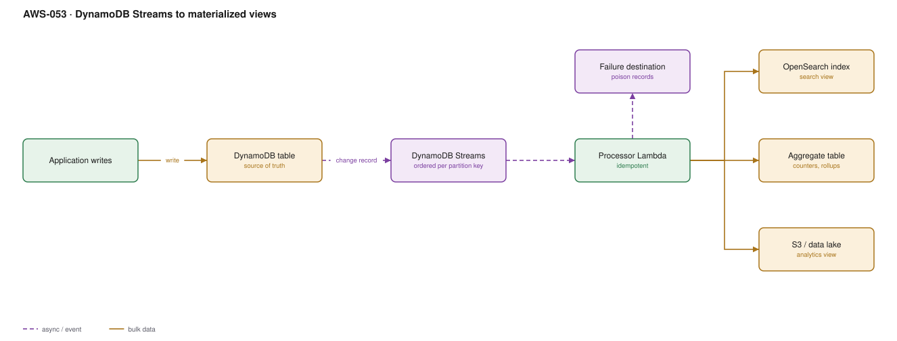

# AWS-053 · DynamoDB Streams to materialized views

> **Category:** [06 · Streaming & Real-Time](readme.md#06) · **Maturity:** Production · **Effort:** M

## The problem

DynamoDB is excellent at the access patterns you designed for and incapable of the ones you
did not. Full-text search, aggregates, analytics, and arbitrary filters are all things it
will not do. Rather than contort the table, treat it as the write-optimised source of truth
and project its change stream into read models shaped for each query — CQRS, with DynamoDB
Streams as the mechanism.

**Use it when** you need search, aggregates or analytics over DynamoDB data, or when another
service must react to data changes.

**Don't use it when** a GSI would answer the query. A GSI is strongly integrated, needs no
code, and is the right first answer ([`aws-010`](aws-010-serverless-crud.md)).

## What each view is for

| View | Built with | Answers |
|---|---|---|
| OpenSearch index | Lambda → OpenSearch | Full-text, fuzzy, faceted search |
| Aggregate table | Lambda → DynamoDB | Counters, rollups, "how many per customer" |
| S3 / Iceberg | Firehose or Lambda → S3 | Analytics, BI, ML training data |
| Cache | Lambda → ElastiCache | Hot denormalised objects |
| Another service | Lambda → EventBridge | Domain events for other bounded contexts |

## Components

| Service | Role | The setting that actually matters |
|---|---|---|
| DynamoDB table | Source of truth | `StreamViewType` — almost always `NEW_AND_OLD_IMAGES` |
| DynamoDB Streams | Ordered change feed | **24-hour retention**, no replay beyond it |
| Event source mapping | Stream → Lambda | `BisectBatchOnFunctionError`, retry limits, on-failure destination |
| Processor Lambda | Builds the views | Must be idempotent; delivery is at-least-once |
| On-failure destination | Poison record handling | Without it, a bad record blocks the shard |
| Kinesis Data Streams (alternative) | Longer retention, more consumers | Up to 365 days, multiple independent readers |

## Flow

1. The application writes to DynamoDB — the only write path.
2. A change record appears on the stream, ordered **per partition key**, containing the old
   and new images.
3. The event source mapping delivers batches to the processor Lambda, one concurrent
   invocation per shard by default.
4. The processor projects the change into each view: upsert the OpenSearch document,
   increment the aggregate, append to S3.
5. Processing is idempotent — the same change applied twice produces the same result —
   because at-least-once delivery means it will happen.
6. Failures retry; after the limit, the batch metadata goes to the on-failure destination and
   the shard advances.

## Cost (us-east-1 — order of magnitude)

| Line item | Small · 1M changes/mo | Medium · 100M/mo | Large · 2B/mo |
|---|---|---|---|
| DynamoDB Streams reads @ $0.02/100K | $0.20 | $20.00 | $400.00 |
| Processor Lambda (256 MB × 50 ms) | $0.30 | $30.00 | $600.00 |
| OpenSearch cluster (3 nodes, sized to data) | $200.00 | $600.00 | $2,500.00 |
| Aggregate table writes | $1.25 | $125.00 | $2,500.00 |
| S3 / Firehose to lake | $0.50 | $30.00 | $600.00 |
| **Total** | **~$202** | **~$805** | **~$6,600** |

**Cost cliff:** the **OpenSearch cluster is a fixed floor** of a few hundred dollars a month
regardless of how little you search. If search is a secondary feature, consider whether a
`contains` filter on a GSI, or OpenSearch Serverless with its own (higher) floor, is a better
fit. The streams and Lambda halves are cheap; the destination is what costs.

**Biggest lever:** batching writes to the destination. Processing records one at a time into
OpenSearch wastes both Lambda duration and OpenSearch indexing throughput; use the bulk API
per Lambda batch.

## Failure modes

| Failure | Symptom | Mitigation |
|---|---|---|
| Poison record blocks the shard | View stops updating for one partition key, silently | `BisectBatchOnFunctionError` + max retries + on-failure destination |
| 24-hour retention exceeded | Changes lost permanently during an extended outage | Alarm on `IteratorAge` at a few hours, not at 23 |
| Non-idempotent projection | Counters drift upward on every retry | Use conditional writes or version numbers, not blind `ADD` |
| Aggregate on a hot key | Throttling on the aggregate table, not the source | Shard the aggregate key and sum on read |
| Views drift from source | Nobody notices until a customer does | Periodic reconciliation job comparing counts and checksums |
| More than two consumers | Stream read throughput contention | Switch to Kinesis Data Streams as the change destination |

## Security notes

- The processor role needs read on the stream and write on each view — not read/write on the
  source table. Keep the write path single.
- Old and new images in the stream contain the full item, including anything sensitive. The
  processor can redact before projecting, which is the cleanest place to do it.
- A projected view in OpenSearch may be queried by a broader audience than the source table.
  Apply field-level security there deliberately.
- Streams records are retained 24 hours; include that in deletion-request handling.

## What people miss

- **Kinesis Data Streams is an alternative change destination** for DynamoDB, with up to 365
  days of retention and multiple independent consumers. If 24 hours is too short, or you have
  more than two consumers, switch — most teams do not know the option exists.
- **Zero-ETL integrations** now push DynamoDB directly into OpenSearch and into Redshift with
  no Lambda at all. Check whether your view is one of those before writing a projector.
- **Ordering is per partition key, not global.** Two items with different keys have no
  relative order, which breaks naive "rebuild in order" assumptions.
- **`TransactWriteItems` produces multiple stream records**, not one atomic event. A view that
  must see a transaction atomically has to reassemble it.
- **Deletes come through with the old image and no new image**, which is exactly what you need
  to remove a document from a search index — and exactly what projectors forget to handle.

## See also

- [`aws-010`](aws-010-serverless-crud.md) — the table this projects from
- [`aws-047`](aws-047-kinesis-lambda.md) — using Kinesis for longer retention
- [`aws-044`](aws-044-cdc-dms.md) — the relational equivalent
- [`aws-054`](aws-054-realtime-counters.md) — a specific aggregate view
