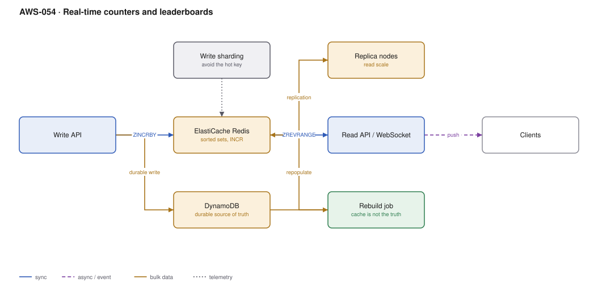

# AWS-054 · Real-time counters and leaderboards

> **Category:** [06 · Streaming & Real-Time](readme.md#06) · **Maturity:** Growing · **Effort:** M

## The problem

"How many views does this post have?" and "who are the top 100 players?" look trivial and
are not. A counter is a single row that every write contends on, which is exactly the
access pattern distributed databases are worst at. A leaderboard needs a sorted view of
millions of entries updated constantly, which is not something a key-value store does.

**Use it when** counts or rankings must be current within a second and are read far more
often than any single one is written.

**Don't use it when** eventual aggregation is fine. A nightly rollup is dramatically simpler,
and "views: 1.2M" updated hourly is indistinguishable to a user from one updated instantly.

## The two patterns

| | Redis sorted set | DynamoDB atomic counter |
|---|---|---|
| Throughput per key | **Very high** (single-threaded, in memory) | ~1,000 WCU per partition, then throttles |
| Ranking query | `ZREVRANGE`, O(log N) | Impossible without a scan |
| Durability | Replica + snapshot, can lose seconds | **Durable** |
| Cost at scale | Node hours | Per write |
| Right as | The serving layer | The source of truth |

The answer is almost always both: Redis serves, DynamoDB persists, and Redis can be rebuilt.

## Components

| Service | Role | The setting that actually matters |
|---|---|---|
| ElastiCache for Redis (or Valkey) | The live counter and ranking | **Cluster mode** for sharding; sorted sets for ranking |
| DynamoDB | Durable record of truth | Write-sharded counter keys to spread the load |
| Write sharding | Avoids the hot key | `key#0` … `key#N`, summed on read |
| Read replicas | Read scale | Reads from replicas; writes to primary only |
| Rebuild job | Repopulates the cache | **The cache is not the source of truth** — prove you can rebuild it |
| WebSocket / SSE | Pushing updates | [`aws-016`](aws-016-serverless-websockets.md) |

## Flow

1. A write arrives: increment a view count, record a score.
2. The API issues `ZINCRBY` or `INCR` against Redis — sub-millisecond, and immediately
   reflected in rankings.
3. The same event is written durably to DynamoDB, using a sharded key (`post#123#shard#7`)
   so no single partition takes every write.
4. Reads for the current count come from Redis; reads for ranking use `ZREVRANGE`, which is
   logarithmic and returns a sorted page directly.
5. A periodic job reconciles Redis against DynamoDB, correcting drift.
6. If Redis is lost, the rebuild job replays DynamoDB sums back into the sorted sets.

## Cost (us-east-1 — order of magnitude)

| Line item | Small · 1K writes/s | Medium · 20K writes/s | Large · 200K writes/s |
|---|---|---|---|
| ElastiCache (r7g.large / 3× r7g.xlarge / 9× r7g.2xlarge) | $150.38 | $902.28 | $5,413.68 |
| Read replicas (1 per shard) | $150.38 | $902.28 | $5,413.68 |
| DynamoDB on-demand writes @ $1.25/M | $3,240.00 | $64,800.00 | $648,000.00 |
| *DynamoDB provisioned equivalent* | $470.00 | $9,400.00 | $94,000.00 |
| *Batched writes (100:1 aggregation)* | **$4.70** | **$94.00** | **$940.00** |
| **Total (provisioned + batching)** | **~$306** | **~$1,899** | **~$11,767** |

**Cost cliff:** **writing every increment to DynamoDB individually.** At 200K writes/second
that is $648,000/month on-demand. Buffering increments in Redis and flushing aggregated
deltas to DynamoDB every few seconds reduces durable writes by two or three orders of
magnitude, at the cost of losing a few seconds of counts in a total cache failure. For view
counts that trade is obviously correct; for financial balances it is obviously not.

**Biggest lever:** write aggregation, then provisioned capacity over on-demand for a
predictable high-write workload.

## Failure modes

| Failure | Symptom | Mitigation |
|---|---|---|
| Hot partition in DynamoDB | Throttling on the popular item while the table is idle | Write sharding across N suffixes, summed on read |
| Hot key in Redis cluster | One shard saturated; cluster mode does not help | A single key lives on one shard — shard the key itself, or use a replica fan-out |
| Cache treated as truth | Node failure loses counts permanently | Durable write path plus a tested rebuild job |
| Rebuild never tested | Discovered during the incident | Rehearse it; a rebuild that takes six hours is a six-hour outage |
| Unbounded sorted set | Memory exhaustion as entries accumulate | Trim with `ZREMRANGEBYRANK`; set a max cardinality |
| Eviction policy wrong | Redis silently evicts counters under memory pressure | `noeviction` for counter workloads — fail the write rather than lose data |

## Security notes

- Enable encryption in transit and at rest, and **Redis AUTH / RBAC**. An unauthenticated
  ElastiCache cluster reachable from the application subnet is a common finding.
- Keep the cluster in private subnets with a security group allowing only the application.
- Counters are often per-tenant. Namespace keys by tenant and verify authorisation in the API
  — Redis has no row-level security.
- Snapshots contain the full dataset; encrypt them and control who can restore.

## What people miss

- **A single hot key defeats Redis cluster mode.** Sharding distributes *keys*, not the load
  on one key. A global leaderboard key is served by exactly one shard; the fix is to shard
  the key itself and merge, or to serve reads from replicas.
- **`noeviction` is the right policy for counters.** The default `allkeys-lru` will silently
  evict your counters under memory pressure, producing data loss that looks like a bug.
- **DynamoDB atomic counters are durable and fine up to the partition limit** — roughly 1,000
  writes/second per partition key. Below that, skip Redis entirely; the two-store complexity
  is not free.
- **Approximate structures solve some of these problems outright.** HyperLogLog counts unique
  visitors in 12 KB regardless of volume, with ~2% error. For "unique viewers" that is
  usually the right answer and it is a single Redis command.
- **Valkey is the open-source fork** and ElastiCache offers it at a lower price than Redis
  OSS for equivalent nodes — a straightforward saving on new deployments.

## See also

- [`aws-053`](aws-053-ddb-streams-views.md) — building aggregates from a change stream instead
- [`aws-016`](aws-016-serverless-websockets.md) — pushing the live number to clients
- [`aws-010`](aws-010-serverless-crud.md) — the DynamoDB design underneath
- [`aws-047`](aws-047-kinesis-lambda.md) — when counts come from an event stream
