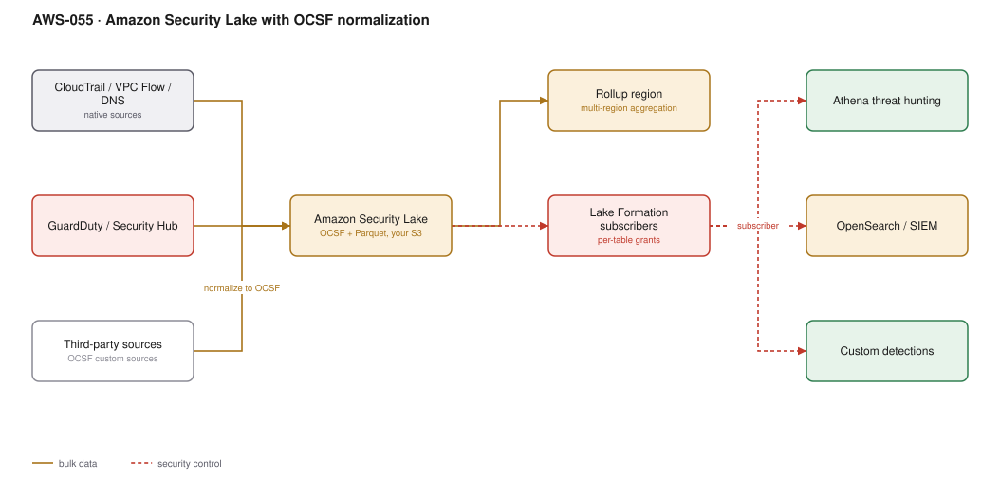

# AWS-055 · Amazon Security Lake with OCSF normalization

> **Category:** [07 · Security, Detection & Response](readme.md#07) · **Maturity:** Growing · **Effort:** L

## The problem

Security data is scattered across services and formats: CloudTrail JSON, VPC Flow Logs in
their own layout, Route 53 DNS query logs, GuardDuty findings in ASFF, plus whatever your
endpoint and identity vendors emit. Correlating "which identity did this, from which IP, to
which resource" means writing a parser per source and maintaining it forever. Security Lake
collects all of it into **your own S3**, normalised to the **OCSF** open schema, converted
to Parquet, partitioned, and queryable from Athena.

**Use it when** you have multiple accounts and regions and need cross-source correlation —
or when a SIEM is charging you per GB and you want to control the data yourself.

**Don't use it when** GuardDuty plus Security Hub answers your questions. Security Lake is a
data platform, not a detection engine: it **finds nothing on its own**. You are buying
normalised, cheap, queryable storage, and you still have to write or buy the detections.

## Why OCSF matters

Without normalisation, "source IP" is `sourceIPAddress` in CloudTrail, `srcaddr` in flow
logs, and `src_endpoint.ip` in a vendor feed. A correlation query needs three different
parsers and breaks whenever any source changes its format.

With OCSF, all three become `src_endpoint.ip` and one query spans them. That is the entire
value proposition, and it is a bigger deal in practice than it sounds.

## Components

| Service | Role | The setting that actually matters |
|---|---|---|
| Security Lake | Collection, normalisation, partitioning | **Delegated administrator** in the security account, enabled org-wide |
| Native sources | CloudTrail, VPC Flow, Route 53 DNS, EKS audit, Security Hub, Lambda | Enabled per source, per region — not all-or-nothing |
| Custom sources | Anything you can emit as OCSF Parquet | You transform to OCSF; the lake does not do it for third parties |
| Rollup regions | Aggregate several regions into one | Cross-region transfer costs apply |
| Lake Formation | Subscriber access control | Grants per table, per column — this is how you give the SOC read access safely |
| Subscribers | Athena, OpenSearch, a SIEM, your own detections | Query access or data access (S3 notifications) |
| Lifecycle | Retention per source | The main cost control |

## Flow

1. Security Lake is enabled from a delegated administrator account across the organisation.
2. Native sources are turned on per region; records are collected without agents or pipelines.
3. Records are normalised to OCSF, converted to Parquet, and partitioned by region, account
   and date in an S3 bucket **you own**.
4. Third-party and custom sources are registered, writing OCSF Parquet into the same
   structure.
5. Rollup regions aggregate selected regions into one for global queries.
6. Subscribers are granted access through Lake Formation — Athena for hunting, OpenSearch or
   a SIEM for dashboards, Lambda or Flink for custom detections.
7. Lifecycle rules tier older partitions to cheaper storage classes.

## Cost (us-east-1 — order of magnitude)

| Line item | Small · 100 GB/mo | Medium · 2 TB/mo | Large · 30 TB/mo |
|---|---|---|---|
| Security Lake ingestion @ ~$0.75/GB (first 10 TB) | $75.00 | $1,500.00 | $19,000.00 |
| S3 storage (12 months accumulated, Parquet) | $14.00 | $280.00 | $4,200.00 |
| Lifecycle to Glacier IR after 90 days | -$8.00 | -$160.00 | -$2,400.00 |
| Athena hunting queries | $10.00 | $80.00 | $500.00 |
| Cross-region rollup transfer | $2.00 | $40.00 | $600.00 |
| OpenSearch subscriber (if used) | $700.00 | $1,500.00 | $6,000.00 |
| **Total (without OpenSearch)** | **~$93** | **~$1,740** | **~$21,900** |

**Cost cliff:** **ingestion is priced per GB and CloudTrail data events are enormous.**
Turning on S3 data events across an estate can multiply your volume by ten or more overnight.
Enable data events selectively — on the buckets that matter — rather than organisation-wide.

**Biggest lever:** source selection and retention. Compare honestly against your SIEM's
per-GB licence: Security Lake plus Athena is frequently a fraction of SIEM ingest pricing,
and the usual winning pattern is **everything into Security Lake, the high-value subset
forwarded into the SIEM**.

## Failure modes

| Failure | Symptom | Mitigation |
|---|---|---|
| Expecting detections | Lake is full, nothing alerts | Security Lake stores and normalises. Detections come from GuardDuty, a SIEM, or code you write |
| Unbounded retention | Storage grows forever, cost climbs | Per-source lifecycle; most sources do not need 12 months of hot Parquet |
| Data events enabled broadly | Ingestion cost jumps 10× | Scope S3 and Lambda data events to specific resources |
| Subscriber granted too much | A SIEM vendor reads every table including sensitive ones | Lake Formation grants per table and per column |
| Custom source not valid OCSF | Data lands but queries do not join | Validate against the OCSF schema in CI before publishing |
| Region gaps | A compromise in an unmonitored region is invisible | Enable in every region, including ones you believe are unused |

## Security notes

- The lake is in **your** account, so you control encryption, retention, replication and
  access. That is the structural advantage over a vendor-hosted SIEM, and it matters for
  data residency.
- Put it in a dedicated security account that application administrators cannot reach, and
  protect the bucket from deletion ([`aws-057`](aws-057-immutable-audit-trail.md)).
- Lake Formation column-level grants let analysts query without seeing sensitive fields.
- Security telemetry is itself sensitive — it reveals topology, identities and behaviour.
  Treat subscriber access as a privileged grant and review it.
- Security Lake does not replace an immutable CloudTrail archive; keep both, because the
  archive is your tamper-evident record.

## What people miss

- **It is a lake, not a SIEM.** The most common disappointment. Budget for the detection
  layer separately, whether that is a SIEM subscriber, Athena queries on a schedule, or
  Flink ([`aws-048`](aws-048-vpc-flow-flink.md)).
- **The SIEM cost model is the real business case.** Per-GB SIEM licensing against cheap
  Parquet in your own S3 is where the money is. Tier: everything in the lake, the noisy
  high-volume sources queried from Athena, only enriched or high-signal events forwarded.
- **OCSF is an open standard**, not an AWS format. Detections written against it port to
  other OCSF-emitting tools, which is a genuine lock-in reduction.
- **Query-access and data-access subscribers are different things.** Query access goes
  through Lake Formation and Athena; data access gives S3 notifications so a consumer can
  read objects directly as they land.
- **Enable it before you need it.** The value is historical correlation. Turning it on during
  an incident gives you nothing about what happened last month.

## See also

- [`aws-057`](aws-057-immutable-audit-trail.md) — the tamper-evident record this complements
- [`aws-056`](aws-056-guardduty-response.md) — the detections that do come out of the box
- [`aws-048`](aws-048-vpc-flow-flink.md) — custom real-time detections over the same data
- [`aws-068`](aws-068-centralized-logging.md) — the operational logging equivalent
