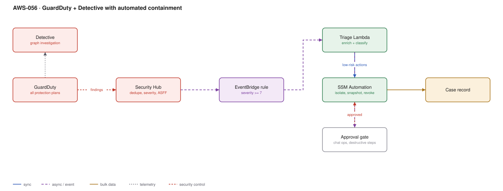

# AWS-056 · GuardDuty + Detective with automated containment

> **Category:** [07 · Security, Detection & Response](readme.md#07) · **Maturity:** Production · **Effort:** M

## The problem

A finding at 03:00 that nobody reads until 09:00 is a six-hour head start for an attacker.
Most GuardDuty findings need the same first three actions — isolate, capture, revoke — and
those actions are mechanical. Automating them turns mean-time-to-containment from hours into
under a minute, while leaving genuine judgement calls to a human.

**Use it when** you have more than a couple of accounts and no 24/7 security team. This is
the highest-value security automation available on AWS.

**Don't** automate every action. Automatic termination of a production instance on a
medium-severity finding is an outage you caused yourself. The design question is which
actions are safe without a human.

## What to automate, and what not to

| Action | Automate? | Why |
|---|---|---|
| Snapshot the EBS volume | **Always** | Non-destructive, and evidence disappears fast |
| Tag the resource as suspect | **Always** | Free, informative |
| Isolate with a quarantine security group | **Usually** | Preserves the instance for forensics; disruptive but reversible |
| Revoke IAM role sessions | **Usually** | Reversible, stops credential misuse immediately |
| Disable an access key | **Usually** | Reversible |
| Block an IP at WAF | With care | Risk of blocking a NAT shared by real users |
| Terminate the instance | **Never automatically** | Destroys evidence and may cause an outage |
| Delete an IAM user | **Never automatically** | Hard to reverse, high blast radius |

## Components

| Service | Role | The setting that actually matters |
|---|---|---|
| GuardDuty | Detection | Enable **all** protection plans: S3, EKS, Malware, RDS, Lambda, Runtime Monitoring |
| Security Hub | Aggregation, dedupe, severity | The single findings queue; ASFF is the common format |
| EventBridge rule | Routes findings to automation | Filter on severity **and** finding type, not severity alone |
| Triage Lambda | Enrich and classify | Adds owner, environment and criticality from tags before deciding |
| SSM Automation | Performs containment | Documents are auditable, parameterised and reusable |
| Approval gate | Human in the loop | Chat-based approval for destructive steps |
| Case record | What happened and when | Every action logged, for the post-incident review |

## Flow

1. GuardDuty analyses CloudTrail, VPC Flow Logs, DNS logs, EKS audit logs and runtime
   telemetry, and raises a finding.
2. The finding goes to Security Hub, which deduplicates it and normalises severity.
3. An EventBridge rule matches on type and severity and invokes the triage function.
4. Triage enriches: which account, which environment, who owns it, is it production, has
   this fired before.
5. Safe actions execute immediately through SSM Automation — snapshot, tag, isolate.
6. Destructive actions post to a chat channel with context and an approve/deny action.
7. Every step is written to a case record, and Detective provides the investigation graph
   for the analyst who picks it up.

## Cost (us-east-1 — order of magnitude)

| Line item | Small · 5 accounts | Medium · 50 accounts | Large · 300 accounts |
|---|---|---|---|
| GuardDuty — CloudTrail events @ ~$4/M | $40.00 | $400.00 | $2,400.00 |
| GuardDuty — VPC Flow + DNS @ ~$1.18/GB | $118.00 | $1,180.00 | $7,080.00 |
| GuardDuty — Runtime Monitoring @ ~$1.50/vCPU-mo | $75.00 | $750.00 | $4,500.00 |
| Detective @ ~$2.00/GB ingested | $100.00 | $1,000.00 | $6,000.00 |
| Security Hub @ $0.0010/finding + checks | $20.00 | $150.00 | $800.00 |
| Automation (Lambda, SSM, EventBridge) | $5.00 | $20.00 | $100.00 |
| **Total** | **~$358** | **~$3,500** | **~$20,880** |

**Cost cliff:** **GuardDuty bills VPC Flow Log and DNS analysis per GB**, so it scales with
network chatter rather than with risk. A busy EKS cluster can double your GuardDuty bill.
Detective is a second per-GB charge on overlapping data — it is an investigation tool, so
enable it where you will actually investigate, not everywhere by default.

**Biggest lever:** the automation itself, measured in avoided incident cost rather than in
dollars saved. The marginal cost of the response pipeline is trivial next to the detection
services.

## Failure modes

| Failure | Symptom | Mitigation |
|---|---|---|
| Over-aggressive automation | Self-inflicted outage from a false positive | Non-destructive actions only without approval; exclude production from auto-isolation initially |
| Finding fatigue | Thousands of low-severity findings, all ignored | Suppression rules for known-benign patterns; automate the handling of the rest |
| Automation role too powerful | A compromised pipeline becomes the attacker's tool | Scope the SSM role tightly; require approval for anything broad |
| Snapshot after termination | Evidence gone | Snapshot **first**, always, as step one |
| Single-account GuardDuty | Findings in member accounts invisible | Delegated administrator with auto-enable for new accounts |
| No runbook for the human | The approval arrives and nobody knows what to do | The chat message must carry context and the recommended action |

## Security notes

- Enable GuardDuty organisation-wide with **auto-enable for new accounts**, or every new
  account is a blind spot until someone remembers.
- The automation role is a privileged identity. It can isolate instances and revoke
  credentials — protect it as you would a break-glass role, and alarm on its use.
- Forensic snapshots should be shared into a separate forensics account with its own
  isolated VPC, never analysed in the compromised account
  ([`aws-062`](aws-062-ir-automation.md)).
- Session revocation works by attaching an inline deny policy with a `TokenIssueTime`
  condition. Know this mechanism before the incident — it is not obvious under pressure.
- Keep findings in Security Lake for long-term correlation
  ([`aws-055`](aws-055-security-lake.md)).

## What people miss

- **GuardDuty Runtime Monitoring** sees process-level activity inside EC2, ECS and EKS
  workloads — a different class of detection from network and API analysis. It is a separate
  charge and frequently left off.
- **Malware Protection for S3** scans uploads without you building a scanning pipeline
  ([`aws-015`](aws-015-s3-upload-pipeline.md)).
- **Revoking a role session is not the same as deleting the role.** The deny-with-
  `TokenIssueTime` trick invalidates issued credentials immediately while leaving the role
  functional for legitimate new sessions.
- **Detective is for the investigation, not the detection.** It builds a behaviour graph from
  the same data; its value appears when an analyst asks "what else did this principal do".
- **Suppression rules are how you keep signal.** A finding type that is always benign in your
  environment should be suppressed deliberately, not ignored habitually.

## See also

- [`aws-062`](aws-062-ir-automation.md) — the playbooks this triggers, in detail
- [`aws-055`](aws-055-security-lake.md) — long-term storage and correlation
- [`aws-065`](aws-065-notification-bus.md) — getting the approval into chat
- [`aws-061`](aws-061-config-compliance.md) — preventing the misconfiguration first
