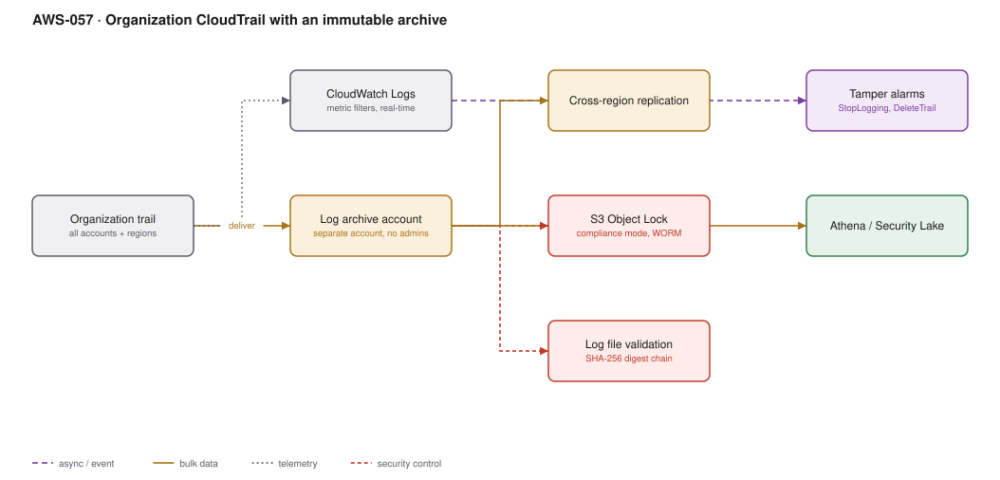

# AWS-057 · Organization CloudTrail with an immutable archive

> **Category:** [07 · Security, Detection & Response](readme.md#07) · **Maturity:** Production · **Effort:** M

## The problem

After an incident, the first question is "what happened". If the audit log lives in the
account that was compromised, the answer may be "we do not know, because the attacker turned
logging off and deleted the bucket". A credible audit trail must be organisation-wide,
delivered to an account the attacker cannot reach, and provably unmodified.

**Use it when** you have more than one AWS account. The organisation trail is free for
management events and takes an hour to set up.

**Don't** treat this as optional because "we have CloudTrail on". Per-account trails with
per-account buckets are exactly the configuration that fails during a real incident.

## Components

| Service | Role | The setting that actually matters |
|---|---|---|
| Organization trail | One trail, every account, every region | Created in the management account, **applies to all accounts including future ones** |
| Log archive account | Isolated destination | A separate account with **no human administrators**, only break-glass |
| S3 Object Lock | Immutability | **Compliance mode** — not even the root user can delete before the retention date |
| Log file validation | Tamper evidence | A SHA-256 digest chain; off by default |
| Cross-region replication | Survives a regional event | Replicate to a second region with its own lock |
| CloudWatch Logs (optional) | Real-time metric filters | For alarms; expensive if you send everything |
| Athena / Security Lake | Querying | Athena over Parquet, or let Security Lake handle normalisation |

## Flow

1. An organisation trail is created in the management account, covering all member accounts
   and all regions, with new accounts included automatically.
2. Events are delivered to a bucket in the dedicated log archive account, which belongs to a
   restrictive OU and has no interactive human access.
3. Object Lock in compliance mode makes every delivered object immutable for the retention
   period.
4. Log file validation produces a digest file chain that proves no object was altered or
   removed.
5. Cross-region replication copies objects to a second region, also locked.
6. A filtered subset also goes to CloudWatch Logs where metric filters raise alarms on
   high-signal events — `StopLogging`, `DeleteTrail`, root login, IAM policy changes.
7. Athena or Security Lake provides the query surface for investigations.

## Cost (us-east-1 — order of magnitude)

| Line item | Small · 10 accounts | Medium · 100 accounts | Large · 500 accounts |
|---|---|---|---|
| Management events, first copy | $0 | $0 | $0 |
| Additional management event copies @ $2/100K | $0 | $0 | $0 |
| **Data events** @ $0.10/100K (if enabled broadly) | $200.00 | $2,000.00 | $12,000.00 |
| S3 storage (12 months, compressed) | $12.00 | $120.00 | $700.00 |
| Cross-region replication + storage | $18.00 | $180.00 | $1,000.00 |
| CloudWatch Logs ingest (filtered subset only) | $25.00 | $200.00 | $900.00 |
| Athena queries | $5.00 | $30.00 | $150.00 |
| **Total (data events scoped, not broad)** | **~$75** | **~$600** | **~$3,000** |

**Cost cliff:** **S3 and Lambda data events.** Management events are free for the first copy;
data events are $0.10 per 100,000 and a busy S3 bucket generates millions per day. Enabling
data events organisation-wide "for completeness" is the classic five-figure surprise. Scope
them to buckets that hold sensitive data.

Second cliff: sending **all** CloudTrail to CloudWatch Logs at $0.50/GB ingest. Send a
filtered subset for alarms; keep the full record in S3.

**Biggest lever:** data event scoping, then CloudWatch Logs filtering. The archive itself is
cheap — it is the real-time copies that cost.

## Failure modes

| Failure | Symptom | Mitigation |
|---|---|---|
| Trail in the same account as workloads | Attacker disables it, evidence gone | Organisation trail, delivered cross-account; SCP denying `cloudtrail:StopLogging` |
| Object Lock in governance mode | A privileged user can still bypass retention | Compliance mode for the archive; governance mode only where you need an escape hatch |
| No log file validation | Cannot prove the log is complete | Enable it; the digest chain is what an auditor asks for |
| Retention shorter than the breach window | Average dwell time exceeds your retention | 12 months minimum; many regimes require longer |
| Data events on everything | Enormous bill, nobody attributed it | Scope to specific buckets and functions |
| No alarms | The archive is perfect and nobody looks at it | Metric filters on `StopLogging`, `DeleteTrail`, root usage, and policy changes |

## Security notes

- **Object Lock in compliance mode cannot be shortened or removed by anyone, including the
  AWS account root.** That is the point, and it is also the risk: you are committing to pay
  for that storage for the full retention period. Test the retention period on a small
  bucket before applying it estate-wide.
- The log archive account should sit in a dedicated OU with an SCP preventing deletion of
  the bucket and disabling of the trail.
- MFA-delete and versioning on the bucket add another layer, though Object Lock is stronger.
- Alarm on the absence of logs too. A trail that silently stops delivering looks identical to
  a quiet day unless you monitor delivery.
- CloudTrail Lake is an alternative managed query store with its own pricing and a seven-year
  retention option, which removes the Athena and partitioning work.

## What people miss

- **The organisation trail covers accounts created in future** automatically, which is the
  main reason it beats per-account trails in a growing estate.
- **Management events are free for the first copy** — there is no cost argument for not
  having this.
- **Log file validation is off by default** and is precisely the control that makes the
  archive evidential rather than merely stored.
- **CloudTrail is not a complete record of everything.** Data events are off by default, some
  services log asynchronously with delays of up to 15 minutes, and a few actions are not
  recorded at all. Know the gaps before relying on it in an investigation.
- **Querying raw CloudTrail JSON in Athena is slow and expensive.** Convert to partitioned
  Parquet, or let Security Lake do it ([`aws-055`](aws-055-security-lake.md)).

## See also

- [`aws-055`](aws-055-security-lake.md) — the normalised analytics layer over this
- [`aws-083`](aws-083-s3-replication-worm.md) — Object Lock in more depth
- [`aws-091`](aws-091-scp-guardrails.md) — the SCPs that prevent tampering
- [`aws-090`](aws-090-landing-zone.md) — where the log archive account comes from
