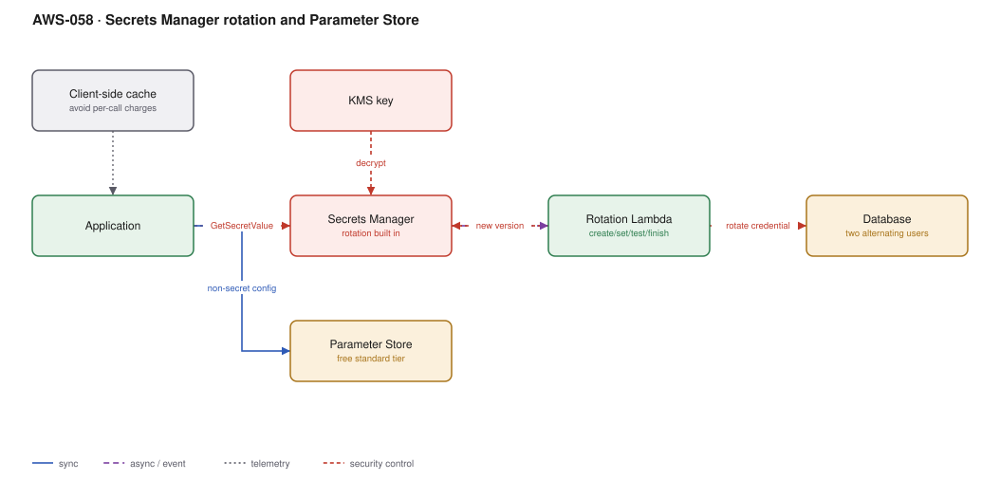

# AWS-058 · Secrets Manager rotation and Parameter Store

> **Category:** [07 · Security, Detection & Response](readme.md#07) · **Maturity:** Production · **Effort:** S

## The problem

Credentials that never change are credentials that eventually leak and stay useful forever.
Rotation is the control, and the reason teams avoid it is that naive rotation causes an
outage: you change the password, and every running instance is still holding the old one.
Secrets Manager's four-step rotation and the two-user alternating pattern solve exactly that.

**Use it when** a credential grants access to something that matters and cannot be replaced
by an IAM role.

**Don't use it when** an IAM role would work. The best secret is no secret:
[`aws-008`](aws-008-m2m-auth.md) for service calls, IRSA/Pod Identity for pods, IAM database
authentication for RDS. Rotation is for credentials you cannot eliminate.

## Secrets Manager vs Parameter Store

| | Secrets Manager | Parameter Store (standard) | Parameter Store (advanced) |
|---|---|---|---|
| Cost | **$0.40/secret/mo** + $0.05/10K calls | **Free** | $0.05/param/mo |
| Rotation | **Built in** | No | No |
| Size limit | 64 KB | 4 KB | 8 KB |
| Cross-account | **Yes**, resource policy | No | No |
| Encryption | KMS, always | KMS for `SecureString` | KMS |

**The rule:** rotating credentials in Secrets Manager; everything else — config, feature
flags, non-secret settings, even static API keys you cannot rotate — in Parameter Store. An
estate with 2,000 secrets in Secrets Manager that are really config is $800/month of
avoidable cost.

## Components

| Service | Role | The setting that actually matters |
|---|---|---|
| Secrets Manager | Storage, versioning, rotation | Rotation schedule, and the `AWSCURRENT`/`AWSPENDING` staging labels |
| Rotation Lambda | The four steps | `createSecret` → `setSecret` → `testSecret` → `finishSecret` |
| Alternating users strategy | Zero-downtime rotation | Two database users; rotate the inactive one, then swap |
| KMS key | Encryption | A customer-managed key if you need cross-account or key-level audit |
| Client-side caching | Cost and latency | The AWS secrets caching libraries — see the cost note |
| Resource policy | Cross-account access | How another account reads a shared secret |

## Flow

1. The application reads the secret at startup and caches it in memory with a TTL.
2. On schedule, Secrets Manager invokes the rotation function.
3. **createSecret**: generate a new credential and store it as the `AWSPENDING` version.
4. **setSecret**: apply it to the target — for the alternating strategy, set the password on
   the *inactive* of two database users.
5. **testSecret**: actually connect using the pending credential. If this fails, rotation
   stops and the current secret is untouched.
6. **finishSecret**: move the `AWSCURRENT` label to the new version. Clients that refresh
   their cache now get the new credential; the previous version remains as `AWSPREVIOUS`.
7. On a 401, the client invalidates its cache, re-reads, and retries once.

## Cost (us-east-1 — order of magnitude)

| Line item | Small · 20 secrets | Medium · 300 secrets | Large · 3,000 secrets |
|---|---|---|---|
| Secrets Manager storage @ $0.40 | $8.00 | $120.00 | $1,200.00 |
| API calls @ $0.05/10K — **cached** | $0.05 | $1.00 | $10.00 |
| API calls @ $0.05/10K — **uncached, per request** | $13.00 | $650.00 | $6,500.00 |
| Rotation Lambda invocations | $0.10 | $1.50 | $15.00 |
| KMS requests | $0.50 | $7.00 | $70.00 |
| *Same values in Parameter Store standard* | $0 | $0 | $0 |
| **Total (cached)** | **~$9** | **~$130** | **~$1,295** |

**Cost cliff:** **fetching the secret on every request instead of caching it.** At scale this
turns a $10 line into a $6,500 line, and adds 20–50 ms to every request. The AWS caching
libraries and the Lambda Parameters and Secrets extension exist precisely for this and are
widely unused.

**Biggest lever:** putting non-rotating configuration in Parameter Store. Most estates have
far more "secrets" than actual rotating credentials.

## Failure modes

| Failure | Symptom | Mitigation |
|---|---|---|
| Single-user rotation | Brief outage at every rotation as old connections fail | **Alternating users** — rotate the inactive user, then swap |
| Client caches forever | Auth fails hours after a successful rotation | Cache with a TTL; invalidate and retry once on 401 |
| `testSecret` not implemented | Rotation "succeeds" and breaks production | The test step is the safety net; implement it properly |
| Rotation Lambda cannot reach the database | Rotation fails silently every night | VPC configuration for the rotation function; alarm on rotation failures |
| Secrets in environment variables | Visible in the console, in logs, in process lists | Read at runtime, not at deploy time |
| Deleted secret recovery window | Secret gone, 30-day window not understood | Deletion is soft by default (7–30 days) — but force-delete is permanent |

## Security notes

- Rotation does not help if the secret is also in a Git history, a CI log or a Terraform
  state file. Scan for those ([`aws-064`](aws-064-shift-left-security.md)), and treat state
  files as secret material.
- Use a customer-managed KMS key when you need cross-account sharing or per-key audit
  granularity ([`aws-059`](aws-059-kms-key-hierarchy.md)).
- Resource policies on secrets enable cross-account access without copying the value — the
  copy is what leaks.
- CloudTrail records every `GetSecretValue`. Alarm on unusual retrieval patterns; that is
  often the first visible sign of credential abuse.
- Set rotation intervals you can actually sustain. A 30-day rotation that breaks production
  monthly will be disabled by someone, and nobody will mention it.

## What people miss

- **The alternating-users strategy is the answer to rotation-causes-outages.** Two database
  users, alternating; the one being rotated is not in use. Single-user rotation always has a
  window where live connections hold a stale password.
- **The Lambda Parameters and Secrets extension** caches secrets in a local HTTP endpoint
  with no code change beyond a URL. It is the simplest fix for the per-request cost problem.
- **Parameter Store is free and most "secrets" belong there.** Standard tier, `SecureString`,
  KMS-encrypted, no per-secret charge.
- **Rotation can be scheduled with cron expressions**, not just "every N days", which lets
  you rotate during a maintenance window rather than at an arbitrary hour.
- **RDS, Redshift and DocumentDB have managed rotation functions** provided by AWS — you do
  not write the Lambda for the common cases.

## See also

- [`aws-008`](aws-008-m2m-auth.md) — eliminating the secret entirely
- [`aws-018`](aws-018-lambda-rds-proxy.md) — IAM database auth, which needs no password
- [`aws-059`](aws-059-kms-key-hierarchy.md) — the keys underneath
- [`aws-064`](aws-064-shift-left-security.md) — catching the secret before it is committed
