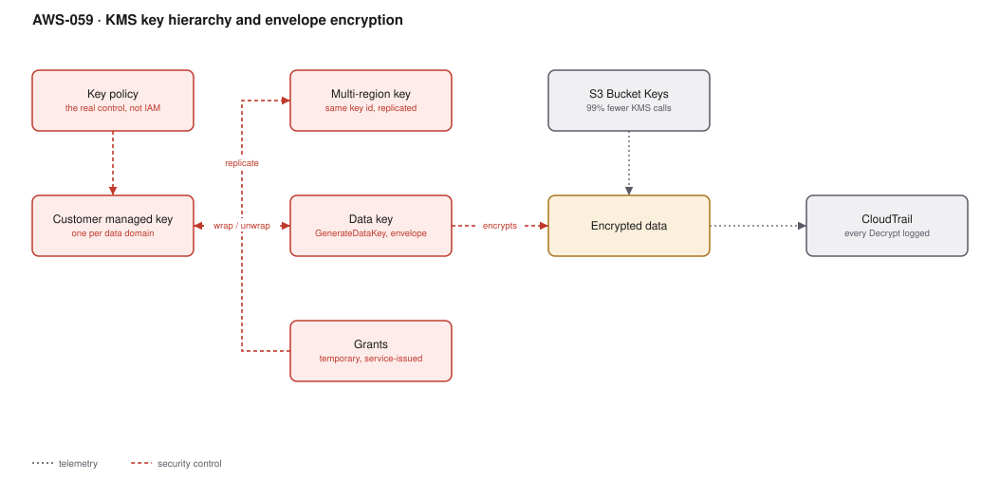

# AWS-059 · KMS key hierarchy and envelope encryption

> **Category:** [07 · Security, Detection & Response](readme.md#07) · **Maturity:** Production · **Effort:** M

## The problem

"Encrypt everything" is easy — most AWS services encrypt by default. The real questions are
harder: who can decrypt, can you prove it, can you revoke it, and what happens when the key
is in one region and the data is in another. Those are answered by key **design**, not by
turning encryption on.

**Use customer-managed keys when** you need to control the key policy, audit decrypt calls,
revoke access independently of IAM, or share encrypted data across accounts.

**Use AWS-managed keys when** you just need encryption at rest and none of the above. They
are free, and a customer-managed key you do not actually manage is $1/month of theatre.

## The key decisions

| Decision | Options | Guidance |
|---|---|---|
| Key granularity | One per account / per service / per data domain | **Per data domain** — one for PII, one for financial, one for logs |
| Key type | AWS-managed / customer-managed / multi-region | Customer-managed where the policy matters; multi-region only for genuine cross-region needs |
| Access control | Key policy / IAM / grants | **The key policy is authoritative** — IAM alone cannot grant access |
| Rotation | Automatic annual / manual | Automatic; it is free and transparent |
| Envelope encryption | Direct `Encrypt` / `GenerateDataKey` | `GenerateDataKey` for anything over 4 KB — which is everything real |

## Components

| Service | Role | The setting that actually matters |
|---|---|---|
| Customer managed key (CMK) | Root of trust for a domain | **Key policy** — the only thing that can grant access to the key |
| Data keys | What actually encrypts the data | `GenerateDataKey` returns plaintext + encrypted; discard the plaintext immediately |
| Grants | Temporary, fine-grained permission | How AWS services get scoped access without a policy change |
| Multi-region keys | Same key material, several regions | Same key ID, independently replicated; **not** the same as replicating data |
| S3 Bucket Keys | Request reduction | Up to **99% fewer KMS calls** — see the cost note |
| CloudTrail | Audit of every cryptographic operation | The reason to use a CMK in the first place |

## Flow

1. A key is created per data domain, with a key policy naming which roles may use it and
   which may administer it.
2. To encrypt an object, the service calls `GenerateDataKey`, receiving a plaintext data key
   and an encrypted copy of it.
3. The data is encrypted locally with the plaintext data key, which is then discarded from
   memory.
4. The encrypted data key is stored alongside the ciphertext.
5. To decrypt, the service sends the encrypted data key to KMS, which returns the plaintext
   key if the caller is permitted.
6. Every one of those calls appears in CloudTrail with the caller identity and the encryption
   context.
7. S3 Bucket Keys cache a bucket-level key so the per-object KMS round trip mostly disappears.

## Cost (us-east-1 — order of magnitude)

| Line item | Small · 10 keys | Medium · 50 keys | Large · 200 keys |
|---|---|---|---|
| Key storage @ $1/key/mo | $10.00 | $50.00 | $200.00 |
| Requests @ $0.03/10K — **without bucket keys** | $300.00 | $3,000.00 | $30,000.00 |
| Requests @ $0.03/10K — **with S3 Bucket Keys** | $3.00 | $30.00 | $300.00 |
| Multi-region replica keys @ $1 each | $3.00 | $15.00 | $60.00 |
| ECC/RSA asymmetric operations (higher rate) | $5.00 | $25.00 | $100.00 |
| **Total (bucket keys on)** | **~$21** | **~$120** | **~$660** |

**Cost cliff:** **KMS request charges on high-object-count S3 workloads.** Every `GetObject`
on an SSE-KMS object is a KMS `Decrypt` call at $0.03 per 10,000. A data lake serving a
billion object reads a month costs $3,000 in KMS requests alone. **S3 Bucket Keys** reduce
this by up to 99% and are a single property on the bucket — enable them everywhere.

**Biggest lever:** S3 Bucket Keys, then key count discipline. Two hundred keys because
someone created one per bucket is $2,400/year for no security benefit.

## Failure modes

| Failure | Symptom | Mitigation |
|---|---|---|
| Key policy locks everyone out | Nobody, including root, can use or modify the key | Always include an account-root principal statement; a key can be made permanently unusable |
| Key deleted | Data is **unrecoverable**, permanently | Deletion has a 7–30 day waiting period; alarm on `ScheduleKeyDeletion` immediately |
| Cross-account access fails | Permission denied despite correct IAM | Key policy **and** the caller's IAM policy must both allow it |
| KMS throttling | Latency spikes, operations fail at scale | Default is ~10,000–50,000 requests/s depending on region and operation; request an increase, or use bucket keys / data key caching |
| Multi-region confusion | Expecting data replication, getting key replication | MRKs replicate the key, not the data; you still replicate S3 or DynamoDB separately |
| No encryption context | Cannot constrain decryption to a purpose | Use encryption context and condition on it in the key policy |

## Security notes

- **The key policy is the control boundary.** Unlike most AWS resources, an IAM policy alone
  cannot grant access to a KMS key — the key policy must allow it. This surprises people and
  is also the property that makes KMS a genuine separation of duties mechanism.
- Separate key **administrators** from key **users** in the policy. The team that can rotate
  and delete a key should not be the team that can decrypt with it.
- Encryption context is additional authenticated data that appears in CloudTrail and can be
  conditioned on in policy — the cleanest way to say "this role may decrypt only objects
  belonging to tenant X".
- Automatic annual rotation is free, transparent, and keeps old key material for decrypting
  older ciphertext. There is no reason to leave it off.
- A CMK gives you the ability to **revoke access to data by changing one policy**, without
  touching the data. That is the strongest argument for customer-managed keys.

## What people miss

- **S3 Bucket Keys are the single biggest KMS cost saving** and most buckets do not have them
  enabled. It is one setting.
- **You cannot encrypt more than 4 KB directly with a CMK.** Envelope encryption via
  `GenerateDataKey` is not an optimisation, it is the only way to encrypt real data.
- **Deleting a key destroys the data irrecoverably.** The waiting period is the only
  safeguard — put a CloudWatch alarm on `ScheduleKeyDeletion` across the organisation.
- **Multi-region keys solve a narrow problem**: the same ciphertext decryptable in two
  regions without re-encryption. For DR of encrypted S3 data with CRR, you need either an MRK
  or a destination key plus replication-time key rewrapping.
- **The KMS request quota is a real operational limit** that large data platforms hit. Data
  key caching in the Encryption SDK trades a little security for a large throughput gain, and
  it is a deliberate decision worth documenting.

## See also

- [`aws-058`](aws-058-secrets-rotation.md) — secrets encrypted by these keys
- [`aws-083`](aws-083-s3-replication-worm.md) — key considerations for cross-region replication
- [`aws-037`](aws-037-s3-data-lake.md) — where bucket keys matter most
- [`aws-091`](aws-091-scp-guardrails.md) — SCPs preventing key deletion
