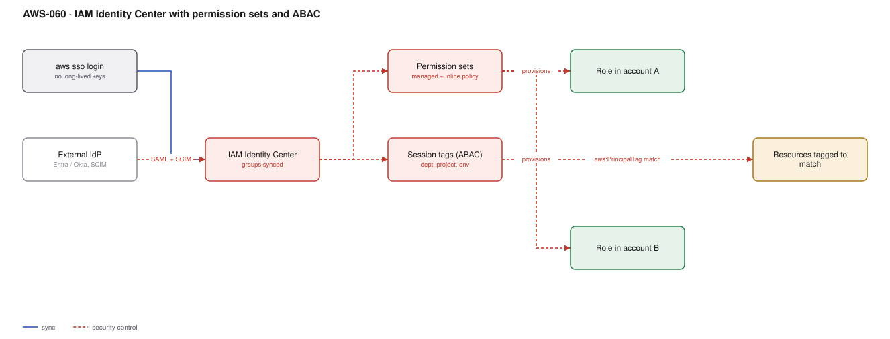

# AWS-060 · IAM Identity Center with permission sets and ABAC

> **Category:** [07 · Security, Detection & Response](readme.md#07) · **Maturity:** Production · **Effort:** M

## The problem

Twenty accounts and forty engineers is 800 potential access grants. Managing that with IAM
users per account means long-lived access keys, no central offboarding, and a quarterly
access review that nobody can complete. IAM Identity Center federates from your existing
identity provider, issues **short-lived credentials**, and lets one permission set apply
across many accounts.

**Use it when** you have more than two accounts or more than five people. Which is almost
everyone.

**Don't use it for** application and workload identity — that is IAM roles
([`aws-008`](aws-008-m2m-auth.md)). Identity Center is for humans.

## RBAC vs ABAC

| | RBAC (permission sets per account) | ABAC (attribute-based) |
|---|---|---|
| Grants | A permission set assigned per group per account | One permission set, policy matches tags |
| Scales with | Number of teams × accounts | Essentially flat |
| New project | New permission set or new assignment | **Add a tag** |
| Policy complexity | Simple policies, many of them | Fewer policies, harder to read |
| Audit | "Who has access?" is easy | Requires understanding tags |

Most organisations want both: RBAC for coarse roles (ReadOnly, Admin, Billing), ABAC inside
a role for project-level separation.

## Components

| Service | Role | The setting that actually matters |
|---|---|---|
| External IdP | Source of truth for identity | **SCIM provisioning** — so leavers are deprovisioned automatically |
| IAM Identity Center | Federation and assignment | Delegated administration out of the management account |
| Permission sets | A reusable policy bundle | Managed policy + inline policy + **permissions boundary** |
| Groups | The unit of assignment | Always assign to groups, never to individual users |
| Session tags | ABAC attributes | Mapped from IdP attributes, available as `aws:PrincipalTag/*` |
| Session duration | How long credentials live | 1 hour default; 4–8 hours for usability, 1 hour for privileged |
| Access portal / CLI | How people actually use it | `aws sso login` — no access keys anywhere |

## Flow

1. Users and groups are provisioned from the IdP into Identity Center over SCIM.
2. A permission set is defined once — policies, boundary, session duration.
3. It is assigned to a **group** in one or many accounts; Identity Center provisions a
   matching IAM role in each.
4. The user signs in through the access portal or `aws sso login` and picks an account and
   role.
5. IdP attributes (department, project, environment) flow through as **session tags**.
6. Policies condition on `aws:PrincipalTag/project` matching `aws:ResourceTag/project`, so
   one permission set gives each team access to only its own resources.
7. Credentials expire at the session duration; there is nothing long-lived to leak.

## Cost (us-east-1 — order of magnitude)

| Line item | Small · 20 users | Medium · 200 users | Large · 2,000 users |
|---|---|---|---|
| IAM Identity Center | $0 | $0 | $0 |
| External IdP licensing (third party) | varies | varies | varies |
| CloudTrail for access audit | included | included | included |
| **Total AWS cost** | **$0** | **$0** | **$0** |

**Cost cliff:** there is none — Identity Center is free. The cost is entirely in migration
effort and in your IdP licensing. Which makes the usual objection ("we will do it later")
purely about effort, and the thing it replaces (long-lived IAM user access keys) is one of
the most common root causes of real breaches.

**Biggest lever:** doing it at all. The avoided cost is an incident.

## Failure modes

| Failure | Symptom | Mitigation |
|---|---|---|
| Assigning to users not groups | Hundreds of individual assignments, unauditable | Groups only, synced from the IdP |
| No SCIM | Leavers keep access until someone remembers | Automated provisioning **and deprovisioning** |
| Session duration too short | Engineers re-authenticate constantly and route around it | 4–8 hours for normal work, 1 hour for privileged sets |
| ABAC tags not enforced | Resources without tags are invisible — or visible to everyone | Tag policies plus an SCP requiring tags on create |
| Management account access | Everyone can reach the root of the organisation | Separate, tightly restricted permission set; almost nobody needs it |
| Old IAM users left behind | The real access path is still the one you did not remove | Audit for IAM users with access keys and delete them after migration |

## Security notes

- The principal benefit is **no long-lived credentials**. A leaked `~/.aws/credentials` file
  becomes a leaked expired session instead of permanent access.
- Enforce MFA at the IdP, not at AWS — then it applies to every downstream system.
- Permissions boundaries on permission sets let you delegate role creation safely: a
  developer can create roles, but none more privileged than the boundary allows.
- Review the management account separately and harshly. It is the one account where an
  SCP cannot protect you.
- CloudTrail records the federated identity in `userIdentity`, so actions are attributable to
  a person, not to a shared role — which is the audit property RBAC-with-shared-users loses.

## What people miss

- **ABAC collapses the permission-set explosion.** One `ProjectDeveloper` permission set with
  `aws:PrincipalTag/project` conditions replaces dozens of near-identical sets. It requires
  tagging discipline, which is the actual hard part.
- **Identity Center supports delegated administration.** You do not have to operate it from
  the management account, which is a meaningful reduction in who needs management-account
  access.
- **Session tags come from IdP attributes**, so the tagging source of truth is your HR or
  directory system rather than something AWS-side that drifts.
- **Customer managed policies in permission sets** must exist in every target account with
  the same name. This trips up teams who define a policy once in the management account.
- **The access portal supports application assignments too** — SAML apps beyond AWS — which
  occasionally makes it a viable lightweight SSO for internal tools.

## See also

- [`aws-090`](aws-090-landing-zone.md) — where Identity Center is set up
- [`aws-091`](aws-091-scp-guardrails.md) — the preventive layer above permission sets
- [`aws-008`](aws-008-m2m-auth.md) — the workload identity equivalent
- [`aws-002`](aws-002-cognito-oidc-spa.md) — Cognito is for customers, this is for staff
