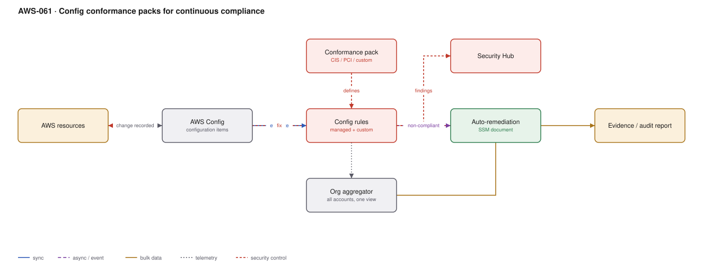

# AWS-061 · Config conformance packs for continuous compliance

> **Category:** [07 · Security, Detection & Response](readme.md#07) · **Maturity:** Production · **Effort:** M

## The problem

Audits ask "was this control in place for the whole period", not "is it in place today". A
point-in-time screenshot proves nothing about last March. AWS Config records every
configuration change to every resource continuously, evaluates rules against each change,
and produces a timeline you can query — which is exactly the evidence an auditor wants, and
also the fastest way to find the bucket someone made public at 02:00.

**Use it when** you have a compliance obligation, or simply want to know when something
drifts.

**Don't** enable it on every resource type in every region without thinking. Config is
priced per configuration item recorded and it is one of the more common unexplained bills.

## Detective vs preventive

Config is **detective**: it tells you something is wrong after it happened. SCPs
([`aws-091`](aws-091-scp-guardrails.md)) are **preventive**: the action fails. Use
preventive controls where you can and detective controls where you cannot — and accept that
you need both, because SCPs cannot express "the security group allows 0.0.0.0/0 on port 22".

## Components

| Service | Role | The setting that actually matters |
|---|---|---|
| AWS Config recorder | Records configuration items | **Which resource types** — the entire cost model |
| Config rules | Evaluate compliance | Managed rules first; custom rules via Lambda or Guard |
| Conformance packs | A bundle of rules as one deployable unit | CIS, PCI, NIST, or your own, deployed org-wide |
| Organization aggregator | One compliance view across accounts and regions | Without it you are checking account by account |
| Remediation | SSM Automation documents | Auto-remediate the safe ones; alert on the rest |
| Security Hub | Where findings land | One queue with GuardDuty and Inspector |

## Flow

1. The configuration recorder is enabled per account and region, scoped to the resource types
   you care about.
2. Every change produces a configuration item: who changed it, when, and the before/after.
3. Rules evaluate on change (and optionally periodically), marking resources compliant or
   non-compliant.
4. A conformance pack deploys a whole standard — say CIS AWS Foundations — across every
   account in the organisation as one unit.
5. Non-compliant findings flow to Security Hub and to the organisation aggregator.
6. Safe violations trigger an SSM Automation remediation — re-enable bucket encryption, remove
   an open security group rule.
7. The configuration timeline provides the audit evidence: this control was in place
   continuously from date X.

## Cost (us-east-1 — order of magnitude)

| Line item | Small · 5 accounts | Medium · 50 accounts | Large · 300 accounts |
|---|---|---|---|
| Configuration items @ $0.003 each | $60.00 | $900.00 | $6,000.00 |
| Rule evaluations @ $0.001 (first 100K) | $25.00 | $300.00 | $1,500.00 |
| Conformance pack evaluations @ ~$0.0012 | $15.00 | $180.00 | $1,000.00 |
| S3 storage for the configuration history | $5.00 | $40.00 | $250.00 |
| Remediation (SSM Automation) | $2.00 | $15.00 | $80.00 |
| **Total** | **~$107** | **~$1,435** | **~$8,830** |

**Cost cliff:** **recording every resource type including transient ones.** Auto Scaling
groups, Lambda versions and EC2 instances in a busy environment generate configuration items
constantly; each is $0.003 and the count runs to millions. Recording *all* resource types
across 300 accounts is a five-figure monthly bill that nobody budgeted.

**Biggest lever:** scope the recorder. Record the resource types that appear in your control
set — IAM, S3, security groups, KMS, RDS, EBS — and exclude high-churn types that no rule
evaluates. Also consider **periodic** rather than change-triggered recording for some types.

## Failure modes

| Failure | Symptom | Mitigation |
|---|---|---|
| Recording everything | Unexplained four- or five-figure bill | Scope to resource types your rules actually evaluate |
| Auto-remediation on production | Remediation causes an outage | Start with alert-only; auto-remediate the provably safe rules first |
| Rules without owners | A dashboard of permanent non-compliance | Every rule maps to a team; non-compliance has a ticket and an SLA |
| No aggregator | Compliance checked per account by hand | Organisation aggregator in the security account |
| Custom rules in Lambda | Cost and maintenance for each evaluation | Use **Guard** (policy-as-code) custom rules where possible — no Lambda |
| Config not enabled in unused regions | Resources created where nothing is watching | Enable everywhere, or SCP-deny the regions outright |

## Security notes

- The configuration timeline is often the fastest answer during an incident: "when did this
  security group change, and who changed it".
- Config is a detective control. Pair with SCPs so the highest-risk actions are impossible
  rather than merely recorded.
- Remediation roles are privileged — they modify production resources automatically. Scope
  each to the specific action its rule needs.
- Deliver the configuration history to the log archive account, not the local one
  ([`aws-057`](aws-057-immutable-audit-trail.md)).
- Conformance pack results are evidence. Retain them for your audit period.

## What people miss

- **Conformance packs are deployable as one unit across the organisation**, which turns "we
  should implement CIS" from a project into an afternoon. The remaining work is triaging
  what it finds.
- **Guard-based custom rules need no Lambda**, which removes both the cost and the
  maintenance of custom compliance code.
- **Config is the backbone of Control Tower's detective guardrails** — if you run Control
  Tower, you are already paying for Config and may as well use it directly.
- **The recorder is per region**, and a resource created in an unmonitored region is
  invisible. Either record everywhere or deny unused regions with an SCP; doing neither is
  the common state.
- **Config can record third-party and custom resource types**, which makes it a general
  configuration-drift database rather than only an AWS compliance tool.

## See also

- [`aws-091`](aws-091-scp-guardrails.md) — the preventive half
- [`aws-064`](aws-064-shift-left-security.md) — catching it before deployment
- [`aws-090`](aws-090-landing-zone.md) — where this is enabled from
- [`aws-056`](aws-056-guardduty-response.md) — the remediation pattern in depth
