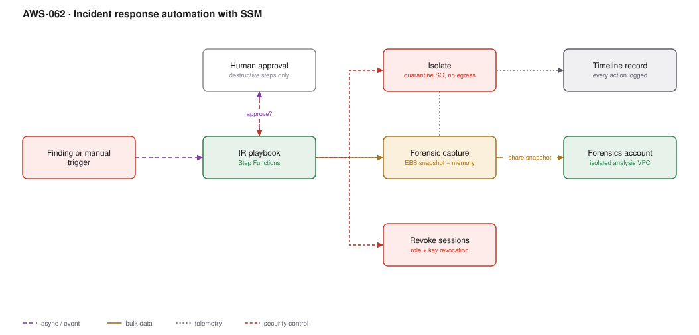

# AWS-062 · Incident response automation with SSM

> **Category:** [07 · Security, Detection & Response](readme.md#07) · **Maturity:** Growing · **Effort:** M

## The problem

At 03:00, an engineer with root-equivalent access, under pressure, improvising. That is the
default incident response plan at most organisations and it produces two bad outcomes:
evidence destroyed by well-meaning cleanup, and actions nobody can reconstruct afterwards.
Codified playbooks make the first five minutes deterministic, auditable and fast.

**Use it when** you have workloads worth defending. Even two playbooks — isolate an
instance, revoke a credential — change the outcome of a real incident.

**Don't** automate the whole response. Automate containment and evidence capture; leave
eradication and recovery to humans with context.

## The four phases, and what to automate

| Phase | Actions | Automate? |
|---|---|---|
| **Contain** | Isolate network, revoke sessions, disable keys | **Yes** — speed matters most, actions are reversible |
| **Capture** | EBS snapshot, memory dump, log preservation | **Yes** — evidence degrades fast |
| **Eradicate** | Remove persistence, patch, rebuild | No — needs understanding of what happened |
| **Recover** | Restore service, verify, monitor | No — business decision |

## Components

| Service | Role | The setting that actually matters |
|---|---|---|
| Step Functions | The playbook | Durable, auditable, supports human approval steps |
| SSM Automation documents | The individual actions | Parameterised, versioned, logged in CloudTrail |
| Quarantine security group | Network isolation | **No inbound, no outbound** — pre-created in every VPC |
| EBS snapshot | Disk evidence | Snapshot **before** anything else |
| Session revocation | Credential containment | Inline deny with an `aws:TokenIssueTime` condition |
| Forensics account | Isolated analysis | Separate account, isolated VPC, snapshots shared into it |
| Case record | Timeline | Every action, actor and timestamp |

## Flow

1. A trigger arrives — a GuardDuty finding, a Security Hub finding, or a human invoking the
   playbook by hand.
2. **Snapshot first.** The EBS volumes are snapshotted and tagged with the incident id before
   anything changes.
3. The instance is tagged `quarantine=true` and its security group is replaced with the
   quarantine group — no inbound, no outbound. The instance keeps running; memory is
   preserved; the attacker loses connectivity.
4. If the finding involves credentials, the role's sessions are revoked by attaching a deny
   policy conditioned on token issue time, and any access keys are disabled.
5. Destructive or production-impacting steps post to chat for approval with full context.
6. Snapshots are shared into the forensics account and attached to an analysis instance in an
   isolated VPC — never analysed in the compromised account.
7. Every step appends to the case record, producing the timeline for the post-incident review.

## Cost (us-east-1 — order of magnitude)

| Line item | Small · rare use | Medium · monthly | Large · weekly |
|---|---|---|---|
| Step Functions executions | $0.01 | $0.10 | $0.50 |
| SSM Automation steps | $0.05 | $0.50 | $2.00 |
| EBS snapshots retained (100 GB each) | $5.00 | $50.00 | $250.00 |
| Forensics account baseline (idle VPC, tooling) | $50.00 | $50.00 | $100.00 |
| Forensic analysis instances (on demand) | $10.00 | $50.00 | $300.00 |
| **Total** | **~$65** | **~$151** | **~$653** |

**Cost cliff:** essentially none. This is one of the cheapest high-value capabilities in AWS
— the components are nearly free and the cost is engineering time. The only line that grows
is snapshot retention, so apply a lifecycle to incident snapshots after the case closes.

**Biggest lever:** the avoided cost. Containment in 60 seconds instead of 6 hours is the
difference between one compromised instance and a lateral-movement incident.

## Failure modes

| Failure | Symptom | Mitigation |
|---|---|---|
| Terminate before snapshot | Evidence destroyed, root cause unknowable | Snapshot is always step one; never automate termination |
| Quarantine SG not pre-created | Playbook fails in the VPC that needs it | Create it in every VPC as part of the landing zone |
| Playbook never rehearsed | Fails on first real use, under pressure | Game-day it quarterly against a disposable instance |
| Automation role too broad | The response tool becomes the attack tool | Scope per action; alarm on every use of the IR role |
| Analysis in the compromised account | Attacker observes the investigation | Dedicated forensics account, isolated VPC, no shared credentials |
| Isolation breaks production silently | An outage with no explanation for the service owner | The playbook notifies the owner as it acts |

## Security notes

- **Isolate, do not terminate.** A running quarantined instance preserves memory, process
  state and attacker tooling. Terminating destroys all of it to save a few dollars.
- Session revocation via `aws:TokenIssueTime` is the correct mechanism and is non-obvious.
  Write the policy template in advance; nobody composes it correctly at 03:00.
- The forensics account should have no trust relationship with production beyond the ability
  to receive shared snapshots.
- Snapshots of compromised volumes are themselves hazardous — they contain malware. Handle
  them in the isolated account with no outbound internet.
- Encrypt snapshots with a forensics-specific KMS key so access to evidence is separately
  auditable.

## What people miss

- **Snapshot before isolate, isolate before anything else.** The ordering matters and is the
  most common thing people get wrong when improvising.
- **Quarantine security groups must exist before the incident.** Creating one at 03:00 in a
  VPC you have never looked at is how playbooks fail.
- **A running instance with no network is better evidence than a terminated one.** SSM
  Session Manager still reaches it through the SSM agent if the VPC endpoint remains
  permitted — decide deliberately whether you want that.
- **Incident Manager** (part of Systems Manager) handles the human side: escalation plans,
  on-call paging, response plans tied to CloudWatch alarms. It pairs with this and is rarely
  used.
- **The post-incident timeline is the deliverable.** Automation produces it for free; manual
  response produces an argument about what happened when.

## See also

- [`aws-056`](aws-056-guardduty-response.md) — what triggers these playbooks
- [`aws-057`](aws-057-immutable-audit-trail.md) — the evidence the investigation reads
- [`aws-070`](aws-070-chaos-fis.md) — rehearsing the response
- [`aws-071`](aws-071-self-healing-ops.md) — the same machinery for operational incidents
