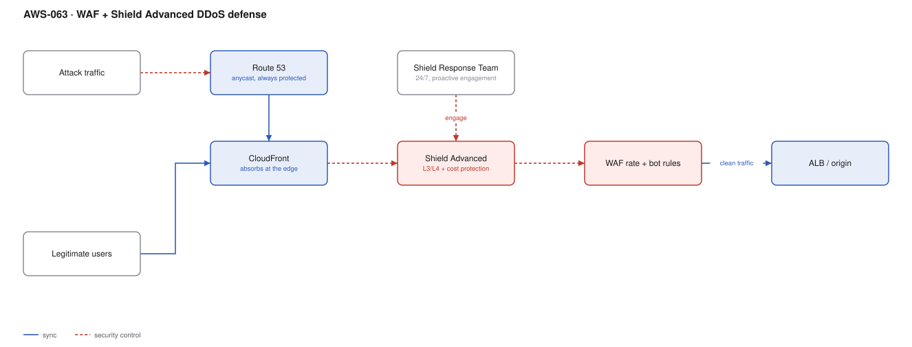

# AWS-063 · WAF + Shield Advanced DDoS defense

> **Category:** [07 · Security, Detection & Response](readme.md#07) · **Maturity:** Specialist · **Effort:** M

## The problem

A volumetric attack saturates your capacity; an application-layer attack exhausts your
backend with requests that look legitimate. AWS absorbs the first category at the edge for
free. The second category, and the business consequences of the first, are what Shield
Advanced and WAF address — at a price that demands a deliberate decision.

**Use Shield Advanced when** downtime has a material cost, you are a plausible target
(gaming, finance, gambling, political, high-profile retail), or a contract requires it.

**Don't** buy it reflexively. Shield Standard is free and already absorbs the large majority
of volumetric attacks, especially behind CloudFront. At $3,000/month, Shield Advanced needs a
reason you can state.

## What each layer actually does

| Layer | Cost | Stops |
|---|---|---|
| Shield Standard | **Free, automatic** | SYN floods, UDP reflection, most L3/L4 volumetrics |
| CloudFront / Global Accelerator | Normal usage | Absorbs and disperses attack traffic across the global edge |
| WAF rate-based rules | ~$8/mo + $0.60/M | Single-source request floods |
| WAF bot control / managed rules | ~$10/mo + ~$1/M | Scrapers, known-bad agents, L7 exploits |
| **Shield Advanced** | **$3,000/mo** + data | Advanced L3/L4 mitigation, **SRT access**, **cost protection**, health-based detection |

## Components

| Service | Role | The setting that actually matters |
|---|---|---|
| CloudFront | The front door | Architecture matters more than product: edge absorption is the primary defence |
| Route 53 | DNS, always protected | Anycast; DNS is a common attack target in its own right |
| Shield Advanced | Enhanced mitigation + support | **Proactive engagement** — the SRT contacts you, enabled explicitly |
| Shield Response Team (SRT) | Humans who help during an attack | Pre-authorise them; do not meet them for the first time mid-attack |
| WAF | L7 filtering | Rate rules plus managed groups; see [`aws-005`](aws-005-api-abuse-control.md) |
| Health-based detection | Reduces false positives | Associate a Route 53 health check with the protected resource |
| Protection groups | Treat related resources as one | Better detection across a fleet than per-resource |

## Flow

1. All ingress is through CloudFront or Global Accelerator, so attack traffic terminates at
   the edge rather than at your origin.
2. Shield Standard mitigates common L3/L4 attacks automatically, with no configuration.
3. Shield Advanced applies more aggressive mitigations and uses application health signals
   to distinguish a real attack from a traffic spike.
4. WAF evaluates L7 rules: rate limits, bot control, managed rule groups.
5. On a significant event, the SRT engages — proactively if you enabled that, otherwise on
   your call — and can apply mitigations on your behalf.
6. Attack diagnostics and metrics are available in near-real time for the duration.
7. Afterwards, cost protection credits can be claimed for scaling charges caused by the
   attack.

## Cost (us-east-1 — order of magnitude)

| Line item | Without Shield Advanced | With Shield Advanced |
|---|---|---|
| Shield Standard | $0 | $0 |
| Shield Advanced subscription (per org, 1-yr commit) | — | $3,000.00/mo |
| Shield Advanced data transfer out | — | included for protected resources |
| WAF (web ACL + 10 rules + 50M requests) | $45.00 | **$0** (WAF included) |
| CloudFront, ALB, Route 53 | normal | normal |
| **Monthly total** | **~$45** | **~$3,000** |

**Cost cliff:** the $3,000/month subscription is **per organisation**, not per resource,
with a 12-month commitment. Two things partly offset it: **WAF charges are included** for
protected resources (worth hundreds a month at volume), and **cost protection** refunds
scaling charges caused by an attack. If you already spend $500/month on WAF across many
resources, the net is closer to $2,500.

**Biggest lever:** architecture, not product. Serving through CloudFront with a locked-down
origin is the single largest reduction in attack surface, and it is free. An origin
reachable by its public IP can be attacked directly, bypassing every edge protection you pay
for.

## Failure modes

| Failure | Symptom | Mitigation |
|---|---|---|
| Origin directly reachable | Attack bypasses CloudFront entirely | Restrict origin security groups to CloudFront prefix lists; use OAC for S3 |
| No health check associated | Shield cannot distinguish attack from a product launch | Associate a Route 53 health check with each protected resource |
| SRT not pre-authorised | Hours lost on paperwork during an attack | Pre-authorise and run a contact drill |
| Proactive engagement off | You call them instead of them calling you | Enable it; it is the main operational benefit |
| WAF rules written during the attack | Mistakes under pressure, legitimate users blocked | Have rate rules in place beforehand, in count mode, ready to flip |
| Cost protection assumed automatic | Big bill arrives anyway | It is a **claim process**, not a cap — file it after the event |

## Security notes

- Hiding the origin is the foundation. Everything else is mitigation after the fact.
- DNS is an attack target. Route 53 is protected and anycast, but your registrar and DNSSEC
  posture are your responsibility ([`aws-033`](aws-033-route53-strategies.md)).
- Rate limits keyed on IP are weak against distributed attacks. Key on something more
  specific where possible — a session, a header, a JA3 fingerprint.
- Have a runbook: who declares an incident, who contacts the SRT, who can approve a rule
  change, and what the acceptable collateral blocking is.
- Application-layer attacks often target the most expensive endpoint — a search, a report, a
  login. Rate-limit those specifically rather than uniformly.

## What people miss

- **WAF is included with Shield Advanced** for protected resources, which materially changes
  the arithmetic for estates with many web ACLs.
- **Cost protection is a reimbursement claim**, not a billing cap. You pay, then claim
  credits, and you must show the charges were attack-driven.
- **Proactive engagement is the real product.** Being contacted by an expert before you have
  noticed, with mitigations ready, is worth more than the additional automatic mitigation.
- **It is priced per organisation**, so one subscription covers every account — which makes
  it far more defensible at scale than the headline number suggests.
- **Most organisations do not need it.** Shield Standard plus CloudFront plus well-configured
  WAF handles the attacks most companies actually experience. Spend the $36,000 a year on
  something else unless you can name the threat.

## See also

- [`aws-005`](aws-005-api-abuse-control.md) — the WAF layer in detail
- [`aws-003`](aws-003-cloudfront-s3-oac.md) — hiding the origin properly
- [`aws-034`](aws-034-global-accelerator.md) — the non-HTTP edge
- [`aws-033`](aws-033-route53-strategies.md) — DNS as an attack surface
