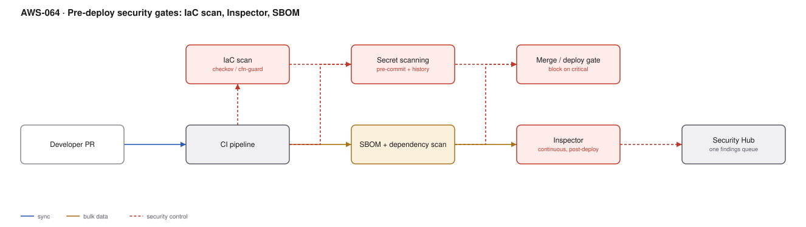

# AWS-064 · Pre-deploy security gates: IaC scan, Inspector, SBOM

> **Category:** [07 · Security, Detection & Response](readme.md#07) · **Maturity:** Growing · **Effort:** M

## The problem

A public S3 bucket found by a CSPM dashboard three weeks after deployment is a finding, a
ticket, a sprint, and a window of exposure. The same misconfiguration caught in the pull
request is a two-line diff and a conversation. Everything on this page is the same controls
you already have, moved earlier.

**Use it when** infrastructure is defined as code. Which should be always.

**Don't** let it become a gate nobody can pass. A scanner reporting 400 findings on day one
gets disabled by the end of the week. Start with critical-only and ratchet.

## The four gates

| Gate | Catches | Tooling |
|---|---|---|
| **Secret scanning** | Credentials in code and history | git-secrets, trufflehog, GitHub secret scanning |
| **IaC scanning** | Public buckets, open SGs, unencrypted volumes | checkov, tfsec, cfn-guard, CDK Nag |
| **Dependency / SBOM** | Vulnerable libraries, licence issues | Inspector SBOM, Dependabot, syft/grype |
| **Image scanning** | OS and package CVEs | ECR + Inspector ([`aws-027`](aws-027-container-supply-chain.md)) |

Secret scanning is the one to do first. It takes an hour and catches the highest-severity
mistake a developer can make.

## Components

| Service | Role | The setting that actually matters |
|---|---|---|
| Pre-commit hooks | Fastest feedback | Secret scanning locally, before the commit exists |
| CI pipeline | Enforcement point | Must **fail the build**, not just annotate |
| IaC scanner | Policy as code | Start with the critical rule set; add rules as incidents teach you |
| Amazon Inspector | Continuous CVE scanning | Covers EC2, ECR and Lambda; **continuous**, not point-in-time |
| SBOM | Inventory of what you ship | The artefact that answers "are we affected" in minutes |
| Security Hub | One findings queue | Pre-deploy and runtime findings in the same place |
| Exception process | Pragmatism | Time-boxed, documented, and visible |

## Flow

1. A pre-commit hook blocks obvious secrets before they enter history.
2. CI scans the IaC: Terraform plans, CloudFormation templates, CDK synth output.
3. Dependencies are resolved and an SBOM generated; known vulnerabilities are checked
   against it.
4. Critical findings fail the build. High findings annotate the PR. Medium and below go to a
   backlog.
5. An exception can be granted with an owner and an expiry — recorded in the repo, not in a
   conversation.
6. After deployment, Inspector continuously rescans running workloads as new CVEs are
   published.
7. All findings, pre-deploy and runtime, land in Security Hub so there is one queue.

## Cost (us-east-1 — order of magnitude)

| Line item | Small · 20 repos | Medium · 200 repos | Large · 1,000 repos |
|---|---|---|---|
| Open-source scanners in CI (compute only) | $5.00 | $50.00 | $250.00 |
| Inspector — EC2 @ ~$1.26/instance-mo | $25.00 | $250.00 | $1,500.00 |
| Inspector — ECR @ ~$0.09/image-mo | $9.00 | $90.00 | $450.00 |
| Inspector — Lambda @ ~$0.30/function-mo | $15.00 | $150.00 | $600.00 |
| Security Hub findings | $10.00 | $80.00 | $400.00 |
| CI minutes for scanning | $20.00 | $200.00 | $1,000.00 |
| **Total** | **~$84** | **~$820** | **~$4,200** |

**Cost cliff:** scanning **CI minutes**, not the tools. A full IaC and dependency scan added
to every push on a busy monorepo can add minutes to every build and become the largest line
here — and, worse, slow the feedback loop enough that people route around it. Scan changed
paths on push, full scan on merge and nightly.

**Biggest lever:** the open-source scanners are free; the cost is CI time and triage effort.
The return is measured in incidents not had, which is uncomfortable to quantify and
genuinely large.

## Failure modes

| Failure | Symptom | Mitigation |
|---|---|---|
| Day-one full ruleset | 400 findings, team disables the gate | Critical-only first, ratchet quarterly |
| Warn-only forever | Findings accumulate, nothing changes | At least one severity must block |
| No exception process | Developers bypass the gate entirely | Time-boxed, owned, visible exceptions |
| Scanning only new code | The existing estate is never fixed | Baseline scan plus a remediation backlog with dates |
| Secret found after commit | Rotating is remembered, history is not | A committed secret is compromised: **rotate it**, do not just remove the commit |
| Findings in four tools | Nobody has one view | Aggregate to Security Hub |

## Security notes

- **A secret in Git history is compromised, permanently.** Removing the commit does not help
  — forks, clones, CI caches and mirrors retain it. The only correct response is rotation.
- Terraform state files contain secrets in plaintext. Encrypt the state bucket, restrict it,
  and never commit state.
- IaC scanning catches the misconfiguration; Config ([`aws-061`](aws-061-config-compliance.md))
  catches the drift afterwards. Both are needed because not all changes come through CI.
- Scanner credentials and CI roles are privileged. A compromised pipeline deploys whatever it
  likes — treat CI as production infrastructure.
- SBOMs are how you answer "which of our services use this library" during the next
  widely-exploited CVE. Generate and store them before you need them.

## What people miss

- **Secret scanning the full history, not just the diff.** Most repos have something in
  history. Scan it once, rotate what you find, then scan diffs going forward.
- **CDK Nag** applies rule packs to CDK constructs at synth time, with per-construct
  suppressions that live in code and require a stated reason — the cleanest exception
  mechanism in this space.
- **Inspector is continuous.** A clean image at build time has critical CVEs six weeks later;
  scan-on-push alone gives false comfort.
- **The exception process is what makes the gate survivable.** Without it, the gate is either
  bypassed or disabled. With it, exceptions are visible and expire.
- **Policy as code lets security own rules without owning every PR.** The rule is reviewed
  once; it then applies to every repository without a human in the loop.

## See also

- [`aws-027`](aws-027-container-supply-chain.md) — the image half of this
- [`aws-061`](aws-061-config-compliance.md) — detecting what gets past the gate
- [`aws-058`](aws-058-secrets-rotation.md) — rotating what the scanner finds
- [`aws-091`](aws-091-scp-guardrails.md) — making the worst cases impossible
