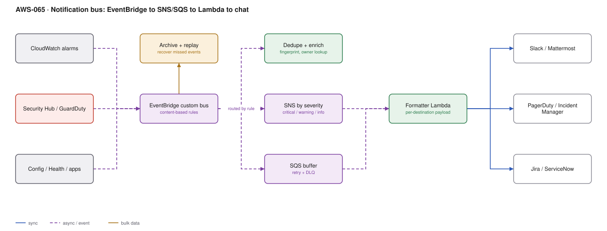

# AWS-065 · Notification bus: EventBridge → SNS/SQS → Lambda → Slack/Mattermost

> **Category:** [08 · Observability & Operations](readme.md#08) · **Maturity:** Production · **Effort:** M

## The problem

Alerts arrive from everywhere — CloudWatch alarms, GuardDuty, Config, AWS Health, Backup
failures, CI pipelines, your own applications — and each one gets wired up individually to
whatever destination the person who built it preferred. The result is twelve integrations,
three of which are broken, a channel nobody reads, and an important alert that went to an
email alias belonging to someone who left.

One event bus fixes this: every producer publishes once, routing is declarative, and adding
a destination is a rule rather than a code change in twelve places.

**Use it when** you have more than a handful of alert sources. Which is immediately.

**Don't** build a bespoke routing engine. The value here is that EventBridge rules,
SNS filter policies and a formatter function are all off-the-shelf parts.

## Why EventBridge rather than SNS alone

| | EventBridge | SNS |
|---|---|---|
| Routing | **Content-based rules** on any field | Message attribute filters only |
| Sources | 200+ AWS services natively | Explicit publishes |
| Archive and **replay** | **Yes** | No |
| Schema registry | Yes | No |
| Targets | 20+ types, no code | Subscriptions |
| Throughput / cost | $1.00/M | $0.50/M, higher throughput |

EventBridge for routing and semantics; SNS underneath for cheap fan-out at volume. Using
both is normal — EventBridge decides *who cares*, SNS delivers.

## Components

| Service | Role | The setting that actually matters |
|---|---|---|
| Custom event bus | One spine for operational events | Separate from the default bus, so AWS service events do not drown yours |
| Rules | Content-based routing | Match on `source`, `detail-type`, severity, account, tag — not just source |
| **Archive + replay** | Recover from a broken consumer | Archive on the bus; replay the window after you fix the bug |
| Dedupe/enrich Lambda | Fingerprint and add context | Owner, environment, runbook link, recent-occurrence count |
| SNS topics by severity | Fan-out | One topic per severity, not per source |
| SQS buffer | Retry and DLQ for chat delivery | Chat APIs rate-limit and go down; a queue absorbs it |
| Formatter Lambda | Destination-specific payload | Slack Block Kit, Mattermost attachments, PagerDuty Events API v2 |

## Flow

1. Every producer emits to the custom bus: CloudWatch alarms via an EventBridge rule on
   alarm state change, Security Hub findings natively, applications with `PutEvents`.
2. The bus archives everything — so a formatter bug does not mean lost alerts.
3. Rules match on content and route to the enrichment function and the appropriate severity
   topic.
4. Enrichment computes a **fingerprint** (service + alarm + resource), looks up the owning
   team from tags, attaches the runbook link, and suppresses if the same fingerprint fired
   within the cooldown.
5. SNS fans out to an SQS queue per destination; the queue absorbs chat-API rate limits and
   outages, with a DLQ behind it.
6. The formatter builds the destination-specific payload and posts: Slack or Mattermost
   webhook, PagerDuty for anything that pages, Jira for anything that needs tracking.
7. Interactive actions (acknowledge, snooze, run the runbook) come back through API Gateway
   into the same bus.

## Cost (us-east-1 — order of magnitude)

| Line item | Small · 10K events/mo | Medium · 1M events/mo | Large · 50M events/mo |
|---|---|---|---|
| EventBridge @ $1.00/M | $0.01 | $1.00 | $50.00 |
| Event archive + storage @ ~$0.10/GB-mo | $0.10 | $2.00 | $100.00 |
| SNS publishes @ $0.50/M | $0.01 | $0.50 | $25.00 |
| SQS @ $0.40/M (≈3 ops each) | $0.02 | $1.20 | $60.00 |
| Lambda (enrich + format, 256 MB × 80 ms) | $0.05 | $5.00 | $250.00 |
| **Total** | **~$0.20** | **~$10** | **~$485** |

**Cost cliff:** there barely is one in AWS charges — this is one of the cheapest
architectures in the catalogue. The real cliff is **downstream**: PagerDuty and similar are
priced per user per month and some plans meter incidents. An un-deduplicated flood that
creates 4,000 incidents is a billing event as well as an operational one. Deduplication is
a cost control, not just a sanity control.

**Biggest lever:** deduplication and suppression. A single bad deploy can emit thousands of
identical alarms; fingerprinting collapses them into one notification with a count.

## Failure modes

| Failure | Symptom | Mitigation |
|---|---|---|
| Alert storm | 400 messages, channel muted, real alert missed | Fingerprint + cooldown + composite alarms ([`aws-066`](aws-066-cloudwatch-core.md)) |
| Chat webhook down or rate-limited | Alerts silently dropped | SQS between SNS and the poster, with a DLQ and an alarm on the DLQ |
| No archive | A formatter bug loses an evening of alerts | Enable archive; replay the window after the fix |
| Everything to one channel | Nobody owns anything | Route by owning team from resource tags; a channel per team |
| Noisy non-actionable alerts | Alert fatigue, genuine alerts ignored | If nobody acts on it, it is a dashboard metric, not an alert |
| No runbook link | Woken at 03:00 with no idea what to do | Enrichment attaches the runbook URL; make it mandatory |

## Security notes

- Notifications leak information: resource names, account ids, error messages, occasionally
  data. Treat the chat destination as a data egress point and keep the channels private.
- Webhook URLs are credentials. Store them in Secrets Manager, not in environment variables
  or code ([`aws-058`](aws-058-secrets-rotation.md)).
- If the chat integration can trigger actions (restart, scale, isolate), that is a privileged
  control path — verify the signature of inbound interactive payloads and authorise the
  invoking user, not just the workspace.
- Resource policies on the bus should restrict which accounts may `PutEvents`, or any account
  in the organisation can inject fake alerts.

## What people miss

- **Archive and replay is the feature that justifies EventBridge here.** Every other bus
  loses events when a consumer is broken. Being able to say "replay the last four hours
  after we fixed the formatter" is worth the price difference on its own.
- **AWS Health events belong on this bus.** Planned maintenance, degraded services and
  resource-specific notices arrive as events and are the thing most teams find out about
  from a customer instead.
- **The default bus already receives most AWS service events.** You do not need to build
  publishers for CloudWatch, Config, GuardDuty, CodePipeline, Backup or Health — just rules
  that forward them to your bus.
- **Mattermost and Slack both accept incoming webhooks with similar payload shapes**, so one
  formatter with a destination switch handles both — useful when parts of an organisation
  are on different tools.
- **Input transformers can build the message without a Lambda.** For simple notifications,
  an EventBridge rule can transform the event into a Slack-shaped payload and post to an API
  destination directly — no function at all.
- **API destinations** let EventBridge call any HTTP endpoint with managed auth and
  rate-limiting built in, which removes the custom poster function for many cases.

## See also

- [`aws-066`](aws-066-cloudwatch-core.md) — composite alarms, which prevent most storms
- [`aws-072`](aws-072-slo-error-budgets.md) — deciding what deserves to page
- [`aws-056`](aws-056-guardduty-response.md) — the security findings this routes
- [`aws-071`](aws-071-self-healing-ops.md) — resolving it before anyone is notified
