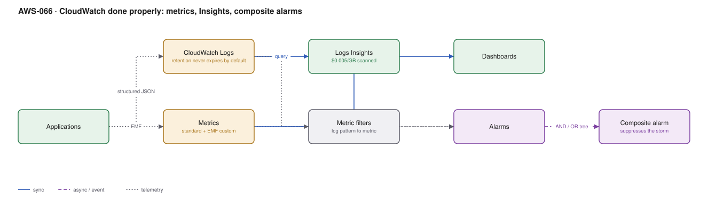

# AWS-066 · CloudWatch done properly: metrics, Insights, composite alarms

> **Category:** [08 · Observability & Operations](readme.md#08) · **Maturity:** Production · **Effort:** S

## The problem

Everyone has CloudWatch. Almost nobody has it configured well. The two symptoms are an
alerting channel that pages forty times for one incident, and a logging bill that nobody can
explain and everyone is slightly afraid of.

**Use it when** you are on AWS. It is already collecting; the work is making it useful.

**Don't** reach for a third-party observability platform before fixing the basics —
structured logs, EMF metrics, composite alarms and a retention policy. Those four changes
solve most of what teams go shopping to fix.

## Components

| Service | Role | The setting that actually matters |
|---|---|---|
| CloudWatch Logs | Log storage and query | **Retention** — the default is *never expire*, and that is the bill |
| Embedded Metric Format (EMF) | Metrics from log lines | Emit a structured log; get a custom metric free of the PutMetricData charge |
| Metric filters | Turn log patterns into metrics | Cheaper than scanning logs repeatedly with Insights |
| Logs Insights | Ad-hoc query | $0.005/GB **scanned** — narrow the time range |
| Alarms | Detection | `TreatMissingData` — the setting that decides whether silence is good or bad |
| **Composite alarms** | Suppression and correlation | One page instead of forty |
| Dashboards | Human view | First 3 free, then $3/month each |

## Flow

1. Applications emit **structured JSON** logs. One line per event, with request id, tenant
   and duration as fields rather than interpolated into a message string.
2. High-cardinality business metrics ride in the same log line using EMF, so CloudWatch
   extracts them as metrics without a separate API call.
3. Metric filters turn recurring log patterns (`ERROR`, `OutOfMemory`) into metrics so you
   are not re-scanning logs to count them.
4. Alarms are defined on the metrics, with `TreatMissingData` set deliberately.
5. A **composite alarm** sits above them: "service is unhealthy" is true when the error-rate
   alarm AND the latency alarm fire, and it suppresses child alarms while a dependency alarm
   is already firing.
6. Only the composite alarm notifies ([`aws-065`](aws-065-notification-bus.md)); the children
   are diagnostic detail.

## Cost (us-east-1 — order of magnitude)

| Line item | Small · 50 GB logs/mo | Medium · 1 TB/mo | Large · 20 TB/mo |
|---|---|---|---|
| Logs ingestion @ $0.50/GB | $25.00 | $500.00 | $10,000.00 |
| *Infrequent Access log class @ $0.25/GB* | $12.50 | $250.00 | $5,000.00 |
| Logs storage @ $0.03/GB-mo (**no retention set**) | $18.00 | $360.00 | $7,200.00 |
| Logs storage with 30-day retention | $1.50 | $30.00 | $600.00 |
| Custom metrics @ $0.30 each (500 / 5K / 50K) | $150.00 | $1,500.00 | $15,000.00 |
| Logs Insights scans | $5.00 | $50.00 | $500.00 |
| Alarms @ $0.10 (standard) / $0.30 (composite) | $10.00 | $50.00 | $200.00 |
| **Total (retention set)** | **~$192** | **~$2,130** | **~$26,300** |

**Cost cliff:** two of them. **Log retention defaults to "never expire"**, so storage grows
forever — this is the single most common unexamined line in a CloudWatch bill. And **custom
metrics are $0.30 each per month**, where "each" means every unique
metric-name/dimension-value combination. Adding `customer_id` as a dimension on a metric with
10,000 customers creates 10,000 metrics and a $3,000 monthly line from one code change.

**Biggest lever:** set retention on every log group (a Config rule can enforce it), and keep
high-cardinality fields in **logs**, not metric dimensions. Query them with Insights when
needed. The Infrequent Access log class halves ingestion cost for logs you rarely query.

## Failure modes

| Failure | Symptom | Mitigation |
|---|---|---|
| No retention policy | Storage bill grows forever | Set retention at log-group creation; enforce with a Config rule |
| High-cardinality dimensions | Thousands of dollars from one new dimension | Cardinality belongs in log fields, not metric dimensions |
| Alarm storm | 40 pages for one root cause | Composite alarms with suppression |
| `TreatMissingData` wrong | Alarm never fires because the metric stopped entirely | For "is it alive", missing data must be `breaching` |
| Alarming on averages | p50 looks fine while 5% of users time out | Alarm on p99 and on error **rate**, not count |
| Unstructured logs | Insights queries are regex archaeology | Structured JSON from day one |

## Security notes

- Logs routinely contain more than intended: tokens in URLs, personal data in request
  bodies, stack traces with internal hostnames. Redact at source, not in the query.
- **Log group data protection policies** can detect and mask sensitive data patterns
  automatically at ingest — a genuinely useful feature almost nobody enables.
- Restrict who can read log groups. "Read-only" access to CloudWatch Logs is often broader
  than people realise.
- Export the long-term archive to S3 rather than paying CloudWatch storage rates for
  compliance retention ([`aws-068`](aws-068-centralized-logging.md)).

## What people miss

- **EMF gives you custom metrics without `PutMetricData` charges.** You write one structured
  log line and CloudWatch extracts the metrics. Teams pay for both the log and the metric
  API call because they do not know this exists.
- **Composite alarms are the cure for alert fatigue** and cost $0.30/month. One composite
  alarm that only fires when several conditions hold turns a storm into a signal.
- **The Infrequent Access log class** halves ingestion cost for logs you keep for compliance
  and rarely query.
- **`TreatMissingData: breaching`** is the right setting far more often than people think.
  A metric that stops arriving usually means something is badly wrong, not that everything
  is fine.
- **Metric math and anomaly detection** are built in and free of extra infrastructure —
  anomaly-detection bands beat static thresholds for anything with a daily or weekly cycle.
- **Alarms on p99, not averages.** An average hides exactly the users who are having a bad
  time.

## See also

- [`aws-065`](aws-065-notification-bus.md) — where alarms should go
- [`aws-067`](aws-067-otel-adot.md) — when you outgrow CloudWatch-native instrumentation
- [`aws-068`](aws-068-centralized-logging.md) — long-term log retention done cheaply
- [`aws-072`](aws-072-slo-error-budgets.md) — alerting on burn rate instead of thresholds
