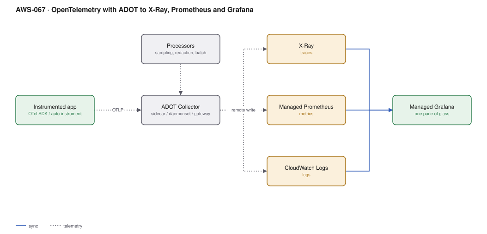

# AWS-067 · OpenTelemetry with ADOT to X-Ray, Prometheus and Grafana

> **Category:** [08 · Observability & Operations](readme.md#08) · **Maturity:** Growing · **Effort:** M

## The problem

Instrument with the X-Ray SDK and your traces are locked to X-Ray. Instrument with a vendor
agent and they are locked to that vendor, and you will pay their per-host price forever.
OpenTelemetry is the vendor-neutral standard: instrument once, and change where the data
goes by editing a collector config.

**Use it when** you run distributed services, want traces across them, or want the freedom
to change observability backends without re-instrumenting.

**Don't** adopt it for a single Lambda. CloudWatch and X-Ray natively are simpler. OTel
earns its keep across many services, especially polyglot ones.

## Components

| Service | Role | The setting that actually matters |
|---|---|---|
| OTel SDK / auto-instrumentation | Produces spans and metrics | Auto-instrumentation gets you 80% with no code change |
| **ADOT Collector** | Receives, processes, exports | Deployment mode: sidecar, daemonset, or **gateway** |
| Processors | Sampling, redaction, batching | **Tail sampling** — the main cost control |
| X-Ray | Trace storage and service map | $5.00 per million traces recorded |
| Managed Prometheus (AMP) | Metrics | Priced per sample ingested |
| CloudWatch Logs | Logs | Correlated by trace id |
| Managed Grafana | Visualisation | $9/editor, $5/viewer per month |

## Flow

1. Services are instrumented with OTel — auto-instrumentation for common frameworks, manual
   spans for business operations.
2. They export OTLP to a local collector (sidecar or daemonset), which batches and forwards
   to a **gateway** collector.
3. The gateway applies processors: redact sensitive attributes, add resource attributes
   (account, cluster, team), and **tail-sample** — keeping all error and slow traces, and a
   small percentage of the rest.
4. Exporters fan the data out: traces to X-Ray, metrics to Managed Prometheus, logs to
   CloudWatch.
5. Grafana queries all three and correlates by trace id, so a slow request on a dashboard
   links to its trace and its logs.
6. Changing backend is a config change in the gateway, not a code change in forty services.

## Cost (us-east-1 — order of magnitude)

| Line item | Small · 10 services | Medium · 60 services | Large · 300 services |
|---|---|---|---|
| Collector compute (daemonset + gateway) | $40.00 | $200.00 | $900.00 |
| X-Ray traces @ $5/M recorded — **100% sampling** | $150.00 | $1,500.00 | $15,000.00 |
| X-Ray traces — **tail sampling at ~5%** | $7.50 | $75.00 | $750.00 |
| Managed Prometheus @ ~$0.30/10M samples | $30.00 | $300.00 | $2,000.00 |
| AMP query + storage | $15.00 | $100.00 | $600.00 |
| Managed Grafana (5 editors, 30 viewers) | $195.00 | $195.00 | $400.00 |
| **Total (tail sampling)** | **~$288** | **~$870** | **~$4,650** |

**Cost cliff:** **sampling rate.** Recording every trace at scale is the dominant line —
$15,000/month at 300 services versus $750 with intelligent tail sampling. Tail sampling
keeps the traces that matter (errors, high latency, specific customers) and discards the
boring majority *after* seeing the whole trace, which head sampling cannot do.

**Biggest lever:** tail sampling in the gateway collector. Second: Prometheus cardinality —
a label with per-request values multiplies series count and cost in exactly the way
CloudWatch dimensions do ([`aws-066`](aws-066-cloudwatch-core.md)).

## Failure modes

| Failure | Symptom | Mitigation |
|---|---|---|
| Collector is a single point of failure | All telemetry lost when it restarts | Gateway as a Deployment with multiple replicas and a PDB; local collectors buffer |
| Head sampling only | Errors sampled out; the traces you need are missing | Tail sampling at the gateway; it needs the complete trace, so the gateway must see all spans of a trace |
| Context not propagated | Disconnected single-span traces | Ensure W3C `traceparent` propagation through every hop, including queues |
| Cardinality explosion in AMP | Cost spike, query timeouts | No per-request values as labels; enforce in the collector with an attribute processor |
| Collector resource limits too low | Dropped spans under load, silently | Monitor the collector's own metrics; it is a service like any other |
| Sensitive data in span attributes | PII in traces, retained for weeks | Attribute processors to redact at the gateway |

## Security notes

- Span attributes frequently contain URLs with tokens, SQL with values, and user identifiers.
  Redact in the collector before export — it is the one place that sees everything.
- The collector holds export credentials for every backend. Scope its IAM role tightly; it
  is a high-value target.
- Trace ids are useful in support conversations and are not secrets, but a trace *body* may
  be. Control who can query traces.
- Managed Grafana integrates with Identity Center for SSO, which is preferable to local
  Grafana users ([`aws-060`](aws-060-identity-center-abac.md)).

## What people miss

- **Tail sampling requires the gateway pattern.** You cannot tail-sample in a sidecar,
  because it only sees its own spans. Routing all spans of a trace to the same gateway
  instance (load-balancing exporter) is the piece people miss, and without it tail sampling
  silently makes incorrect decisions.
- **Auto-instrumentation is remarkably good now.** Java, Python, Node and .NET get HTTP,
  database and messaging spans with no code change — often a one-line container argument.
- **OTel is the exit from vendor lock-in**, which is a commercial argument as much as a
  technical one. The instrumentation outlives the backend decision.
- **ADOT is AWS's supported distribution** of the upstream collector; you can also run the
  upstream contrib collector if you need a component ADOT does not ship.
- **Logs are the least mature OTel signal.** Many teams send traces and metrics via OTel and
  keep logs on the existing path, which is a perfectly reasonable interim state.

## See also

- [`aws-066`](aws-066-cloudwatch-core.md) — the simpler native option
- [`aws-072`](aws-072-slo-error-budgets.md) — what the metrics feed
- [`aws-024`](aws-024-service-mesh.md) — per-hop signals without instrumenting code
- [`aws-068`](aws-068-centralized-logging.md) — the log side of the story
