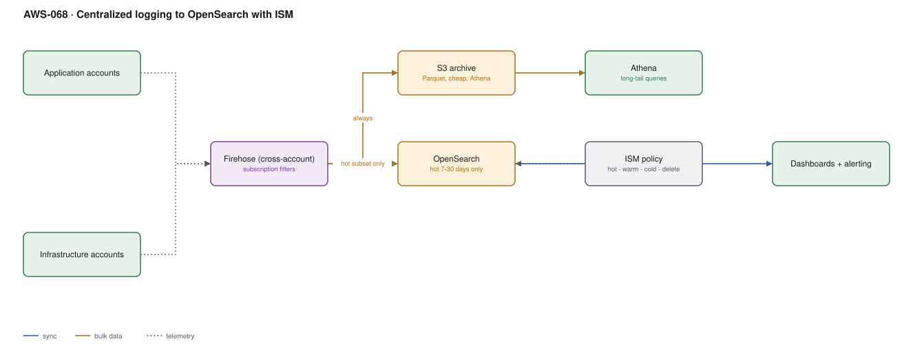

# AWS-068 · Centralized logging to OpenSearch with ISM

> **Category:** [08 · Observability & Operations](readme.md#08) · **Maturity:** Production · **Effort:** M

## The problem

Logs scattered across sixty accounts cannot be correlated, and an engineer debugging a
cross-service problem needs access to sixty accounts to read them. Centralising solves that
and immediately creates the opposite problem: an OpenSearch cluster holding everything
forever is one of the most expensive things you can build on AWS.

The architecture that works is **tiered**: a cheap complete archive, and an expensive
searchable window.

**Use it when** you have multiple accounts and anyone needs to search across them.

**Don't** send everything to OpenSearch. That is the default mistake and it is a six-figure
one at scale.

## The tiering decision

| Tier | Where | Cost per TB/mo | Query latency | Keep for |
|---|---|---|---|---|
| Hot | OpenSearch | ~$200–400 | milliseconds | 7–30 days |
| Warm | OpenSearch UltraWarm | ~$25 | seconds | 30–90 days |
| Cold | OpenSearch cold storage | ~$10 | minutes (attach first) | 90–365 days |
| Archive | S3 + Athena | **~$23** (Standard), ~$1 (Deep Archive) | seconds to hours | years |

The archive in S3 is the complete record. OpenSearch holds only what people interactively
search, which is almost always recent.

## Components

| Service | Role | The setting that actually matters |
|---|---|---|
| CloudWatch subscription filters | Export from each account | **Filter pattern** — send a subset, not everything |
| Firehose | Cross-account delivery | Buffer size; Parquet conversion for the S3 copy |
| S3 archive | Complete record | Partitioned Parquet, lifecycle to Glacier |
| OpenSearch | Interactive search | Instance types, and UltraWarm for the middle tier |
| **ISM policy** | Index lifecycle | hot → UltraWarm → cold → delete, automatically |
| Athena | Long-tail queries | Over the S3 archive, at $5/TB scanned |
| Dashboards + alerting | What people use | OpenSearch Dashboards or Grafana |

## Flow

1. Each account's log groups have subscription filters that match the subset worth
   centralising — errors, audit events, security-relevant lines — not every debug line.
2. Filters deliver cross-account to a Firehose stream in the logging account.
3. Firehose writes **every** record to S3 as partitioned Parquet: the cheap, complete,
   permanent archive.
4. A parallel delivery sends the hot subset to OpenSearch for interactive search.
5. An ISM policy rolls indices from hot to UltraWarm at 7 days, to cold at 30, and deletes
   at 90 — automatically, with no human.
6. Anything older is queried in Athena over the S3 archive.
7. Dashboards and alerting run against OpenSearch for recent data.

## Cost (us-east-1 — order of magnitude)

| Line item | Small · 100 GB/mo | Medium · 2 TB/mo | Large · 30 TB/mo |
|---|---|---|---|
| Firehose @ $0.029/GB | $2.90 | $58.00 | $870.00 |
| S3 archive (Parquet, 12 mo accumulated) | $8.00 | $160.00 | $2,400.00 |
| **OpenSearch — everything, 90 days hot** | $700.00 | $4,500.00 | $45,000.00 |
| **OpenSearch — 20% subset, ISM tiering** | $350.00 | $900.00 | $6,000.00 |
| UltraWarm nodes | $0 | $200.00 | $1,200.00 |
| Athena for long-tail queries | $2.00 | $20.00 | $200.00 |
| **Total (tiered)** | **~$363** | **~$1,338** | **~$10,670** |

**Cost cliff:** **OpenSearch hot storage**. It is roughly 10–20× the price of S3 for the
same data, and the default design sends everything there and keeps it. Tiering plus
filtering is routinely an 80% reduction with no practical loss — because almost nobody
interactively searches logs from three months ago, and when they do, Athena is fine.

**Biggest lever:** the subscription filter pattern. Not centralising debug logs at all is
cheaper than storing them cleverly.

## Failure modes

| Failure | Symptom | Mitigation |
|---|---|---|
| Everything to OpenSearch | The cluster is the biggest line in the account | Filter at the subscription; archive everything to S3 instead |
| No ISM policy | Indices accumulate until the cluster runs out of disk | ISM from day one; it is the cluster's lifecycle |
| Too many shards | Cluster instability, slow queries, high JVM pressure | Target 10–50 GB per shard; far fewer shards than people create |
| Cluster undersized for ingest | Indexing backpressure, Firehose retries, data loss | Dedicated master nodes; monitor indexing queue depth |
| Logs still unstructured | Centralised, searchable, still unreadable | Structured JSON at source ([`aws-066`](aws-066-cloudwatch-core.md)) |
| No cross-account access model | Engineers cannot see their own logs | Fine-grained access control mapped to Identity Center groups |

## Security notes

- The logging account holds everything from every account — it is one of the most sensitive
  accounts you own. Restrict it accordingly.
- Use OpenSearch fine-grained access control with document-level security so a team sees its
  own logs, not everyone's.
- Logs contain secrets more often than anyone admits. Redact at source, and enable
  CloudWatch Logs data protection policies on groups likely to contain them.
- Keep the security-relevant subset in Security Lake rather than here
  ([`aws-055`](aws-055-security-lake.md)) — different retention, different access model,
  different audience.
- Encrypt the domain at rest and in transit, and never give it a public endpoint.

## What people miss

- **S3 plus Athena is a perfectly good log search tool** for anything not interactive.
  Partitioned Parquet in S3 queried by Athena costs a fraction of OpenSearch and answers
  "what happened on the 14th" in seconds.
- **UltraWarm uses S3 under the hood** and is roughly a tenth the cost of hot storage for
  data you still want searchable through the same interface. It is a one-line ISM transition.
- **Subscription filters support a pattern.** You do not have to export every line. Most
  teams export everything because the pattern field was left blank.
- **OpenSearch Serverless** removes shard and node management, with a higher floor (~$700/
  month for the minimum OCUs) and better scaling behaviour. Compare it against a small
  managed cluster honestly.
- **Shard sizing is the usual cause of OpenSearch instability.** The default index template
  creating five shards for a 2 GB daily index is the most common misconfiguration in this
  entire architecture.

## See also

- [`aws-066`](aws-066-cloudwatch-core.md) — fixing the logs before centralising them
- [`aws-055`](aws-055-security-lake.md) — the security-log equivalent
- [`aws-051`](aws-051-clickstream-firehose.md) — the same delivery mechanism
- [`aws-082`](aws-082-s3-lifecycle.md) — lifecycle for the archive tier
