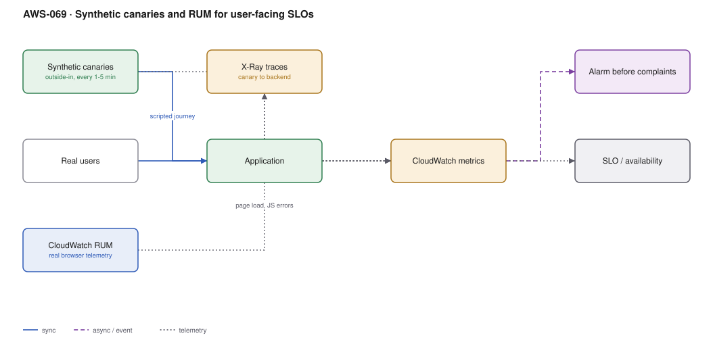

# AWS-069 · Synthetic canaries and RUM for user-facing SLOs

> **Category:** [08 · Observability & Operations](readme.md#08) · **Maturity:** Growing · **Effort:** S

## The problem

Every backend metric is green and a customer emails to say the site is broken. The
monitoring is measuring the wrong thing: whether *your services* are healthy, not whether
*a user can complete a journey*. Those differ when the CDN misbehaves, a certificate
expires, a third-party script hangs, DNS is wrong, or the JavaScript bundle fails to parse
on a browser you did not test.

**Use it when** you have a user-facing application. Synthetics is the cheapest way to know
before your users tell you.

**Don't** replace backend monitoring with it. Canaries detect; traces and metrics diagnose.

## Synthetic vs real-user monitoring

| | Synthetic canaries | RUM |
|---|---|---|
| Measures | A scripted journey from outside | What real users actually experienced |
| Coverage | Only what you scripted | Every browser, device and network |
| Works at 03:00 with no traffic | **Yes** | No |
| Detects regressions pre-release | **Yes** (run against staging) | No |
| Core Web Vitals | Synthetic approximation | **Real** |
| Good for | Availability alerting | Performance and experience |

They answer different questions. Canaries are your alerting signal; RUM is your performance
and prioritisation signal.

## Components

| Service | Role | The setting that actually matters |
|---|---|---|
| CloudWatch Synthetics canary | Scripted browser or API check | **Frequency** — the cost driver; and running from more than one region |
| Canary blueprints | Heartbeat, API, broken-link, GUI workflow | The GUI workflow canary is the one that catches real breakage |
| CloudWatch RUM | Real browser telemetry | Sampling rate; and it is **per event**, see cost |
| X-Ray integration | Canary → backend trace | Turns "the journey is slow" into "this service is slow" |
| Alarms | Notification | Alarm on **consecutive** failures, not a single one |
| SLO calculation | The availability number | Canary success rate is a defensible availability SLI |

## Flow

1. A canary runs a scripted journey every 1–5 minutes from one or more regions: load the
   page, log in, search, add to basket.
2. It records success or failure, step durations, HTTP status codes and screenshots on
   failure.
3. With X-Ray enabled, the canary's requests are traced through the backend, so a failure
   links to the service that caused it.
4. RUM, meanwhile, collects real page loads, Core Web Vitals, JavaScript errors and session
   detail from actual browsers.
5. Alarms fire on consecutive canary failures — before any user has complained.
6. The canary success rate over 28 days becomes the user-facing availability SLI
   ([`aws-072`](aws-072-slo-error-budgets.md)).

## Cost (us-east-1 — order of magnitude)

| Line item | Small · 5 canaries, 1M page views | Medium · 25 canaries, 20M | Large · 100 canaries, 200M |
|---|---|---|---|
| Canary runs @ $0.0012 each, every 5 min | $43.20 | $216.00 | $864.00 |
| *Same canaries at 1-minute frequency* | $216.00 | $1,080.00 | $4,320.00 |
| Lambda + S3 for canary artifacts | $10.00 | $50.00 | $200.00 |
| RUM @ $1.00 per 100K events (≈3 events/view) | $30.00 | $600.00 | $6,000.00 |
| *RUM at 10% sampling* | $3.00 | $60.00 | $600.00 |
| Alarms + dashboards | $5.00 | $15.00 | $50.00 |
| **Total (5-min canaries, 10% RUM)** | **~$61** | **~$341** | **~$1,714** |

**Cost cliff:** **canary frequency** and **RUM sampling**. A 1-minute canary costs 5× a
5-minute one, and multiplies by the number of regions you run from. RUM is billed per
event, and three events per page view at 200M views is $6,000/month at full sampling.

**Biggest lever:** sample RUM at 10–25% (statistically ample for performance analysis) and
reserve 1-minute canary frequency for the two or three journeys that genuinely need
sub-5-minute detection.

## Failure modes

| Failure | Symptom | Mitigation |
|---|---|---|
| Alerting on a single failure | Pages constantly from transient network blips | Alarm on 2–3 consecutive failures, or a failure in 2 of 3 regions |
| Canary credentials | Test account password in the script | Secrets Manager, and a dedicated low-privilege test account |
| Canary data pollutes analytics and production | Fake orders, skewed conversion metrics | Flag canary traffic with a header and exclude it everywhere |
| Only a heartbeat canary | Homepage is up, checkout is broken | Script the journey that makes money, not the one that is easy |
| Single region | Regional network issue looks like an outage | Run from at least two regions and require agreement |
| RUM at 100% | Surprising bill from a successful marketing campaign | Sample; and remember cost scales with traffic, not with problems |

## Security notes

- Canary scripts contain credentials. Use Secrets Manager and a dedicated test identity
  with the minimum permissions to complete the journey.
- Canary artifacts include **screenshots and HAR files**, which capture page content and
  sometimes tokens. The artifact bucket needs the same protection as production data.
- RUM collects real user sessions. Configure what is captured; URLs with tokens or
  identifiers in the path will be collected unless excluded.
- Give the canary test account no access to real customer data, and ensure its activity is
  distinguishable in audit logs.

## What people miss

- **Script the journey that matters, not the homepage.** A heartbeat canary on `/` proves
  almost nothing. A canary that logs in and completes a purchase against a test account
  catches the failures that cost money.
- **Canaries can run against staging** as a release gate — the same script, before deploy.
  This is a free, high-value use of an asset you already built.
- **Canary + X-Ray gives you cause, not just symptom.** Without it you learn that checkout
  is slow; with it you learn which downstream call is slow.
- **Excluding canary traffic is a real task.** Unflagged canaries corrupt conversion rates,
  A/B tests and load forecasts, and nobody notices for months.
- **RUM shows you browsers and geographies you never test.** The most common RUM finding is
  that one browser or one country has a dramatically worse experience than your team's
  laptops suggest.

## See also

- [`aws-072`](aws-072-slo-error-budgets.md) — turning canary success rate into an SLO
- [`aws-066`](aws-066-cloudwatch-core.md) — the alarms this feeds
- [`aws-067`](aws-067-otel-adot.md) — the traces that explain a canary failure
- [`aws-025`](aws-025-progressive-delivery.md) — canaries as a deployment gate
