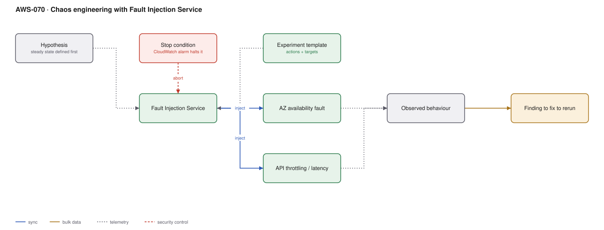

# AWS-070 · Chaos engineering with Fault Injection Service

> **Category:** [08 · Observability & Operations](readme.md#08) · **Maturity:** Specialist · **Effort:** M

## The problem

Your architecture diagram says the system survives an AZ failure. Nobody has ever tested
that claim. The multi-AZ database, the health check thresholds, the connection timeouts, the
retry logic, the runbook — all untested assumptions that will be evaluated for the first
time during a real incident, at the worst possible moment.

Chaos engineering tests them on a Tuesday afternoon instead, with everyone watching and a
stop button ready.

**Use it when** you have made availability claims you have not verified, or you are about
to depend on a failover path.

**Don't** start in production. Start in staging, with one experiment, during business
hours, with the owning team present. "Chaos monkey in production" is where mature practices
end up, not where they start.

## The experiments worth running first

| Experiment | Tests | Common finding |
|---|---|---|
| **AZ availability loss** | Multi-AZ claims | Capacity only existed in one AZ; failover exhausted it |
| Instance termination | ASG replacement, graceful shutdown | No `SIGTERM` handling; in-flight requests dropped |
| API throttling / errors | Retry and backoff logic | Retries without jitter cause a self-inflicted storm |
| Increased latency | Timeout configuration | Default timeouts of 60 s cascade into thread exhaustion |
| RDS failover | Application reconnection | Connection pool holds dead connections for minutes |
| Disk / CPU pressure | Autoscaling and alarms | Alarm thresholds never triggered because the metric was wrong |

The AZ experiment is the single highest-value one, because it is the claim most often made
and least often verified.

## Components

| Service | Role | The setting that actually matters |
|---|---|---|
| FIS experiment template | The experiment definition | Actions, targets, duration |
| **Stop conditions** | The abort switch | A CloudWatch alarm that halts the experiment — **mandatory**, not optional |
| Target selection | What gets broken | Tag-based with a count or percentage, so blast radius is bounded |
| Actions | The faults | AZ loss, instance stop, API error injection, network latency, EKS/ECS faults |
| Steady-state hypothesis | What "healthy" means | Defined and measured **before** you start |
| Observability | How you see what happened | If you cannot observe it, do not break it |

## Flow

1. Write the hypothesis first: "if we lose AZ-a, error rate stays below 1% and p99 latency
   stays under 400 ms".
2. Verify the steady state — the system is healthy right now by those measures.
3. Define the experiment: the action, the tag-based targets, the duration, and a stop
   condition alarm derived from the hypothesis.
4. Run it in staging. Observe. It will fail the first time, and the finding is the point.
5. Fix what you found. Re-run until the hypothesis holds.
6. Promote to production, during business hours, with the team watching and the stop
   condition armed.
7. Schedule it to run regularly, so the property stays true as the system changes.

## Cost (us-east-1 — order of magnitude)

| Line item | Small · 10 experiments/mo | Medium · 50/mo | Large · 300/mo |
|---|---|---|---|
| FIS @ $0.10 per action-minute | $6.00 | $50.00 | $300.00 |
| Extra capacity during experiments | ~$20 | ~$100 | ~$600 |
| Engineering time (the real cost) | days | days | ongoing |
| **Total AWS cost** | **~$26** | **~$150** | **~$900** |

**Cost cliff:** none in AWS charges — FIS is inexpensive. The cost is **engineering time and
organisational nerve**. The avoided cost is the outage you find on a Tuesday instead of at
03:00 on Black Friday, which is the entire business case and is hard to put on an invoice.

**Biggest lever:** running the AZ experiment once. It routinely finds a capacity or
configuration problem that would have turned a single-AZ event into a full outage.

## Failure modes

| Failure | Symptom | Mitigation |
|---|---|---|
| No stop condition | A real outage caused by your test | A stop-condition alarm is mandatory. FIS supports it; use it |
| Starting in production | A career-limiting afternoon | Staging first, bounded blast radius, business hours |
| No hypothesis | "We broke things and watched" — no learning | Define steady state and a measurable prediction before running |
| Blast radius too large | The experiment *is* the incident | Target by tag with a percentage; start at one instance |
| Nobody told the on-call | A real page for a planned test | Announce the window; suppress alerting or mark it clearly |
| Finding not fixed | The same failure found three quarters running | Each finding is a ticket with an owner and a re-run date |

## Security notes

- The FIS role can stop instances and inject API errors. That is a destructive capability —
  scope it tightly and alarm on its use outside planned windows.
- Use tag-based targeting with an explicit `chaos-eligible=true` tag so an experiment cannot
  accidentally select a resource that was never meant to be in scope.
- Experiments in production are change events; record them so an unrelated incident during
  the window is not misattributed, and so an experiment is not mistaken for an attack.
- FIS can inject IAM access-denied errors, which is an excellent test of how your
  application behaves when a permission is revoked — and a useful rehearsal for
  [`aws-062`](aws-062-ir-automation.md).

## What people miss

- **The AZ availability action is the headline capability.** It simulates a true AZ
  impairment across EC2, ECS, EKS, RDS and ElastiCache simultaneously — something you cannot
  approximate by stopping a few instances.
- **Stop conditions make this safe.** The difference between chaos engineering and
  recklessness is a pre-armed alarm that halts the experiment automatically.
- **FIS can inject errors into AWS API calls** — throttling, access denied, service errors —
  which tests your retry logic against the failure mode you will actually hit.
- **Game days matter more than the tooling.** The test is as much of the humans, the runbook
  and the escalation path as of the system.
- **Schedule it.** A one-off experiment proves something about a system that no longer
  exists. Recurring experiments keep the property true.

## See also

- [`aws-087`](aws-087-dr-pilot-light.md) — the DR claim this verifies
- [`aws-062`](aws-062-ir-automation.md) — rehearsing the response, not just the failure
- [`aws-072`](aws-072-slo-error-budgets.md) — where the steady-state hypothesis comes from
- [`aws-025`](aws-025-progressive-delivery.md) — proving rollback actually works
