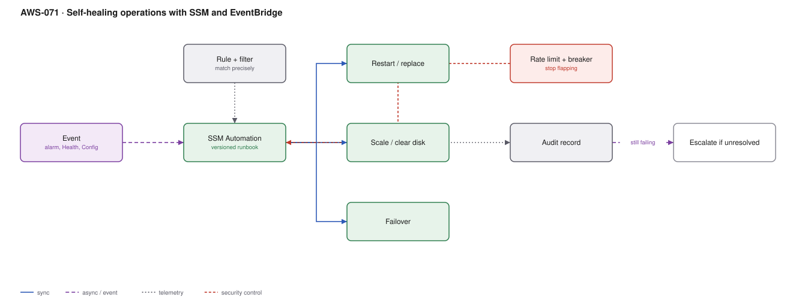

# AWS-071 · Self-healing operations with SSM and EventBridge

> **Category:** [08 · Observability & Operations](readme.md#08) · **Maturity:** Growing · **Effort:** M

## The problem

Look at your last hundred pages. A large fraction were "restart the service", "clear the
disk", "replace the unhealthy instance", "the certificate expired". A human was woken to
run three commands they have run forty times before. That is not operations, it is a
missing automation with a pager attached.

**Use it when** the same remediation has been performed manually more than twice.

**Don't** automate something you do not understand. Auto-restarting a service that is
crash-looping because of data corruption hides the problem and makes it worse.

## What to automate, and the order to do it in

| Remediation | Risk | Automate |
|---|---|---|
| Clear disk space / rotate logs | Low | **Immediately** |
| Restart an unhealthy process | Low | **Immediately**, with a rate limit |
| Replace an unhealthy instance in an ASG | Low | **Immediately** |
| Scale out on a sustained metric | Low | Use autoscaling, not automation |
| Re-enable a disabled control (encryption, logging) | Low | **Immediately** ([`aws-061`](aws-061-config-compliance.md)) |
| Failover a database | Medium | After rehearsal |
| Restart a stateful service | Medium | With a circuit breaker |
| Anything that deletes data | High | Never automatically |

Start with the boring, frequent, low-risk ones. They are the bulk of the pages.

## Components

| Service | Role | The setting that actually matters |
|---|---|---|
| EventBridge rule | The trigger | Match precisely — alarm name, resource tag, event detail |
| **SSM Automation document** | The runbook, as code | Versioned, parameterised, logged in CloudTrail |
| SSM Run Command | Commands on instances | No SSH, no bastion, fully audited |
| Rate limiting / circuit breaker | Stops a repair loop | **The most important safety control** |
| Audit record | What was done and why | DynamoDB table or the case record |
| Escalation | When automation fails | Hand to a human with everything already tried |

## Flow

1. An alarm, Health event or Config rule fires and publishes to EventBridge.
2. A rule matches the specific condition — not "any alarm", but this alarm on resources with
   this tag — and starts an SSM Automation execution.
3. The document checks preconditions: is this resource in scope, has this remediation run
   recently, is a change freeze in effect.
4. The remediation runs. For instance-level work, Run Command executes through the SSM
   agent, with no inbound network access required.
5. The document verifies the fix: did the alarm clear within the expected window.
6. Everything is recorded — trigger, actions, outcome, duration.
7. If the remediation has run N times in the window, the **circuit breaker** opens: stop
   trying, escalate to a human, and include everything already attempted.

## Cost (us-east-1 — order of magnitude)

| Line item | Small · 50 remediations/mo | Medium · 1,000/mo | Large · 20,000/mo |
|---|---|---|---|
| EventBridge events | $0.01 | $0.10 | $2.00 |
| SSM Automation steps @ ~$0.002 | $0.50 | $10.00 | $200.00 |
| Run Command | $0 | $0 | $0 |
| Lambda for custom logic | $0.10 | $2.00 | $40.00 |
| Audit record (DynamoDB) | $0.05 | $1.00 | $20.00 |
| **Total** | **~$1** | **~$13** | **~$262** |

**Cost cliff:** none — this is nearly free. The economics are entirely about **avoided
human time and avoided incident duration**. A thousand automated remediations a month is a
thousand pages that did not happen.

**Biggest lever:** choosing the right remediations. The top three most frequent manual
actions in your incident history are worth more than twenty clever ones.

## Failure modes

| Failure | Symptom | Mitigation |
|---|---|---|
| Repair loop | Automation restarts a service every 30 seconds forever | Circuit breaker: N attempts per window, then stop and escalate |
| Masking a real problem | The underlying bug is never fixed because automation hides it | Track remediation frequency as a metric; a rising count is a defect, not a success |
| Over-broad trigger | Remediation runs against unintended resources | Match on tag **and** alarm name; precondition checks in the document |
| No verification | "Remediated" but the problem persists | Verify the alarm cleared; escalate if not |
| Automation during a change freeze | Fights a deliberate human action | Check for a freeze tag or a maintenance window before acting |
| Silent success | Nobody knows automation is doing anything | Post low-severity notifications; visibility maintains trust |

## Security notes

- The automation role can restart, replace and reconfigure production resources. Scope one
  role per remediation type rather than one powerful role for everything.
- SSM Run Command replaces SSH entirely: no bastion, no keys, no inbound ports, and every
  command recorded in CloudTrail. That is a security improvement as much as an operational
  one.
- Session Manager logging should be on, with session output sent to S3 or CloudWatch.
- An automation that can be triggered by an event an attacker can cause is an attack
  primitive. Validate preconditions inside the document, not only in the rule.

## What people miss

- **Track how often each remediation fires.** Automation that runs 400 times a month is
  pointing at a defect. The metric turns toil into an engineering backlog item instead of
  hiding it.
- **SSM Automation documents are proper code** — parameters, conditional branches, loops,
  approval steps, and error handling. Many teams write Lambda functions for things a
  document does natively.
- **The circuit breaker is the control that makes this safe.** Without it, automation
  amplifies failures rather than absorbing them.
- **Automatic remediation of compliance drift** is the highest-value starting point:
  re-enable bucket encryption, remove a public ACL, restore a deleted log configuration
  ([`aws-061`](aws-061-config-compliance.md)).
- **Notify even on success, quietly.** A silent automation erodes trust; a low-priority
  "healed X" message builds it, and it tells you the system is working.

## See also

- [`aws-062`](aws-062-ir-automation.md) — the security-incident equivalent
- [`aws-065`](aws-065-notification-bus.md) — the events that trigger this
- [`aws-061`](aws-061-config-compliance.md) — compliance drift as a trigger
- [`aws-070`](aws-070-chaos-fis.md) — proving the automation works
