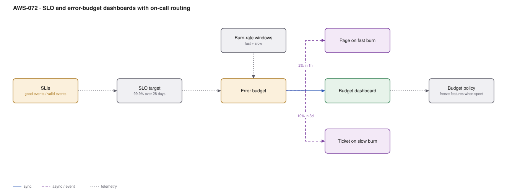

# AWS-072 · SLO and error-budget dashboards with on-call routing

> **Category:** [08 · Observability & Operations](readme.md#08) · **Maturity:** Growing · **Effort:** M

## The problem

Threshold alerts answer "is CPU above 80%", which nobody outside the team cares about. They
fire during harmless spikes and stay quiet during slow degradations that are destroying the
user experience. An SLO reframes the question as "are we meeting the reliability we promised"
and gives you a budget you can spend — on releases, on experiments, on risk.

**Use it when** alert fatigue is real, or when "how reliable are we" has no agreed answer.

**Don't** set an SLO you cannot measure, and do not set 99.99% because it sounds impressive.
An SLO you miss constantly and ignore is worse than none, because it teaches everyone that
the numbers do not matter.

## The arithmetic that changes behaviour

| SLO | Downtime per 28 days | Realistically needs |
|---|---|---|
| 99% | 6 h 43 m | One region, basic redundancy |
| 99.9% | **40 m** | Multi-AZ, tested deploys, on-call |
| 99.95% | 20 m | Automated failover, canary deploys |
| 99.99% | **4 m** | Multi-region active-active, no manual steps |

Each nine is roughly an order of magnitude more cost and complexity. 99.99% means a human
cannot be in the recovery path at all — there is not time to read the page.

## Components

| Service | Role | The setting that actually matters |
|---|---|---|
| SLI | The measurement | **good events / valid events** — defined from the user's perspective |
| SLO target | The promise | Over a rolling window, usually 28 days |
| Error budget | 100% − SLO, as a quantity | What you are permitted to spend |
| **Burn-rate alerts** | The alerting mechanism | Multi-window: fast burn pages, slow burn tickets |
| Dashboard | Shared visibility | Budget remaining, per service, visible to product too |
| Budget policy | What happens when it runs out | Agreed in advance, in writing |

## Flow

1. Define the SLI from the user's view: successful requests ÷ valid requests, or canary
   journey successes ÷ attempts ([`aws-069`](aws-069-synthetics-rum.md)).
2. Set an SLO target over a 28-day rolling window, chosen from what the business needs and
   what you can actually deliver.
3. The error budget is the allowed failure quantity — for 99.9% over 28 days, 40 minutes.
4. **Burn-rate alerts** replace threshold alerts. A 14.4× burn rate over one hour consumes
   2% of a 28-day budget in that hour, which means total exhaustion in two days — that
   pages. A 3× burn over six hours is a slow leak — that creates a ticket.
5. The dashboard shows budget remaining per service, visible to engineering and product
   alike.
6. The budget policy, agreed beforehand, says what happens at exhaustion: feature work
   pauses, reliability work takes priority, until the budget recovers.

## Cost (us-east-1 — order of magnitude)

| Line item | Small · 5 services | Medium · 30 services | Large · 150 services |
|---|---|---|---|
| CloudWatch custom metrics for SLIs | $15.00 | $90.00 | $450.00 |
| Metric math / composite alarms | $5.00 | $30.00 | $150.00 |
| Dashboards @ $3 each (3 free) | $6.00 | $45.00 | $200.00 |
| Managed Grafana (if used) | $50.00 | $150.00 | $400.00 |
| Synthetics for user-journey SLIs | $45.00 | $200.00 | $900.00 |
| **Total** | **~$121** | **~$515** | **~$2,100** |

**Cost cliff:** not in AWS charges — in the **reliability work the SLO implies**. Moving from
99.9% to 99.99% typically means multi-region active-active, which can double your
infrastructure cost ([`aws-086`](aws-086-ddb-global-tables.md)). The SLO is a budget
decision disguised as a technical one, which is exactly why it should be agreed with the
business rather than chosen by engineering.

**Biggest lever:** choosing the right target. Over-specifying reliability is one of the most
expensive mistakes an engineering organisation can make, and it is usually made casually.

## Failure modes

| Failure | Symptom | Mitigation |
|---|---|---|
| SLO chosen aspirationally | Permanently in breach, universally ignored | Measure current performance for a month first, then set a target slightly above it |
| Single-window burn alerts | Either noisy or too slow | Multi-window, multi-burn-rate: fast (1 h) pages, slow (6 h) tickets |
| SLI measured server-side only | Green dashboards while users see errors | Measure at the edge or in the browser — the user's view, not yours |
| Budget policy not agreed | Budget exhausted, nothing changes, SLO is theatre | Agree the consequence with product **before** you need it |
| Too many SLOs | Nobody can hold 40 numbers in mind | One or two per user-facing service: availability and latency |
| Planned maintenance counted | Budget consumed by deliberate work | Decide explicitly whether maintenance windows are excluded |

## Security notes

- SLO dashboards reveal reliability posture and traffic patterns. Internal, not public.
- Where availability is contractual, the SLI definition is the thing a dispute turns on —
  write it down precisely, including what counts as a valid event.
- Error-budget data informs change-freeze decisions, which makes it an input to production
  access control during incidents.

## What people miss

- **Burn-rate alerting is the practical payoff.** It replaces dozens of threshold alarms
  with two alerts per SLO that are, by construction, both urgent and actionable. This alone
  justifies the exercise.
- **The error budget is permission to ship.** Teams with budget remaining should move
  faster, not more carefully. Reframing reliability as a budget rather than a prohibition is
  what makes the practice stick.
- **Measure from the user's side.** A server-side 200 means nothing if the CDN served a
  stale error page. Canaries and RUM measure what actually happened.
- **99.99% requires removing humans from recovery.** Four minutes a month does not allow for
  a page, a laptop, a VPN and a runbook. If someone asks for four nines, that is what they
  are asking for.
- **Start with one SLO on one service.** The organisational change — agreeing targets,
  agreeing consequences — is harder and more valuable than the measurement.

## See also

- [`aws-069`](aws-069-synthetics-rum.md) — where user-facing SLIs come from
- [`aws-065`](aws-065-notification-bus.md) — routing the burn-rate alerts
- [`aws-087`](aws-087-dr-pilot-light.md) — what the higher targets actually cost
- [`aws-025`](aws-025-progressive-delivery.md) — spending the budget deliberately
