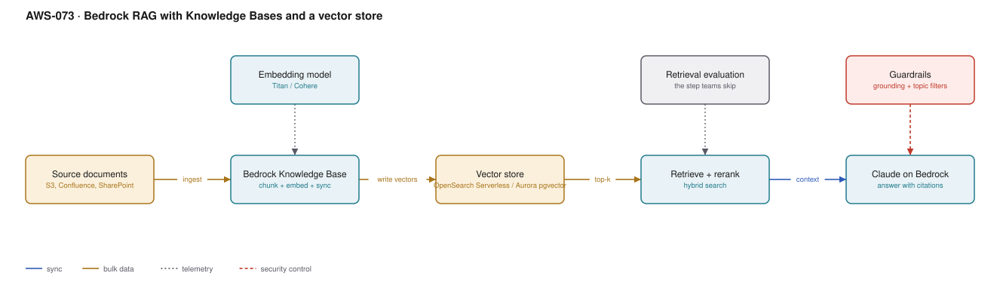

# AWS-073 · Bedrock RAG with Knowledge Bases and a vector store

> **Category:** [09 · AI/ML & Generative AI](readme.md#09) · **Maturity:** Growing · **Effort:** M

## The problem

A model knows nothing about your contracts, your runbooks or last Tuesday's incident.
Retrieval-augmented generation fixes that by finding relevant passages and putting them in
the prompt. The architecture is easy; getting *good answers* is not, and the gap is almost
always retrieval quality rather than the model.

**Use it when** answers must be grounded in a corpus that changes, and citations matter.

**Don't use it when** the corpus is small and stable enough to fit in the context window —
just put it in the prompt and cache it ([`aws-075`](aws-075-llm-gateway.md)). Long-context
models have made a lot of small RAG systems unnecessary.

## Where RAG quality actually comes from

In rough order of impact:

1. **Chunking** — chunks that split a table or a clause in half cannot be retrieved usefully.
2. **Hybrid search** — semantic plus keyword. Pure vector search misses exact identifiers,
   error codes and product names, which is what people actually search for.
3. **Reranking** — retrieve 50 candidates, rerank, keep 5. Usually the largest single
   quality jump for the least work.
4. **Metadata filtering** — scope by tenant, date or document type before ranking.
5. Model choice — matters least, and is what teams change first.

## Components

| Service | Role | The setting that actually matters |
|---|---|---|
| Source documents | The corpus | S3, plus connectors for Confluence, SharePoint, Salesforce, web |
| Bedrock Knowledge Base | Chunking, embedding, sync | **Chunking strategy** — fixed, semantic, or hierarchical |
| Embedding model | Text → vectors | Dimension count drives both storage and quality |
| Vector store | Index and search | OpenSearch Serverless, Aurora pgvector, Neptune Analytics, Pinecone |
| Reranker | Reorders candidates | The cheapest meaningful quality improvement |
| Guardrails | Grounding and topic control | **Contextual grounding check** scores whether the answer is supported |
| Evaluation | Measuring quality | Retrieval metrics first, generation metrics second |

## Flow

1. Documents land in S3; the knowledge base ingests and chunks them.
2. Each chunk is embedded and written to the vector store with its metadata.
3. A user question is embedded and used for hybrid search — vector plus keyword — filtered
   by metadata where applicable.
4. The top candidates are reranked and the best few are selected.
5. Those passages plus the question go to Claude on Bedrock, with instructions to answer
   only from the provided context and to cite sources.
6. Guardrails apply a contextual grounding check: an answer not supported by the retrieved
   passages can be blocked rather than returned.
7. Responses carry citations back to source chunks.

## Cost (us-east-1 — order of magnitude)

| Line item | Small · 10K docs | Medium · 500K docs | Large · 10M docs |
|---|---|---|---|
| OpenSearch Serverless (min 2 OCU indexing + 2 search) | $700.00 | $1,400.00 | $4,200.00 |
| *Aurora pgvector alternative (db.r6g.large)* | $204.00 | $500.00 | $2,000.00 |
| Embedding at ingest (one-off per document version) | $5.00 | $250.00 | $5,000.00 |
| Query embeddings (100K queries/mo) | $2.00 | $2.00 | $2.00 |
| Model inference — see note below | varies | varies | varies |
| Reranking | $10.00 | $50.00 | $200.00 |
| **Infrastructure total (excl. inference)** | **~$720** | **~$1,700** | **~$9,400** |

> **On model pricing:** Claude on Amazon Bedrock is partner-operated and priced separately
> from Anthropic's first-party API — check the
> [Bedrock pricing page](https://aws.amazon.com/bedrock/pricing/) for current per-token
> rates rather than assuming first-party numbers. The model tiers available on Bedrock use
> IDs prefixed with `anthropic.` (for example `anthropic.claude-opus-5`,
> `anthropic.claude-sonnet-5`, `anthropic.claude-haiku-4-5`), and there is roughly an order
> of magnitude between the cheapest and most capable tiers.

**Cost cliff:** **OpenSearch Serverless has a floor of about $700/month** — it requires
minimum OCUs for indexing and search whether or not anyone queries it. For a knowledge base
of 10,000 documents that is wildly disproportionate. Aurora with pgvector, or a small
provisioned OpenSearch domain, is far cheaper at small scale.

**Biggest lever:** retrieving fewer, better passages. Sending 20 chunks instead of 5
triples your input tokens on every single query for worse answers — more context is not
better context.

## Failure modes

| Failure | Symptom | Mitigation |
|---|---|---|
| Bad chunking | Confident, wrong answers from half a table | Semantic or hierarchical chunking; test retrieval on real questions |
| Pure vector search | Exact terms, error codes and IDs are never found | Hybrid search — this is the most common single defect |
| No reranking | Relevant passage retrieved at rank 18, never used | Retrieve wide, rerank, keep few |
| Stale index | Answers cite deleted or superseded documents | Scheduled or event-driven sync; show document dates in citations |
| No evaluation | Nobody can tell whether a change helped | A golden set of question/answer pairs, scored on every change |
| No tenant filtering | One customer sees another's documents | Metadata filters enforced server-side, never from the client |

## Security notes

- **Tenant isolation must be enforced at retrieval**, not by prompt instruction. A model
  told "only discuss tenant A" will eventually discuss tenant B. Filter the vector query.
- Retrieved context inherits the permissions of whoever indexed it. If the corpus contains
  documents the asker is not entitled to see, RAG becomes a data-exfiltration path.
- Guardrails' contextual grounding check is a real control against confident fabrication —
  it scores whether the answer is supported by the retrieved passages.
- Prompt injection in source documents is a genuine risk: a document containing "ignore
  previous instructions" becomes part of the prompt. Treat the corpus as untrusted input.
- Log prompts and responses for audit, and remember they may contain sensitive content.

## What people miss

- **Hybrid search is the single highest-value fix.** Teams debug model quality for weeks
  when the retrieval step never returned the right passage.
- **Evaluate retrieval separately from generation.** If the right chunk was not in the
  context, no model can answer correctly, and no amount of prompt engineering helps.
- **Long context has changed the calculus.** With a 1M-token context window, a corpus of a
  few hundred pages can simply be included in the prompt — and with prompt caching, the
  repeated cost of doing so is much lower than it used to be. Check whether you need RAG at
  all before building it.
- **Metadata filtering before ranking** is both a quality and a security feature, and is
  routinely left for later.
- **Citations are a product feature, not a nicety.** Users trust an answer they can verify,
  and they forgive a wrong answer they could check.

## See also

- [`aws-075`](aws-075-llm-gateway.md) — quotas, caching and cost attribution in front of this
- [`aws-074`](aws-074-bedrock-agents.md) — when the model must act, not just answer
- [`aws-079`](aws-079-document-intelligence.md) — getting text out of documents first
- [`aws-081`](aws-081-mlops-pipelines.md) — the evaluation discipline this needs
