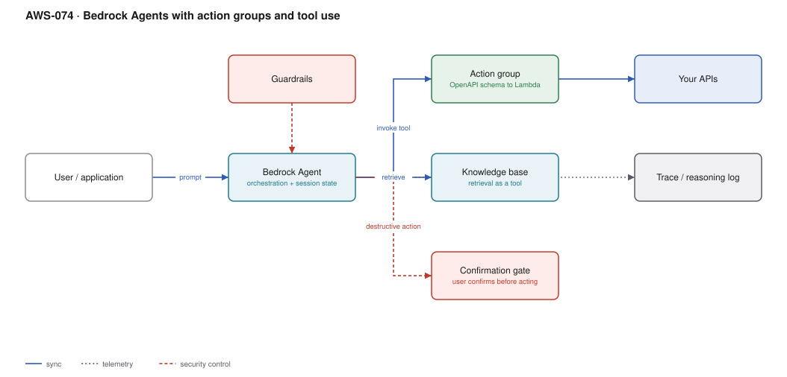

# AWS-074 · Bedrock Agents with action groups and tool use

> **Category:** [09 · AI/ML & Generative AI](readme.md#09) · **Maturity:** Growing · **Effort:** M

## The problem

Answering questions is useful; doing things is valuable. "Check my order status and refund
it if it shipped late" needs the model to call your APIs, in the right order, with the right
arguments, and to stop when it has done enough. Bedrock Agents provide the orchestration
loop, session state and tool-calling protocol so you supply the tools rather than the loop.

**Use it when** the task genuinely requires open-ended, model-driven tool use — the steps
are not knowable in advance.

**Don't use it when** the workflow is deterministic. If you can draw the flowchart, build
the flowchart ([`aws-011`](aws-011-step-functions-saga.md)). An agent that always calls the
same three tools in the same order is an expensive, non-deterministic way to write a
function.

## Should this be an agent at all?

Four questions, all of which must be yes:

- **Complexity** — is the task hard to fully specify in advance?
- **Value** — does the outcome justify higher cost and latency?
- **Viability** — is the model actually good at this task?
- **Cost of error** — can mistakes be caught and recovered from?

Most "agent" requirements fail at least one, and are better served by a workflow with a
single model call inside it.

## Components

| Service | Role | The setting that actually matters |
|---|---|---|
| Bedrock Agent | Orchestration, session state | Model choice; agents are far more sensitive to it than RAG |
| Action group | A set of tools | **OpenAPI schema** or function definitions → Lambda |
| Tool descriptions | How the model decides what to call | The highest-leverage prompt text in the whole system |
| Knowledge base | Retrieval as a tool | [`aws-073`](aws-073-bedrock-rag.md) |
| **Confirmation gate** | Human approval before acting | `requireConfirmation` on destructive actions |
| Guardrails | Content and topic policy | Applied to input and output |
| Trace | The reasoning and tool-call log | Essential for debugging; also an audit record |

## Flow

1. The user sends a request; the agent starts or resumes a session.
2. The agent reasons about which tool to call, using the tool descriptions and schemas.
3. For a read-only action it invokes the action group's Lambda directly.
4. For a destructive action with confirmation required, it pauses and asks the user to
   confirm before proceeding.
5. Tool results return to the agent, which decides whether to call another tool or answer.
6. Guardrails evaluate input and output against policy.
7. The full trace — reasoning steps, tool calls, parameters, results — is available for
   debugging and audit.

## Cost (order of magnitude)

| Line item | Small · 10K sessions/mo | Medium · 200K/mo | Large · 2M/mo |
|---|---|---|---|
| Model inference (see note) | dominant | dominant | dominant |
| Action group Lambda | $5.00 | $100.00 | $1,000.00 |
| Knowledge base retrieval | $20.00 | $200.00 | $1,500.00 |
| Guardrails evaluation | $15.00 | $300.00 | $3,000.00 |
| Trace logging to CloudWatch | $10.00 | $150.00 | $1,200.00 |
| **Non-inference total** | **~$50** | **~$750** | **~$6,700** |

> **On model pricing:** Bedrock is partner-operated and priced separately from Anthropic's
> first-party API — see the [Bedrock pricing page](https://aws.amazon.com/bedrock/pricing/).
> Bedrock model IDs carry an `anthropic.` prefix (`anthropic.claude-opus-5`,
> `anthropic.claude-sonnet-5`, `anthropic.claude-haiku-4-5`).

**Cost cliff:** **an agent re-sends the entire conversation on every turn.** A ten-turn
session with a 5,000-token system prompt and growing tool results does not cost ten times a
single call — it costs far more, because turn ten carries everything from turns one to
nine. Token spend grows roughly quadratically with turn count. Capping turns is both a cost
control and a safety control.

**Biggest lever:** prompt caching on the stable prefix (system prompt and tool definitions),
and keeping the tool surface small. A cached prefix is dramatically cheaper to re-read than
an uncached one, and it is re-read on every single turn.

## Failure modes

| Failure | Symptom | Mitigation |
|---|---|---|
| Infinite tool loop | Agent calls the same tool repeatedly, cost climbs | Hard cap on turns per session; alarm on sessions hitting it |
| Vague tool descriptions | Wrong tool chosen, or arguments hallucinated | Tool descriptions are prompt engineering — invest there first |
| Too many tools | Accuracy drops as the tool list grows | Keep the surface small; split into multiple agents if needed |
| No confirmation on destructive actions | The agent issues a refund it should not have | `requireConfirmation` on anything that writes, pays or deletes |
| Non-idempotent tools | A retry charges the customer twice | Idempotency keys on every write tool |
| Unbounded session growth | Context exhausted mid-task | Cap turns; summarise or clear old tool results |

## Security notes

- **The agent's Lambda is the security boundary.** The model decides *what* to call; your
  code decides whether it is *allowed*. Authorise inside the tool against the end user's
  identity — never trust the model to enforce permissions.
- Pass the user's identity into the action group and check it. An agent acting with a
  single powerful service role can be talked into acting on another user's data.
- Prompt injection is the central threat: content retrieved from a document or an API can
  contain instructions. Treat every tool result as untrusted input.
- Confirmation gates are a real control for destructive actions and are off by default.
- The trace log records reasoning and parameters, which may include sensitive data —
  protect it accordingly.

## What people miss

- **Tool descriptions are the most important text in the system.** More effort there pays
  off more than model upgrades or prompt tweaks. Describe when *not* to use a tool too.
- **Return errors to the agent as data**, not as exceptions. A tool result saying
  "order not found, check the ID format" lets the model recover; a 500 ends the turn.
- **Cap the turns.** Without a limit, a confused agent will loop until something else stops
  it, and the something else is usually a bill.
- **A deterministic workflow with one model call inside it beats an agent** for most tasks
  people reach for agents to solve. Agents earn their cost when the path genuinely varies.
- **Session state is not a database.** It is conversation context with a size limit, not
  durable application state.

## See also

- [`aws-073`](aws-073-bedrock-rag.md) — retrieval as one of the agent's tools
- [`aws-011`](aws-011-step-functions-saga.md) — the deterministic alternative
- [`aws-075`](aws-075-llm-gateway.md) — governing agent spend centrally
- [`aws-001`](aws-001-lambda-authorizer.md) — authorising the APIs the agent calls
