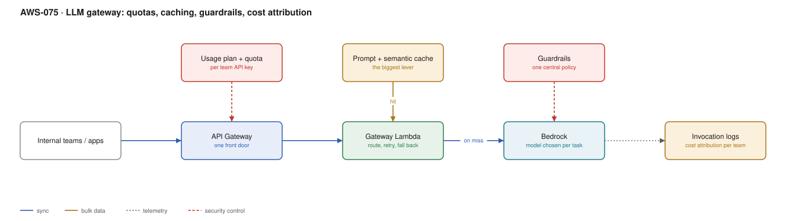

# AWS-075 · LLM gateway: quotas, caching, guardrails, cost attribution

> **Category:** [09 · AI/ML & Generative AI](readme.md#09) · **Maturity:** Growing · **Effort:** M

## The problem

Six teams call Bedrock directly. Nobody knows which team is responsible for the bill, each
has its own retry logic and its own guardrail policy (or none), one team's load test
exhausts the shared account quota and breaks production for everyone, and there is no
single place to change the model. A gateway puts one front door in front of model access.

**Use it when** more than two teams use models, or when you need per-team cost attribution,
central policy, or a quota that stops one team starving the others.

**Don't** build it for a single application — add the complexity when the second consumer
appears.

## What the gateway is actually for

| Capability | Why it needs to be central |
|---|---|
| **Cost attribution** | Bedrock bills the account, not the team. Without a gateway you cannot answer "who spent this" |
| **Quotas** | Model throughput quotas are account-wide and shared; one team can exhaust them |
| **Caching** | A cache is only effective if everyone shares it |
| **Guardrails** | One policy, applied consistently, auditable |
| **Model routing** | Change the model for everyone without touching six codebases |
| **Fallback** | Cross-region or cross-model failover in one place |
| **Audit** | One log of every prompt and response |

## Components

| Service | Role | The setting that actually matters |
|---|---|---|
| API Gateway | The front door | **Usage plan per team API key** — the attribution and quota mechanism |
| Gateway Lambda | Routing, retry, fallback | Streaming passthrough; buffering breaks the user experience |
| **Prompt caching** | Reuse of a stable prefix | The single biggest cost lever — see below |
| Semantic cache | Reuse of similar questions | A vector lookup before the model; high hit rates on FAQ traffic |
| Bedrock Guardrails | Content and topic policy | One policy applied to every team |
| Model routing | Task → model tier | Cheap model for classification, capable model for reasoning |
| Invocation logging | Cost and audit | To S3, partitioned by team and date; queried with Athena |

## Flow

1. A team calls the gateway with its own API key; the usage plan applies that team's quota.
2. The gateway checks the semantic cache for a sufficiently similar recent request.
3. On a miss it selects a model by task type and constructs the request with a **stable
   prefix** — system prompt and tool definitions first, volatile content last — so prompt
   caching applies.
4. Guardrails evaluate the input against the central policy.
5. Bedrock is invoked, streaming the response back through the gateway unbuffered.
6. On throttling, the gateway retries with backoff and can fall back to another region or
   a different model tier.
7. Token counts, model, latency, team and outcome are logged to S3 for attribution.

## Cost (order of magnitude)

| Line item | Small · 1M requests/mo | Medium · 20M/mo | Large · 200M/mo |
|---|---|---|---|
| API Gateway @ $1.00/M | $1.00 | $20.00 | $200.00 |
| Gateway Lambda (512 MB × 200 ms) | $2.00 | $40.00 | $400.00 |
| Semantic cache (ElastiCache / vector) | $150.00 | $300.00 | $900.00 |
| Guardrails evaluation | $75.00 | $1,500.00 | $15,000.00 |
| Invocation logs to S3 + Athena | $10.00 | $150.00 | $1,200.00 |
| **Gateway overhead total** | **~$238** | **~$2,010** | **~$17,700** |
| Model inference | **dominant — see note** | | |

> **On model pricing:** Claude on Amazon Bedrock is partner-operated and priced separately
> from Anthropic's first-party API; see the
> [Bedrock pricing page](https://aws.amazon.com/bedrock/pricing/). Bedrock model IDs are
> prefixed `anthropic.` — for example `anthropic.claude-opus-5` (most capable),
> `anthropic.claude-sonnet-5` (mid-tier), `anthropic.claude-haiku-4-5` (cheapest, 200K
> context). The spread between tiers is roughly an order of magnitude per token.

**Cost cliff:** **inference dwarfs everything else**, so the gateway pays for itself purely
by reducing tokens. Two levers do most of the work:

- **Prompt caching.** Cache reads are a fraction of the price of fresh input tokens. For a
  long, stable system prompt re-sent on every request, this is often a 60–90% reduction in
  input cost. It requires prefix stability: any byte change anywhere in the cached prefix
  invalidates everything after it, so put the frozen content first and the per-request
  content last.
- **Model routing.** Sending a classification task to the most capable model costs roughly
  10× what the cheapest tier costs for an identical result.

**Biggest lever:** caching, then routing, then effort/verbosity settings. Verify caching is
actually working by checking cache-read token counts in the response usage — a silent
invalidator such as a timestamp in the system prompt produces a zero hit rate and nobody
notices.

## Failure modes

| Failure | Symptom | Mitigation |
|---|---|---|
| Cache never hits | Costs unchanged after enabling caching | Audit for volatile content in the prefix: timestamps, request IDs, unsorted JSON |
| Buffering the stream | Users stare at a blank screen for 20 seconds | Stream through the gateway; do not accumulate and forward |
| Quota exhaustion | One team's batch job throttles everyone | Per-team usage plans, plus provisioned throughput for critical paths |
| No cost attribution | A large bill nobody owns | Log team, model and token counts per request from day one |
| Gateway becomes a bottleneck | Added latency on every call | Keep the gateway thin; it routes and logs, it does not transform |
| Single region | A regional model outage stops everything | Cross-region fallback in the gateway |

## Security notes

- The gateway is the right place to redact personal data from prompts before they leave
  your account, and to detect secrets in prompts.
- Guardrails centrally enforce content policy, denied topics and PII handling — far more
  reliable than asking each team to configure their own.
- Prompt and response logs are sensitive by definition. Encrypt them, restrict access, and
  set retention deliberately.
- Per-team API keys identify callers for metering; they are not authentication. Put real
  auth in front ([`aws-008`](aws-008-m2m-auth.md)).
- Prompt injection defences belong here too — a central filter is better than six
  inconsistent ones.

## What people miss

- **Prompt caching is the dominant cost lever and is easy to break silently.** A
  `datetime.now()` in the system prompt, a differently-ordered JSON tool definition, or a
  per-request ID placed before the cached content all reduce the hit rate to zero while
  everything still works. Monitor cache-read tokens as a first-class metric.
- **Order matters: tools, then system, then messages.** Stable content first, volatile
  content after the last cache breakpoint.
- **Semantic caching works better than people expect** on support and FAQ traffic, where
  many users ask the same question differently. Hit rates of 30–40% are achievable.
- **Batch inference is around half price** for anything not latency-sensitive —
  classification backfills, bulk summarisation, evaluation runs.
- **Attribution changes behaviour.** Teams that can see their own model spend reduce it
  without being asked. That is often the gateway's largest return.

## See also

- [`aws-073`](aws-073-bedrock-rag.md) — a major consumer of this gateway
- [`aws-074`](aws-074-bedrock-agents.md) — agents are the heaviest token consumers
- [`aws-092`](aws-092-finops-cur-pipeline.md) — joining gateway logs to the billing data
- [`aws-005`](aws-005-api-abuse-control.md) — the quota mechanics in detail
