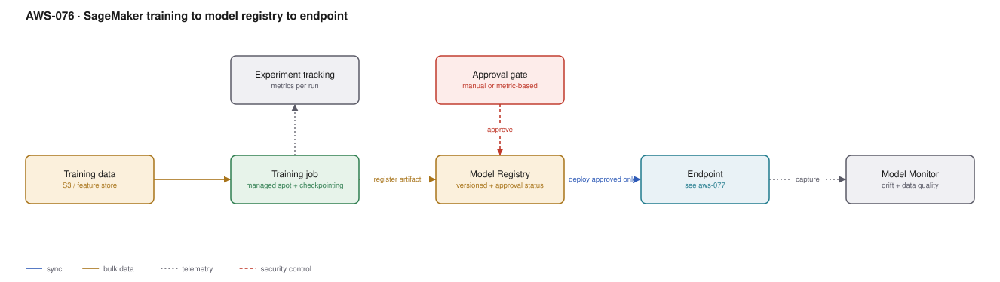

# AWS-076 · SageMaker training to model registry to endpoint

> **Category:** [09 · AI/ML & Generative AI](readme.md#09) · **Maturity:** Production · **Effort:** L

## The problem

A model trained in a notebook on a laptop is not a production asset. Nobody can reproduce
it, nobody knows which data it saw, there is no record of whether it is better than the one
currently serving, and deploying it is a manual copy. This architecture turns training into
something that produces a **versioned, approvable, redeployable artifact**.

**Use it when** you train your own models and more than one person depends on the result.

**Don't** build this for a one-off analysis. And if the task is served by a foundation
model through Bedrock, do that instead — training a custom model is a large commitment that
fine-tuning or prompting often avoids.

## Components

| Service | Role | The setting that actually matters |
|---|---|---|
| Training data | Versioned input | S3 with versioning, or a feature store ([`aws-078`](aws-078-feature-store.md)) |
| Training job | Produces the model artifact | **Managed Spot training** — up to 90% cheaper, needs checkpointing |
| Experiment tracking | Metrics per run | Compare runs; without it you cannot tell what helped |
| **Model Registry** | Versioned catalogue | `ModelApprovalStatus` — the gate between training and production |
| Approval gate | Human or metric-based | Automated: only register if it beats the current champion |
| Endpoint | Serving | See [`aws-077`](aws-077-inference-selection.md) for the mode choice |
| Model Monitor | Drift detection | Needs data capture enabled on the endpoint |

## Flow

1. A training job starts from a specific, versioned dataset and a container image with
   pinned dependencies.
2. It runs on managed Spot instances with checkpointing to S3, so an interruption resumes
   rather than restarts.
3. Metrics are logged to the experiment tracker so this run is comparable with every
   previous one.
4. The resulting artifact is registered in the Model Registry as a new version in a model
   package group, with its metrics, lineage and container image recorded.
5. Approval is granted — manually, or automatically when the candidate beats the current
   production model on a held-out set.
6. Only **approved** versions can be deployed. Deployment is a canary shift, not a replace.
7. The endpoint captures a sample of requests and responses for Model Monitor.

## Cost (us-east-1 — order of magnitude)

| Line item | Small · weekly, CPU | Medium · daily, 1 GPU | Large · daily, 8 GPU |
|---|---|---|---|
| Training on-demand (ml.m5.xlarge / p4d) | $40.00 | $2,350.00 | $18,800.00 |
| **Training on managed Spot (~70% off)** | **$12.00** | **$705.00** | **$5,640.00** |
| S3 for data, checkpoints and artifacts | $20.00 | $100.00 | $800.00 |
| Model Registry | $0 | $0 | $0 |
| Real-time endpoint (ml.m5.large / ml.g5.xlarge) | $84.00 | $730.00 | $2,920.00 |
| Model Monitor jobs | $15.00 | $50.00 | $200.00 |
| **Total** | **~$131** | **~$1,585** | **~$9,560** |

**Cost cliff:** **the always-on endpoint.** A model serving ten predictions a day on a
`ml.m5.large` costs $84/month to sit idle. Serverless or async inference scales to zero and
is dramatically cheaper for intermittent traffic
([`aws-077`](aws-077-inference-selection.md)). Idle endpoints left over from experiments are
one of the most common sources of unexplained ML spend.

**Biggest lever:** managed Spot training, which is typically 70–90% off and requires only
checkpointing. Second: deleting endpoints nobody calls — audit them monthly.

## Failure modes

| Failure | Symptom | Mitigation |
|---|---|---|
| No checkpointing on Spot | A six-hour job restarts from zero on interruption | Checkpoint to S3 and resume; this is what makes Spot viable |
| Data not versioned | A result cannot be reproduced | S3 versioning or a dataset snapshot id recorded with the run |
| Anything deployable | An unvalidated model reaches production | Only `Approved` registry versions are deployable; enforce in the pipeline |
| Idle endpoints | Thousands a month for models nobody calls | Monthly audit; alarm on endpoints with near-zero invocations |
| Container drift | Training and serving behave differently | Same base image, pinned dependencies, recorded in the registry |
| No baseline comparison | New models shipped that are worse | Automated champion/challenger evaluation before approval |

## Security notes

- Training data is often the most sensitive asset in the organisation. Encrypt it, restrict
  the training role to the specific prefix, and run jobs in a VPC with no internet route.
- Enable network isolation on training jobs that must not exfiltrate data — the container
  gets no network access at all.
- The model artifact can encode training data. Treat it with the same classification as the
  data it was trained on.
- Endpoint data capture writes real requests to S3, which may include personal data. Scope
  the sampling and the retention.
- Model Registry approval is a control point — restrict who can approve, and log it.

## What people miss

- **Managed Spot training is the biggest and easiest saving in ML**, and most teams do not
  use it because of a vague worry about interruptions that checkpointing resolves.
- **The Model Registry is a governance tool, not a filing cabinet.** The approval status
  gating deployment is what turns it from metadata into a control.
- **Lineage tracking is automatic** in SageMaker and answers "which data and code produced
  this model" — the question auditors and incident reviews always ask.
- **Warm pools** keep training instances alive between runs, cutting start-up time
  dramatically for iterative experimentation at a small cost.
- **Check Bedrock first.** For many text and vision tasks, a foundation model with good
  prompting ([`aws-075`](aws-075-llm-gateway.md)) outperforms a custom model you have to
  train, host, monitor and retrain forever.

## See also

- [`aws-077`](aws-077-inference-selection.md) — the deployment decision this feeds
- [`aws-081`](aws-081-mlops-pipelines.md) — automating this whole flow
- [`aws-078`](aws-078-feature-store.md) — where the training data should come from
- [`aws-026`](aws-026-aws-batch.md) — Spot economics for non-ML batch
