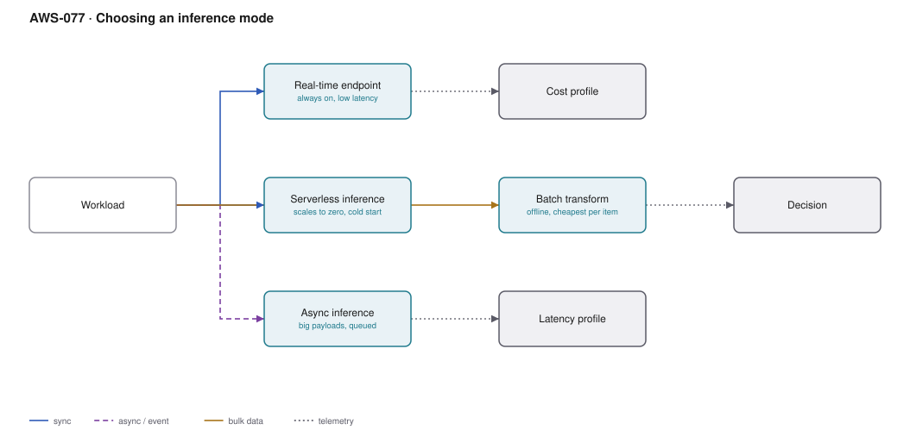

# AWS-077 · Choosing an inference mode

> **Category:** [09 · AI/ML & Generative AI](readme.md#09) · **Maturity:** Production · **Effort:** M

## The problem

SageMaker offers four ways to serve a model and the default choice — a real-time endpoint,
because it is the one in the tutorial — is wrong for a large share of workloads. The
consequence is an always-on GPU instance serving two hundred predictions a day.

**Use this page when** you are about to deploy a model and have not deliberately chosen the
mode.

## The four modes

| | Real-time | Serverless | Async | Batch transform |
|---|---|---|---|---|
| Latency | **Lowest, consistent** | Cold start on idle | Minutes | Offline |
| Scales to zero | No | **Yes** | **Yes** | N/A |
| Max payload | 6 MB | 4 MB | **1 GB** | Unlimited |
| Max processing time | 60 s | 60 s | **1 hour** | Unlimited |
| GPU support | **Yes** | **Yes** (newer) | **Yes** | **Yes** |
| Billing | Per instance-hour, always | Per request + duration | Per instance-hour while processing | Per instance-hour for the job |
| Right for | Steady, latency-sensitive traffic | Spiky, intermittent | Big inputs, long inference | Scoring a whole dataset |

## How to choose

1. **Is the result needed within the request?** No → **batch transform** if you are scoring
   a dataset, **async** if it is per-request but can take minutes.
2. **Is the payload over 6 MB or the inference over 60 seconds?** → **async**.
3. **Is traffic steady and latency-sensitive?** → **real-time**, with autoscaling.
4. **Otherwise** → **serverless**, and accept a cold start.

The common error is treating "we have an API" as implying real-time. An API that returns a
job id and a webhook can be served by async inference at a fraction of the cost.

## Components

| Service | Role | The setting that actually matters |
|---|---|---|
| Real-time endpoint | Persistent instances behind an endpoint | **Autoscaling policy**, and multi-model endpoints to share instances |
| Serverless inference | On-demand, scales to zero | **Memory size** and `MaxConcurrency`; provisioned concurrency removes cold starts |
| Async inference | Queued, S3 in and out | `MaxConcurrentInvocationsPerInstance`, and scale-to-zero on an empty queue |
| Batch transform | A job over a dataset | Instance count and `MaxPayloadInMB` |
| Inference recommender | Benchmarks instance types for you | Removes guesswork about which instance to use |
| Multi-model endpoints | Many models, one instance | The answer to "we have 500 per-customer models" |

## Cost (us-east-1 — order of magnitude, 1M inferences/month)

| Line item | Steady 1M/mo | Spiky 1M/mo | 1M offline |
|---|---|---|---|
| Real-time (2 × ml.m5.large, always on) | $168.00 | $168.00 | $168.00 |
| Serverless (3 GB, 200 ms each) | $100.00 | **$100.00** | $100.00 |
| Async (scales to zero, 4 h/day active) | $28.00 | $28.00 | $28.00 |
| Batch transform (4 × ml.m5.xlarge, 3 h) | — | — | **$2.76** |
| **Best choice** | **real-time** | **serverless** | **batch** |

**Cost cliff:** **a GPU real-time endpoint for intermittent traffic.** An `ml.g5.xlarge`
costs around $730/month whether it serves one request or a million. The same workload on
async inference scaling to zero can be a tenth of that. This single decision is routinely
the largest line in an ML budget.

**Biggest lever:** choosing correctly in the first place, then autoscaling the real-time
endpoints you do keep — including scaling to zero where supported.

## Failure modes

| Failure | Symptom | Mitigation |
|---|---|---|
| Real-time for spiky traffic | Paying 24/7 for occasional use | Serverless or async; measure the actual request pattern first |
| Serverless cold starts | p99 latency unacceptable | Provisioned concurrency, or real-time if latency is contractual |
| Payload over the limit | Silent failures on large inputs | Async for anything over 6 MB |
| No autoscaling | Over-provisioned normally, saturated at peak | Target-tracking on `InvocationsPerInstance` |
| Many small models, one endpoint each | Dozens of mostly-idle endpoints | Multi-model endpoints, or inference components |
| Batch job sized wrong | Hours of a large cluster for a small dataset | Instance count should match data volume, not habit |

## Security notes

- Endpoints should be in a VPC with no public access; call them through an interface
  endpoint.
- Data capture writes real inference requests to S3 — sample it, encrypt it, and set
  retention; it often contains personal data.
- Async inference reads from and writes to S3, so the endpoint role needs access to those
  prefixes only.
- Multi-model endpoints load models from a shared S3 prefix; ensure per-tenant models
  cannot be invoked by the wrong caller — the endpoint does not enforce that for you.

## What people miss

- **Async inference scales to zero** and is the most underused mode. For anything where a
  few minutes is acceptable, it combines the cost profile of batch with a per-request API.
- **Multi-model endpoints** host thousands of models on shared instances, loading on
  demand. For per-customer models this turns an impossible cost into a routine one.
- **Inference components** (newer) let you pack several models onto one endpoint with
  independent scaling — finer-grained than multi-model endpoints.
- **Inference Recommender benchmarks instance types against your actual model** and removes
  a guessing game that usually resolves as "pick something bigger than needed".
- **Serverless now supports GPU**, which removed the main reason teams defaulted to
  real-time for deep learning models.
- **Batch transform is absurdly cheap** for scoring a dataset — often cents where an
  endpoint would be hundreds of dollars. If the question is "score everything nightly",
  this is the answer.

## See also

- [`aws-076`](aws-076-sagemaker-training.md) — producing the model being deployed
- [`aws-081`](aws-081-mlops-pipelines.md) — automating deployment and rollback
- [`aws-012`](aws-012-async-job-submission.md) — the API pattern async inference fits
- [`aws-095`](aws-095-rightsizing-waste.md) — finding the idle endpoints you already have
