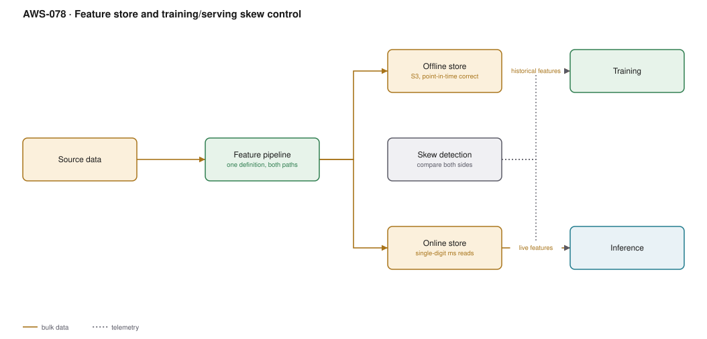

# AWS-078 · Feature store and training/serving skew control

> **Category:** [09 · AI/ML & Generative AI](readme.md#09) · **Maturity:** Specialist · **Effort:** L

## The problem

A model performs beautifully in training and badly in production. The usual cause is not
the model — it is that "average order value over the last 30 days" was computed one way in
the training notebook (pandas, over a historical table) and another way in the serving path
(a hand-written SQL query against the live database). The two disagree subtly, and the
model sees inputs it was never trained on.

That is **training/serving skew**, and a feature store exists to make it structurally
impossible by having one definition feed both paths.

**Use it when** you have several models sharing features, or an online model whose features
are computed, not just read.

**Don't use it when** you have one model with features computed in a single batch job.
A feature store is real infrastructure; two models and ten features do not need it.

## The second problem: point-in-time correctness

If you train on "customer lifetime value" as it is *today*, and the label is "did they
churn last March", the model learns from information that did not exist in March. It will
look excellent in validation and fail in production. This is **label leakage**, and
point-in-time-correct joins are the fix — the offline store must return each feature's
value *as of* the event timestamp, not its current value.

Getting this right by hand is difficult. It is the second reason the feature store exists.

## Components

| Service | Role | The setting that actually matters |
|---|---|---|
| Feature pipeline | Computes features **once** | One definition, both consumers — the whole point |
| **Offline store** | Historical values, in S3 | Point-in-time-correct joins via event time and record id |
| **Online store** | Latest value per entity | Single-digit-millisecond reads; backed by DynamoDB-like storage |
| Feature group | Schema plus both stores | Record identifier and event-time feature are mandatory |
| Skew detection | Compares the two paths | Statistical comparison of training vs serving distributions |
| Lineage | Which model used which features | Needed to answer "what changes if we fix this feature" |

## Flow

1. A feature pipeline computes features from source data — streaming for fresh ones, batch
   for the rest.
2. Each record is ingested into the feature group with a record identifier and an event
   timestamp.
3. The **online store** keeps the latest value per entity for low-latency reads.
4. The **offline store** keeps the full history in S3, append-only.
5. Training builds a dataset with a point-in-time join: for each labelled event, the feature
   values as they were at that moment.
6. Inference reads the same features by entity id from the online store, with the same
   definitions.
7. Skew detection compares the distribution of features seen at training time against those
   seen at serving time and alerts on divergence.

## Cost (us-east-1 — order of magnitude)

| Line item | Small · 10 features, 1M entities | Medium · 100 features, 10M | Large · 500 features, 100M |
|---|---|---|---|
| Online store writes @ ~$1.25/M | $12.50 | $1,250.00 | $12,500.00 |
| Online store reads @ ~$0.25/M | $5.00 | $250.00 | $2,500.00 |
| Online store storage | $25.00 | $250.00 | $2,500.00 |
| Offline store (S3, 12 months) | $30.00 | $300.00 | $3,000.00 |
| Feature pipeline compute (Glue/EMR) | $50.00 | $400.00 | $2,000.00 |
| Athena for point-in-time joins | $10.00 | $100.00 | $600.00 |
| **Total** | **~$133** | **~$2,550** | **~$23,100** |

**Cost cliff:** **the online store is priced like a database**, per write and per GB. Writing
500 features for 100 million entities hourly is an enormous write volume — tens of thousands
of dollars a month — and most of those features change daily, not hourly. Match ingestion
frequency to how fast each feature actually changes, per feature group.

**Biggest lever:** only putting features in the **online** store that an online model
actually reads. Many features are training-only and belong in the offline store alone, at a
hundredth of the cost.

## Failure modes

| Failure | Symptom | Mitigation |
|---|---|---|
| Point-in-time join done wrong | Excellent validation scores, poor production performance | Use the feature store's point-in-time join; never `SELECT` current values for historical labels |
| Separate training and serving code | Subtle skew, hard to find | One pipeline, two sinks — refuse to let the paths diverge |
| Everything in the online store | Enormous write bill | Online store only for features served online |
| No skew monitoring | Degradation discovered by the business | Compare feature distributions between paths continuously |
| Stale online features | Model sees yesterday's data | Freshness SLA per feature group, monitored |
| No feature ownership | Nobody knows if a feature can be changed | Lineage plus an owner per feature group |

## Security notes

- Features are derived personal data. A feature store becomes a centralised copy of
  sensitive attributes across many source systems — classify and protect it accordingly.
- Deletion requests must reach both stores. The offline store is append-only in S3, which
  makes per-subject deletion a design problem you should solve before you need it.
- Access control per feature group lets you share non-sensitive features widely while
  restricting the rest.
- Features sometimes encode protected characteristics indirectly; lineage is what lets you
  answer a fairness question later.

## What people miss

- **Point-in-time correctness is the hard part**, not the storage. Most teams that "do not
  need a feature store" are quietly training on leaked future information.
- **The online store is the expensive half.** Split features by whether they are served
  online; the ratio is usually heavily toward offline-only.
- **A feature store is only worth it when features are shared.** For one model, one pipeline
  writing to one table is simpler and correct.
- **Streaming ingestion changes what features are possible** — "transactions in the last
  five minutes" cannot come from a nightly batch, and fraud models need it.
- **Start with the registry, not the infrastructure.** Just agreeing on feature definitions
  and owners, documented, captures much of the value before any store exists.

## See also

- [`aws-076`](aws-076-sagemaker-training.md) — the training this feeds
- [`aws-081`](aws-081-mlops-pipelines.md) — drift monitoring, the sibling discipline
- [`aws-053`](aws-053-ddb-streams-views.md) — streaming features from a change feed
- [`aws-046`](aws-046-data-quality-contracts.md) — quality gates on the feature pipeline
