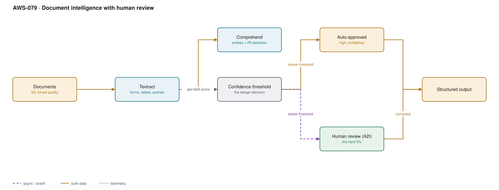

# AWS-079 · Document intelligence with human review

> **Category:** [09 · AI/ML & Generative AI](readme.md#09) · **Maturity:** Production · **Effort:** M

## The problem

Invoices, claims forms, contracts, ID documents — thousands a day, in every quality from
clean PDF to a photograph of a fax. Extraction is 95% accurate, which sounds excellent and
is useless if the remaining 5% silently produces wrong payments. The architecture that
works is not "better extraction"; it is **routing by confidence** so machines handle the
easy majority and humans handle the hard remainder.

**Use it when** documents arrive at volume and errors have a cost.

**Don't** aim for 100% automation. The design goal is a confidence threshold that makes the
automated path trustworthy, not the elimination of human review.

## Components

| Service | Role | The setting that actually matters |
|---|---|---|
| S3 | Document landing | Immutable original, always kept |
| **Textract** | OCR, forms, tables, queries | **Queries** — ask "what is the invoice total" instead of parsing layout |
| Comprehend | Entities, classification, **PII detection** | PII detection and redaction as a first-class step |
| Bedrock (optional) | Reasoning over extracted text | Good at messy semi-structured documents Textract alone struggles with |
| **Confidence threshold** | The core design decision | Per-field, not per-document |
| Augmented AI (A2I) | Human review workflow | Private workforce for sensitive documents |
| Output store | Structured result | With provenance: which fields were human-corrected |

## Flow

1. A document lands in S3 ([`aws-015`](aws-015-s3-upload-pipeline.md)) and an event starts
   the pipeline.
2. Textract extracts text, form key-value pairs and tables. **Queries** ask directly for
   the fields you need rather than reverse-engineering layout.
3. Comprehend identifies entities and detects personal data for redaction or tagging.
4. Each extracted field carries a confidence score.
5. Fields above the threshold are auto-approved. A document where every required field
   clears goes straight through.
6. Any document with a field below threshold is routed to A2I, where a reviewer sees the
   document, the proposed value and the uncertainty, and corrects it.
7. Corrections are recorded — both as output and as data for measuring where extraction is
   weak.

## Cost (us-east-1 — order of magnitude)

| Line item | Small · 10K pages/mo | Medium · 500K/mo | Large · 10M/mo |
|---|---|---|---|
| Textract text detection @ ~$1.50/1K pages | $15.00 | $750.00 | $15,000.00 |
| **Textract forms + tables @ ~$50/1K pages** | $500.00 | $25,000.00 | $500,000.00 |
| Textract queries @ ~$15/1K pages | $150.00 | $7,500.00 | $150,000.00 |
| Comprehend entity detection | $30.00 | $1,500.00 | $30,000.00 |
| A2I human review (5% of docs, $0.08 each) | $40.00 | $2,000.00 | $40,000.00 |
| Step Functions + Lambda + S3 | $10.00 | $200.00 | $3,000.00 |
| **Total (queries, not full forms+tables)** | **~$245** | **~$11,950** | **~$238,000** |

**Cost cliff:** **forms-and-tables analysis is roughly 30× the price of plain text
detection.** Running `AnalyzeDocument` with FORMS and TABLES on every page of every
document — when most pages are prose and only page 2 has the table — is the most common
and most expensive mistake here. Classify first, then apply expensive analysis only to the
pages that need it.

**Biggest lever:** page-level routing. Detect text cheaply on everything, classify the page,
and run forms/tables or queries only where the structured data actually lives. That is
routinely an 80–90% reduction.

## Failure modes

| Failure | Symptom | Mitigation |
|---|---|---|
| Forms+tables on every page | Enormous bill for prose pages | Classify first; apply expensive analysis selectively |
| Document-level confidence | A document "passes" with one critical field wrong | Threshold **per field**, weighted by field importance |
| No human loop | 5% error rate reaches production | A2I for low-confidence documents |
| Threshold never tuned | Too much review, or too many errors | Measure the automated path against a human-labelled sample monthly |
| Original not retained | Cannot re-process when extraction improves | Keep the original immutably; re-run is then free of re-collection |
| Reviewer sees everything | Unnecessary exposure of sensitive documents | Redact non-relevant PII before review; private workforce |

## Security notes

- Documents of this kind — invoices, claims, identity — are among the most sensitive data
  an organisation holds. Encrypt at rest with a dedicated key, restrict the pipeline role
  to specific prefixes.
- Use a **private workforce** in A2I for anything sensitive. A public crowd workforce
  reviewing passports is a data-protection incident.
- Comprehend PII detection can redact before a human sees the document, which narrows
  exposure to what the reviewer actually needs.
- Human corrections are a decision record and may need the same retention as the document.
- Where extraction feeds a payment or an eligibility decision, retain provenance: which
  fields were machine-extracted, which were human-corrected, and by whom.

## What people miss

- **Textract Queries changed this architecture.** Instead of extracting all key-value pairs
  and matching them to your schema, you ask "what is the total due" in natural language and
  get an answer with a confidence score. It is cheaper than full forms analysis and far
  less brittle than layout parsing.
- **Confidence thresholds belong per field.** A 90% confident invoice number is a problem;
  a 90% confident supplier address usually is not.
- **The human review data is training data.** Corrections tell you exactly which fields and
  document types are weak, and justify where to invest.
- **A foundation model is good at the messy residue.** For documents with inconsistent
  layouts, passing Textract's raw text to Claude on Bedrock with a schema often beats
  trying to make forms extraction work ([`aws-075`](aws-075-llm-gateway.md)).
- **Keep the original forever, cheaply.** Extraction improves; being able to re-run on three
  years of archived documents is worth far more than the Glacier storage costs.

## See also

- [`aws-015`](aws-015-s3-upload-pipeline.md) — how documents arrive
- [`aws-080`](aws-080-media-pipeline.md) — the same pattern for audio and video
- [`aws-073`](aws-073-bedrock-rag.md) — making the extracted corpus searchable
- [`aws-082`](aws-082-s3-lifecycle.md) — archiving the originals affordably
