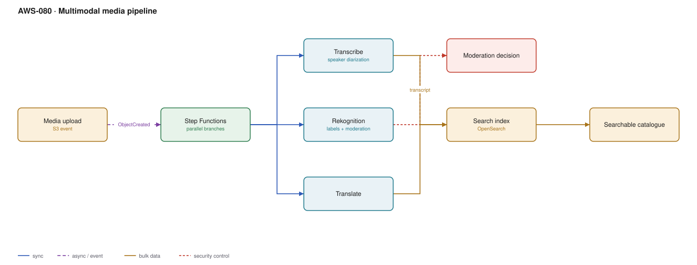

# AWS-080 · Multimodal media pipeline

> **Category:** [09 · AI/ML & Generative AI](readme.md#09) · **Maturity:** Growing · **Effort:** M

## The problem

A library of recorded calls, training videos, podcasts or user-uploaded clips is opaque. You
cannot search it, moderate it, translate it, or extract anything from it. Turning media into
text makes all of that possible, and the pipeline is a fan-out of specialised services
orchestrated into one result.

**Use it when** media is an asset you need to search, moderate, caption or analyse.

**Don't** build the whole pipeline at once. Transcription alone usually delivers most of the
value; add moderation and translation when there is demand.

## Components

| Service | Role | The setting that actually matters |
|---|---|---|
| S3 + event | Ingest | See [`aws-015`](aws-015-s3-upload-pipeline.md) |
| **Step Functions** | Orchestration | Parallel branches; `Map` for per-segment work |
| Transcribe | Speech to text | **Speaker diarization**, custom vocabulary, automatic language identification |
| Rekognition | Labels, faces, text in video, **moderation** | Moderation confidence threshold |
| Translate | Localisation | Custom terminology for product names |
| Comprehend / Bedrock | Summaries, topics, sentiment | A foundation model is better at summarisation than a classifier |
| OpenSearch | The searchable index | Transcript with timestamps, so search jumps to the moment |

## Flow

1. Media lands in S3 and an event starts a Step Functions execution.
2. Parallel branches run: Transcribe for audio, Rekognition for video frames, and
   (for long media) a `Map` over segments.
3. Transcribe produces a timestamped transcript with speaker labels.
4. Rekognition returns labels, detected text and moderation signals per frame.
5. Moderation results gate publication — content above the threshold is held for review.
6. Translate produces localised transcripts; a foundation model summarises and extracts
   topics and action items.
7. Everything is indexed with timestamps so a search result links to the exact second.

## Cost (us-east-1 — order of magnitude)

| Line item | Small · 100 h/mo | Medium · 5,000 h/mo | Large · 50,000 h/mo |
|---|---|---|---|
| Transcribe @ ~$0.024/min | $144.00 | $7,200.00 | $72,000.00 |
| *Transcribe batch vs streaming* | same rate | same rate | same rate |
| Rekognition video @ ~$0.10/min | $600.00 | $30,000.00 | $300,000.00 |
| *Rekognition on sampled frames only (1 fps → 1 per 10 s)* | **$60.00** | **$3,000.00** | **$30,000.00** |
| Translate @ $15/M characters (2 languages) | $20.00 | $1,000.00 | $10,000.00 |
| Summarisation via Bedrock | see note | | |
| S3 + Step Functions + OpenSearch | $200.00 | $600.00 | $3,000.00 |
| **Total (sampled frames, 2 languages)** | **~$424** | **~$11,800** | **~$115,000** |

> Bedrock is partner-operated and priced separately from Anthropic's first-party API — see
> the [Bedrock pricing page](https://aws.amazon.com/bedrock/pricing/). Summarising a
> one-hour transcript is a few thousand input tokens, so this line is small relative to
> Transcribe and Rekognition unless volume is very high.

**Cost cliff:** **Rekognition video analysis at full frame rate.** Analysing every frame of
50,000 hours is a six-figure monthly line. Most use cases — moderation, label extraction,
scene detection — are satisfied by sampling one frame every 5–10 seconds, which is an order
of magnitude cheaper and usually indistinguishable in result quality.

**Biggest lever:** frame sampling, then selective processing. Not every video needs
translation, and not every video needs moderation — route by content type and destination.

## Failure modes

| Failure | Symptom | Mitigation |
|---|---|---|
| Full-frame-rate video analysis | Costs multiples of the value delivered | Sample frames; justify full rate with a specific requirement |
| No custom vocabulary | Product names and jargon consistently wrong | Custom vocabulary and custom language models in Transcribe |
| Long media in one job | Timeouts, no partial results | Segment and process with a `Map` state |
| Moderation with no human path | False positives block legitimate content | Threshold plus review queue, as in [`aws-079`](aws-079-document-intelligence.md) |
| No timestamps in the index | Search returns a 2-hour video with no position | Index per-utterance with start times |
| Re-processing on every change | Repeated cost for unchanged media | Cache results keyed on a content hash |

## Security notes

- Recorded calls and user uploads frequently contain personal data. Transcripts make it
  *searchable*, which materially changes the risk profile — a transcript is far easier to
  exfiltrate meaningfully than an audio file.
- Run PII detection over transcripts and redact before indexing where appropriate; both
  Transcribe and Comprehend support this.
- Consent and retention matter: recording and transcribing may carry obligations that
  differ by jurisdiction. Store the consent state alongside the media.
- Moderation results are sensitive judgements about content and sometimes people. Restrict
  access and log who viewed held content.
- Face detection and comparison have specific legal constraints in several jurisdictions —
  check before enabling face features, not after.

## What people miss

- **Transcribe does speaker diarization**, which turns an undifferentiated wall of text
  into an attributed conversation. It is a single parameter and transforms usefulness.
- **Custom vocabulary is the quality lever.** Domain terms, product names and acronyms are
  exactly what people search for and exactly what generic models get wrong.
- **Call Analytics** (a Transcribe mode) adds sentiment, talk-time, interruptions and
  categories designed for contact centres — far more than a plain transcript, for little
  extra work.
- **Sampling frames is almost always enough.** Ask what temporal resolution the decision
  actually needs; it is rarely 30 fps.
- **The transcript is the product.** Once media is text, every text tool applies —
  search ([`aws-073`](aws-073-bedrock-rag.md)), classification, summarisation, analytics.
  Teams often stop at transcription and discover that was 80% of the value.

## See also

- [`aws-079`](aws-079-document-intelligence.md) — the document equivalent
- [`aws-015`](aws-015-s3-upload-pipeline.md) — how the media arrives
- [`aws-011`](aws-011-step-functions-saga.md) — the orchestration mechanics
- [`aws-073`](aws-073-bedrock-rag.md) — making the transcripts answerable
