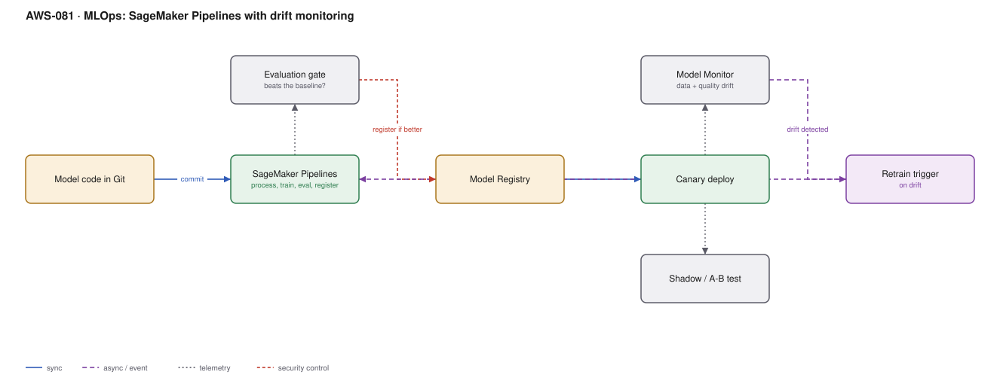

# AWS-081 · MLOps: SageMaker Pipelines with drift monitoring

> **Category:** [09 · AI/ML & Generative AI](readme.md#09) · **Maturity:** Growing · **Effort:** L

## The problem

Models degrade silently. Nothing errors, no alarm fires, latency is fine — the predictions
just get gradually worse as the world moves away from the training data. Meanwhile the
retraining process is a notebook someone runs occasionally, and nobody can say whether the
new model is better than the old one.

MLOps closes both gaps: automated, reproducible retraining, and monitoring that detects
degradation before the business does.

**Use it when** a model is in production and the data it sees changes over time. Which is
nearly all of them.

**Don't** build the full pipeline for a model that is retrained twice a year. Monitoring
first, automation when retraining frequency justifies it.

## The four kinds of drift

| Drift | What changed | Detected by |
|---|---|---|
| **Data quality** | Schema, nulls, ranges | Baseline statistics vs live |
| **Data (covariate) drift** | Input distribution | Distribution distance vs baseline |
| **Model quality** | Accuracy against ground truth | Requires labels — the hard one |
| **Bias drift** | Fairness across groups | Group-wise metric comparison |

Data drift is detectable immediately; model quality drift needs labels that arrive days or
weeks later. Most teams monitor only the first and are surprised by the third.

## Components

| Service | Role | The setting that actually matters |
|---|---|---|
| SageMaker Pipelines | The DAG: process → train → evaluate → register | A **conditional step** that only registers if the model improves |
| Evaluation step | Champion/challenger comparison | Compare on the same held-out set, with the same metric |
| Model Registry | Versioned, approvable artifacts | [`aws-076`](aws-076-sagemaker-training.md) |
| Deployment | Canary or shadow | Never a straight replace |
| **Model Monitor** | Drift detection | Requires **data capture** on the endpoint and a **baseline** |
| Ground-truth ingestion | Labels for model quality | The step teams skip, and the reason they cannot measure accuracy |
| Retrain trigger | Drift → pipeline | Automated trigger, human approval of the result |

## Flow

1. A commit, a schedule, or a drift alarm starts the pipeline.
2. Processing prepares the dataset; training produces a candidate model.
3. The evaluation step scores the candidate on a fixed held-out set and compares it with
   the current production champion.
4. A conditional step registers the model **only if it wins**. A worse model stops here.
5. Deployment shifts a small share of traffic to the challenger — canary, or shadow mode
   where it scores live traffic without affecting responses.
6. The endpoint captures inputs and predictions; Model Monitor compares them with the
   training baseline on a schedule.
7. Ground-truth labels, when they arrive, are joined back to predictions to measure real
   accuracy.
8. Significant drift triggers the pipeline again.

## Cost (us-east-1 — order of magnitude)

| Line item | Small · monthly retrain | Medium · weekly | Large · daily |
|---|---|---|---|
| Pipeline execution (processing + training, Spot) | $20.00 | $200.00 | $1,200.00 |
| Evaluation jobs | $5.00 | $40.00 | $250.00 |
| Model Monitor jobs (hourly baseline comparison) | $50.00 | $150.00 | $400.00 |
| Data capture storage in S3 | $10.00 | $60.00 | $400.00 |
| Endpoints (champion + challenger during canary) | $168.00 | $336.00 | $1,460.00 |
| Ground-truth join and labelling | varies | varies | varies |
| **Total** | **~$253** | **~$786** | **~$3,710** |

**Cost cliff:** **Model Monitor runs a processing job on every schedule**, and hourly
monitoring across twenty endpoints is twenty jobs an hour, every hour, forever. Monitoring
cost can exceed inference cost on low-traffic endpoints. Match the monitoring frequency to
how fast the data actually drifts — daily is enough for most models.

**Biggest lever:** monitoring schedule, and running retraining on Spot. The second lever is
not retraining when nothing has changed — drift-triggered retraining beats a fixed schedule
on both cost and model quality.

## Failure modes

| Failure | Symptom | Mitigation |
|---|---|---|
| Auto-deploy without comparison | A worse model replaces a better one | Conditional registration on an evaluation metric — the single most important step |
| No ground truth | Data drift monitored, accuracy unknown | Build the label feedback loop, even if labels lag by weeks |
| No baseline | Model Monitor reports nothing | A baseline job must run against the training data before monitoring works |
| Drift alarm with no action | Alerts accumulate, nothing retrains | Wire drift to a pipeline trigger, with human approval of the output |
| Retraining on drifted data | The model learns the broken state | Quality gates on the training data too ([`aws-046`](aws-046-data-quality-contracts.md)) |
| Both endpoints left running | Paying twice indefinitely after a canary | Automate the teardown of the losing variant |

## Security notes

- Data capture writes live inference requests to S3 — real customer inputs. Sample it,
  encrypt it, restrict access, and set retention.
- The pipeline role can train and register models; registration approval should be a
  separate principal from the one that can deploy.
- Model artifacts can leak training data under some attacks; classify them as you classify
  the training set.
- Bias drift monitoring is a compliance control in regulated domains, not just a quality
  one. Keep the evidence.
- An automated retraining loop is an automated path to production — treat it with the same
  controls as any deployment pipeline ([`aws-064`](aws-064-shift-left-security.md)).

## What people miss

- **The conditional registration step is the whole safety mechanism.** Without "only
  register if it beats the champion", automated retraining is an automated way to ship
  regressions.
- **Shadow deployment is underused.** Running the challenger against live traffic without
  serving its predictions gives you a true comparison at a fraction of the risk of a canary.
- **Ground truth is the hard part, and it is an organisational problem.** Deciding how
  labels get back to you — a human review, a downstream outcome, a customer action — is a
  product design question, not an infrastructure one.
- **Drift-triggered retraining beats scheduled retraining.** Retraining weekly when nothing
  changed wastes money and adds risk; retraining when the data moved is both cheaper and
  more effective.
- **Monitor the features, not just the prediction.** A shifted input distribution is
  visible immediately; a shifted accuracy needs labels you may not have for a month.

## See also

- [`aws-076`](aws-076-sagemaker-training.md) — the training half
- [`aws-078`](aws-078-feature-store.md) — skew, the sibling failure mode
- [`aws-025`](aws-025-progressive-delivery.md) — the canary mechanics
- [`aws-046`](aws-046-data-quality-contracts.md) — quality gates on training data
