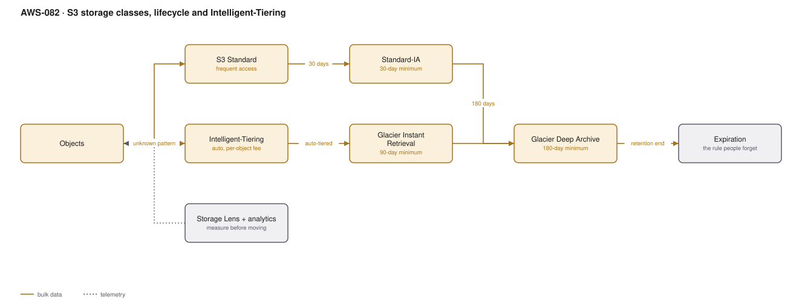

# AWS-082 · S3 storage classes, lifecycle and Intelligent-Tiering

> **Category:** [10 · Storage, Backup & Resilience](readme.md#10) · **Maturity:** Production · **Effort:** S

## The problem

S3 Standard is $0.023/GB-month. Deep Archive is $0.00099/GB-month — **23× cheaper**. Most
organisations store everything in Standard forever because nobody ever set a lifecycle
rule, and the data nobody has read in three years costs the same as the data read hourly.

**Use it when** you have more than a few terabytes, or any data with a natural cooling
curve: logs, backups, raw ingest, media archives.

**Don't** move data to a colder class without checking the access pattern. Retrieval fees
and minimum durations can make the "cheaper" class more expensive.

## The classes that matter

| Class | $/GB-mo | Min duration | Retrieval | Use for |
|---|---|---|---|---|
| Standard | $0.023 | none | free | Active data |
| **Intelligent-Tiering** | $0.023 → $0.0036 | none | **free** | **Unknown or changing patterns** |
| Standard-IA | $0.0125 | 30 days | $0.01/GB | Known-infrequent, needs millisecond access |
| One Zone-IA | $0.01 | 30 days | $0.01/GB | Reproducible data only — single AZ |
| Glacier Instant Retrieval | $0.004 | 90 days | $0.03/GB | Archive, still needs instant access |
| Glacier Flexible | $0.0036 | 90 days | $0.01/GB, minutes–hours | Real archive |
| **Deep Archive** | **$0.00099** | 180 days | $0.02/GB, 12 hours | Compliance retention |

## Components

| Service | Role | The setting that actually matters |
|---|---|---|
| Lifecycle rules | Automatic transitions and expiry | **Expiration** — the rule people set transitions for and then forget |
| Intelligent-Tiering | Automatic tiering on access | A small per-object monitoring fee; no retrieval charges |
| Storage Lens | Estate-wide visibility | Free dashboard; the advanced tier adds recommendations |
| Storage Class Analysis | Access patterns per prefix | Measure before you move |
| Incomplete multipart cleanup | Invisible waste | Billed storage you cannot see in a listing |
| Versioning + noncurrent rules | Old versions accumulate | Expire noncurrent versions, or versioning doubles your bill |

## Flow

1. Storage Lens and Storage Class Analysis show what is actually accessed, by prefix.
2. Objects with an unknown or variable access pattern go to **Intelligent-Tiering**, which
   moves them automatically and charges nothing to retrieve.
3. Objects with a known cooling curve get explicit lifecycle transitions — Standard to
   Standard-IA at 30 days, Glacier at 90, Deep Archive at 180.
4. A lifecycle rule aborts incomplete multipart uploads after 7 days.
5. Where versioning is on, a noncurrent-version expiration rule removes old versions after
   an agreed window.
6. An **expiration** rule deletes objects at the end of their retention period.

## Cost (us-east-1 — order of magnitude, 500 TB)

| Scenario | Monthly |
|---|---|
| All in S3 Standard | $11,500 |
| 20% Standard, 30% Standard-IA, 50% Glacier IR | $5,275 |
| 10% Standard, 20% Glacier IR, 70% Deep Archive | $2,041 |
| All Intelligent-Tiering (mostly cold after 90 days) | ~$3,300 |
| Intelligent-Tiering monitoring (50M objects @ $0.0025/1K) | +$125 |

**Cost cliff:** **minimum storage durations.** An object deleted from Standard-IA after 10
days is billed for the full 30. One moved to Deep Archive and retrieved a week later is
billed for 180 days plus a retrieval fee. A lifecycle rule that transitions short-lived
objects to a colder class can **increase** your bill — this is the most common
lifecycle mistake.

**Biggest lever:** expiration. Deleting data you are not required to keep beats optimising
where it is stored. After that, Intelligent-Tiering for anything whose pattern you do not
know, because it has no retrieval fees and no minimum duration.

## Failure modes

| Failure | Symptom | Mitigation |
|---|---|---|
| Transitions without expiration | Bill grows forever, just more slowly | Every lifecycle rule should end in an expiration or a documented reason |
| Transitioning small objects | Transition request fees exceed the saving | Objects under 128 KB are not worth transitioning; Intelligent-Tiering ignores them |
| Incomplete multipart uploads | Phantom storage, invisible in listings | Lifecycle rule to abort after 7 days — near-universal advice, rarely applied |
| Versioning with no noncurrent rule | Storage doubles or worse | Expire noncurrent versions after 30–90 days |
| Deep Archive for anything restorable in a hurry | 12-hour restore during an incident | Glacier Instant Retrieval if you might need it quickly |
| One Zone-IA for irreplaceable data | Data loss on AZ failure | One Zone-IA is only for reproducible data |

## Security notes

- Lifecycle expiration and legal hold interact badly: an Object Lock retention period
  overrides expiration, and that is intentional ([`aws-083`](aws-083-s3-replication-worm.md)).
- Deleting data on schedule is a privacy control as much as a cost one — a documented,
  enforced retention period is what a regulator asks to see.
- Storage Lens exposes estate-wide bucket names and sizes; restrict who can view it.
- Transitions are performed by S3 itself and do not need a role, which means they cannot be
  blocked by an IAM mistake — but they also cannot be audited as user actions.

## What people miss

- **Intelligent-Tiering has no retrieval fees and no minimum duration.** For unpredictable
  access patterns it is almost always the right default, and it removes the risk of
  mis-tiering entirely. The only cost is a small per-object monitoring fee, which makes it
  unsuitable for very large numbers of very small objects.
- **Incomplete multipart uploads are billed and invisible.** Many estates have terabytes of
  them. One lifecycle rule removes it.
- **Expiration is where the money is.** Teams spend weeks tuning transitions for data that
  should have been deleted.
- **Glacier Instant Retrieval is the quiet winner** for archives that must stay instantly
  readable — a sixth of Standard with no retrieval delay.
- **S3 Storage Lens is free** at the basic tier and most organisations have never opened it.
  It answers "where is our storage actually going" in one screen.

## See also

- [`aws-083`](aws-083-s3-replication-worm.md) — when retention is a legal requirement
- [`aws-084`](aws-084-aws-backup-org.md) — backups have their own lifecycle
- [`aws-037`](aws-037-s3-data-lake.md) — tiering the bronze layer
- [`aws-092`](aws-092-finops-cur-pipeline.md) — attributing storage cost to teams
