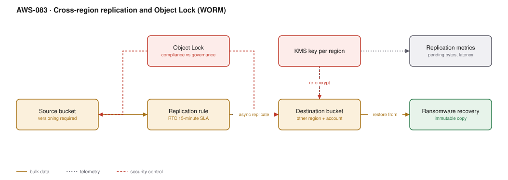

# AWS-083 · Cross-region replication and Object Lock (WORM)

> **Category:** [10 · Storage, Backup & Resilience](readme.md#10) · **Maturity:** Production · **Effort:** M

## The problem

Two different requirements that use the same machinery. **Replication** answers "what if we
lose a region". **Object Lock** answers "what if someone — an attacker, or an insider —
deletes it", and increasingly "prove to a regulator that this record cannot be altered".

Together they are the only credible answer to ransomware: a copy, in another account and
region, that **nobody can delete**, including you.

**Use Object Lock when** data is regulatory evidence, a backup of last resort, or an audit
trail. **Use replication when** you need regional resilience or lower read latency
elsewhere.

**Don't** enable compliance-mode Object Lock without testing. It cannot be undone, by
anyone, for the retention period — including AWS support.

## Governance vs compliance mode

| | Governance mode | Compliance mode |
|---|---|---|
| Who can shorten retention | A principal with `s3:BypassGovernanceRetention` | **Nobody.** Not root, not AWS |
| Use for | Internal policy, accidental deletion | Regulatory retention, ransomware resilience |
| Risk | An over-privileged principal can bypass | **You pay storage for the full period, no exceptions** |

Start in governance mode. Move to compliance mode when you have proven the retention period
is right, because getting it wrong is expensive and irreversible.

## Components

| Service | Role | The setting that actually matters |
|---|---|---|
| Versioning | Prerequisite for both features | Must be on before Object Lock can be enabled |
| Object Lock | Immutability | Mode, plus default retention period on the bucket |
| Legal hold | Indefinite, independent of retention | Survives retention expiry; removed explicitly |
| Replication rule | Copies objects to another bucket | **Different account and region** — the security property |
| Replication Time Control (RTC) | 15-minute SLA on replication | Costs extra; without it replication is best-effort |
| KMS | Encryption on both sides | The destination needs its own key and a policy allowing replication |
| Replication metrics | Observability | `OperationsPendingReplication` and replication latency |

## Flow

1. Versioning is enabled on the source bucket; Object Lock is enabled at bucket creation
   (it cannot be added to an existing bucket without support involvement).
2. A default retention period applies to new objects, with per-object overrides where
   needed.
3. A replication rule copies objects to a bucket in a **different account and region**,
   owned by a different set of administrators.
4. The destination bucket has its own Object Lock configuration — replication does not
   carry it automatically.
5. RTC provides a 15-minute replication SLA with metrics and alarms.
6. Objects re-encrypt with the destination region's KMS key during replication.
7. In a ransomware event, the destination copy is immutable and in an account the attacker's
   credentials do not reach.

## Cost (us-east-1 → us-west-2 — order of magnitude, 100 TB)

| Line item | Monthly |
|---|---|
| Source storage (S3 Standard) | $2,300.00 |
| Destination storage (S3 Standard) | $2,300.00 |
| *Destination in Glacier Instant Retrieval instead* | $400.00 |
| Replication data transfer @ $0.02/GB (10 TB/mo change) | $200.00 |
| Replication PUT requests | $50.00 |
| **Replication Time Control @ $0.015/GB** | $150.00 |
| KMS requests on both sides | $60.00 |
| **Total (with RTC, Standard destination)** | **~$5,060** |
| **Total (no RTC, Glacier IR destination)** | **~$3,010** |

**Cost cliff:** **you are doubling your storage bill**, plus transfer. The destination does
not have to be S3 Standard — replicating into Glacier Instant Retrieval or Glacier Flexible
cuts the destination line by 80–90%, and a DR copy is by definition rarely read. Most teams
replicate Standard-to-Standard without considering it.

Second cliff: compliance-mode Object Lock **commits you to paying for that storage for the
entire retention period**. A seven-year retention on a petabyte is a seven-year financial
commitment you cannot exit.

**Biggest lever:** the destination storage class, then whether you need RTC. RTC is about
15% on top of replication cost and is only worth it when the 15-minute SLA is contractual.

## Failure modes

| Failure | Symptom | Mitigation |
|---|---|---|
| Compliance mode with the wrong period | Years of storage you cannot delete | Test in governance mode first; model the cost over the full period |
| Object Lock not on the destination | Replica is deletable; the control is void | Configure Object Lock on **both** buckets |
| Replication to the same account | A compromised root account deletes both | Different account, with separate administrators |
| Existing objects not replicated | Only new objects copied | Batch Replication for the backlog — it is not automatic |
| Delete markers replicated | A deletion propagates to the DR copy | Delete marker replication is **off by default** — keep it off for DR |
| No replication monitoring | Silent replication failure, discovered during recovery | Alarm on pending operations and replication latency |

## Security notes

- The destination account must be administered by different people. A replica an attacker
  with your credentials can reach is not a backup.
- Object Lock plus MFA Delete plus versioning is the layered answer to deletion.
  Object Lock is the strongest of the three.
- Legal hold is separate from retention and has no expiry — the right tool for litigation
  hold, and easy to leave on forever by accident.
- Replication requires a role that can read the source and write the destination; scope it
  to those buckets.
- Encrypted objects need the replication role granted use of both KMS keys, which is the
  most common reason replication silently fails.

## What people miss

- **Replicating into a cheaper storage class** is supported and halves or better the main
  cost of this architecture. A DR copy that is read once a year does not belong in Standard.
- **Delete markers are not replicated by default**, which is exactly what you want for
  ransomware resilience — deletions on the source do not propagate.
- **Object Lock must be enabled at bucket creation.** Retrofitting it means a new bucket and
  a migration, so decide early.
- **Batch Replication handles pre-existing objects**; enabling a rule only affects new ones.
  This surprises people during their first DR test.
- **Compliance mode is a financial commitment**, not just a technical control. Model the
  total storage cost across the full retention before enabling it.

## See also

- [`aws-057`](aws-057-immutable-audit-trail.md) — the audit-log application of this
- [`aws-084`](aws-084-aws-backup-org.md) — the equivalent for databases and volumes
- [`aws-082`](aws-082-s3-lifecycle.md) — the destination storage class decision
- [`aws-059`](aws-059-kms-key-hierarchy.md) — the cross-region key problem
