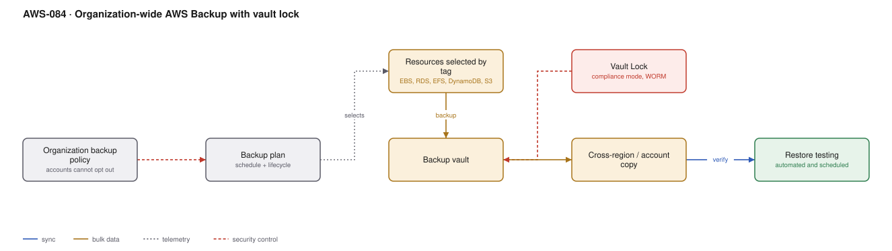

# AWS-084 · Organization-wide AWS Backup with vault lock

> **Category:** [10 · Storage, Backup & Resilience](readme.md#10) · **Maturity:** Production · **Effort:** M

## The problem

Backups configured per team means some teams have none, several have a Lambda that stopped
working months ago, nobody has tested a restore, and the backups sit in the same account as
the thing they protect — so a compromised account loses both. AWS Backup applied as an
**organization policy** makes backup something accounts cannot opt out of.

**Use it when** you have more than a few accounts, or any compliance requirement about
recoverability.

**Don't** assume backup equals recovery. An untested backup is a hypothesis.

## Components

| Service | Role | The setting that actually matters |
|---|---|---|
| Organization backup policy | Enforced from the management account | Member accounts **cannot** modify or remove it |
| Backup plan | Schedule, window, lifecycle | Transition to cold storage, and the expiry |
| Resource selection | What gets backed up | **By tag** — so new resources are included automatically |
| Backup vault | Where recovery points live | A vault in a **separate account** for the copies |
| **Vault Lock** | WORM for backups | Compliance mode: nobody can delete early, including root |
| Cross-region/account copy | Resilience to account compromise | The copy is what survives a bad day |
| **Restore testing** | Automated, scheduled validation | AWS Backup can do this natively |

## Flow

1. A backup policy is defined in the management account and applied to an OU. Every account
   in that OU inherits it and cannot remove it.
2. The plan selects resources by tag — `backup=daily` — so anything correctly tagged is
   covered from creation.
3. Backups run in the window, producing recovery points in the local vault.
4. Recovery points are copied to a vault in a **separate backup account**, in a different
   region.
5. Vault Lock in compliance mode makes those copies immutable for the retention period.
6. Lifecycle moves recovery points to cold storage after a set period and expires them at
   the end of retention.
7. Restore testing runs on a schedule, actually restoring a sample and verifying it, then
   deleting the test resource.

## Cost (us-east-1 — order of magnitude)

| Line item | Small · 5 TB | Medium · 50 TB | Large · 500 TB |
|---|---|---|---|
| EBS snapshot storage @ $0.05/GB | $250.00 | $2,500.00 | $25,000.00 |
| RDS backup storage @ $0.095/GB (beyond free) | $100.00 | $1,000.00 | $10,000.00 |
| **Cold storage tier @ $0.01/GB** | $50.00 | $500.00 | $5,000.00 |
| Cross-region copy transfer @ $0.02/GB | $100.00 | $1,000.00 | $10,000.00 |
| Destination vault storage | $250.00 | $2,500.00 | $25,000.00 |
| Restore testing (compute + storage, transient) | $20.00 | $100.00 | $500.00 |
| **Total (warm, with cross-region copy)** | **~$720** | **~$7,100** | **~$70,500** |

**Cost cliff:** **retention multiplied by frequency.** Daily backups retained for 7 years is
2,555 recovery points. Even with incremental snapshots, a long retention on a large,
high-churn dataset is a very large number. The usual answer is a tiered schedule — daily
kept 30 days, weekly kept 3 months, monthly kept 7 years — which is a fraction of the cost
of daily-for-seven-years and satisfies the same requirement.

**Biggest lever:** the cold storage tier (roughly 80% cheaper) combined with a tiered
retention schedule. Second: not backing up what can be recreated — rebuild an
auto-scaling node from an AMI rather than backing up its root volume.

## Failure modes

| Failure | Symptom | Mitigation |
|---|---|---|
| Never tested a restore | Discover during the incident that it does not work | Scheduled restore testing; AWS Backup supports it natively |
| Backups in the same account | Account compromise loses backups too | Copy to a dedicated backup account with separate administrators |
| Tag-based selection, untagged resources | Silent gaps in coverage | A Config rule that flags untagged resources; tag policies to enforce |
| Vault Lock period wrong | Cannot delete, paying for years | Governance mode first; there is a cooling-off window before compliance mode becomes permanent |
| Restore time not measured | RTO is a guess | Measure restore duration during testing; a 20 TB restore is not quick |
| Cross-region copy not enabled | Regional event takes out the backups | Copy to a second region as part of the plan |

## Security notes

- The backup account is a tier-0 account. It should have no human interactive access
  outside break-glass, and its own SCP preventing vault deletion.
- Vault Lock in compliance mode is the control that defeats ransomware that targets
  backups — an increasingly common pattern. Governance mode is bypassable by design.
- Backups contain production data at its most concentrated. Encrypt with a key the backup
  account controls, not the source account.
- Restore permissions are as sensitive as read permissions on the original data — a
  restore is a data copy.
- Record restore tests as evidence; auditors ask for proof of testing, not proof of backup.

## What people miss

- **Organization backup policies cannot be removed by member accounts**, which is the
  property that makes coverage reliable. A per-account backup plan can be deleted by anyone
  with the permission.
- **Restore testing is a native feature now.** It restores, validates and cleans up
  automatically on a schedule, which turns "we should test restores" into a configured
  control.
- **Tiered retention satisfies most requirements at a fraction of the cost** of flat daily
  retention, and almost nobody models it.
- **AWS Backup covers more than EBS** — RDS, Aurora, DynamoDB, EFS, FSx, S3, DocumentDB,
  Neptune, Redshift, and VMware. A single plan replaces several bespoke mechanisms.
- **Backup is not DR.** Restoring 50 TB takes hours; if your RTO is minutes, you need
  replication ([`aws-085`](aws-085-aurora-global.md)), not backups.

## See also

- [`aws-087`](aws-087-dr-pilot-light.md) — when restore time is too slow
- [`aws-083`](aws-083-s3-replication-worm.md) — the S3-specific equivalent
- [`aws-091`](aws-091-scp-guardrails.md) — protecting the backup account
- [`aws-070`](aws-070-chaos-fis.md) — rehearsing recovery, not just backup
