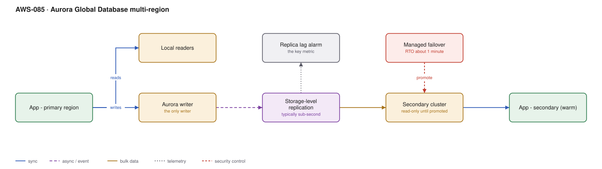

# AWS-085 · Aurora Global Database multi-region

> **Category:** [10 · Storage, Backup & Resilience](readme.md#10) · **Maturity:** Production · **Effort:** L

## The problem

A Multi-AZ Aurora cluster survives an AZ failure. It does not survive a regional event, and
it does not help a user in Sydney reading from Virginia. Aurora Global Database replicates
at the **storage layer** to up to five secondary regions, typically with sub-second lag and
negligible impact on the primary's write performance.

**Use it when** you need a cross-region RPO measured in seconds, or low-latency reads in
distant regions.

**Don't use it when** backups and a slower recovery are acceptable. It roughly doubles your
database cost. And note it is **active-passive for writes** — if you need multi-region
writes, that is [`aws-086`](aws-086-ddb-global-tables.md) or a different design.

## Components

| Service | Role | The setting that actually matters |
|---|---|---|
| Primary cluster | The only writer | Everything writes here, from everywhere |
| Storage-level replication | Physical replication, not logical | Typically under one second; does not consume database CPU |
| Secondary cluster | Read-only until promoted | Can have its own read replicas |
| Headless secondary | Storage only, no instances | A much cheaper DR posture |
| **Managed planned failover** | Switchover with no data loss | For planned events; RTO around a minute |
| Unplanned failover | Promote a secondary after a regional failure | May lose the last fraction of a second of writes |
| `AuroraGlobalDBReplicationLag` | The metric that matters | Alarm on it; it is your real RPO |

## Flow

1. The application writes to the primary cluster in the primary region.
2. Aurora replicates at the storage layer to each secondary region — below the database
   engine, so it does not consume the writer's CPU.
3. Secondary clusters serve local reads with typically sub-second staleness.
4. Applications in secondary regions read locally and send writes back to the primary.
5. For a planned switchover, managed failover reverses the roles with no data loss.
6. For an unplanned regional failure, a secondary is promoted — typically about a minute,
   with a small possible data loss equal to the replication lag at the moment of failure.
7. Route 53 or ARC shifts traffic to the new primary
   ([`aws-087`](aws-087-dr-pilot-light.md)).

## Cost (us-east-1 + eu-west-1 — order of magnitude)

| Line item | Small · r6g.large | Medium · r6g.2xlarge | Large · r6g.8xlarge |
|---|---|---|---|
| Primary writer | $204.40 | $817.60 | $3,270.40 |
| Primary reader | $204.40 | $817.60 | $3,270.40 |
| Secondary region cluster (1 instance) | $204.40 | $817.60 | $3,270.40 |
| *Headless secondary (storage only)* | **$0** | **$0** | **$0** |
| Storage (both regions, 1 TB) | $200.00 | $200.00 | $200.00 |
| **Cross-region replicated write I/O @ $0.20/M** | $50.00 | $500.00 | $4,000.00 |
| **Total (with secondary instance)** | **~$863** | **~$3,153** | **~$14,011** |
| **Total (headless secondary)** | **~$659** | **~$2,335** | **~$10,741** |

**Cost cliff:** **replicated write I/O**, billed per million operations crossing regions. A
write-heavy workload can make this line larger than the instances. Aurora I/O-Optimized
removes per-I/O charges for a higher instance price and is frequently cheaper above roughly
25% I/O spend — check which configuration you are on.

**Biggest lever:** a **headless secondary**. The secondary region keeps the replicated
storage with no database instances running at all — you pay storage and replication but no
compute, and instances are created at promotion time. It costs more RTO (minutes to
provision) and saves the entire secondary compute line.

## Failure modes

| Failure | Symptom | Mitigation |
|---|---|---|
| Writes sent to a secondary | Errors; the secondary is read-only | Application must route writes to the primary endpoint, always |
| Replication lag unmonitored | Real RPO unknown until it matters | Alarm on `AuroraGlobalDBReplicationLag` |
| Failover never rehearsed | Promotion fails or takes far longer than expected | Managed planned failover, quarterly, as a rehearsal |
| App not ready in the secondary | Database is up; nothing can use it | Pilot light the application tier too ([`aws-087`](aws-087-dr-pilot-light.md)) |
| Cross-region write latency | Secondary-region users see slow writes | Writes cross the ocean; design for read-local, write-remote |
| Secondary promoted, primary returns | Split brain | ARC routing controls; fence the old primary before recovery |

## Security notes

- Each region needs its own KMS key; the global cluster handles re-encryption, but the key
  policies must permit it.
- A secondary region is a full copy of production data. It inherits the same
  classification, and it may sit in a different legal jurisdiction — check before choosing
  the region.
- IAM database authentication and security groups must be configured in both regions;
  provisioning only the primary is a common gap found during the first failover test.
- Audit logging should be enabled in all regions — an attacker will prefer the one nobody
  watches.

## What people miss

- **Headless secondaries are the cost-effective DR posture** and are widely unknown. You
  keep the replicated storage and sub-second RPO, pay nothing for secondary compute, and
  accept a few extra minutes of RTO while instances start.
- **Replication is at the storage layer**, which is why it barely affects the primary's
  performance — unlike logical replication, which consumes CPU on the writer.
- **Write forwarding** lets secondary-region applications issue writes that are
  transparently forwarded to the primary. It simplifies application code considerably at
  the cost of cross-region write latency.
- **Managed planned failover is the rehearsal mechanism.** It performs a clean role
  reversal with no data loss, so you can test the path quarterly without inventing a
  disaster.
- **RTO is not just the database.** Promotion takes about a minute; getting application
  capacity, DNS and caches ready in the secondary is usually what actually determines your
  recovery time.

## See also

- [`aws-087`](aws-087-dr-pilot-light.md) — the surrounding DR strategy
- [`aws-086`](aws-086-ddb-global-tables.md) — when you need multi-region writes
- [`aws-018`](aws-018-lambda-rds-proxy.md) — connection handling across failover
- [`aws-033`](aws-033-route53-strategies.md) — shifting traffic to the new primary
