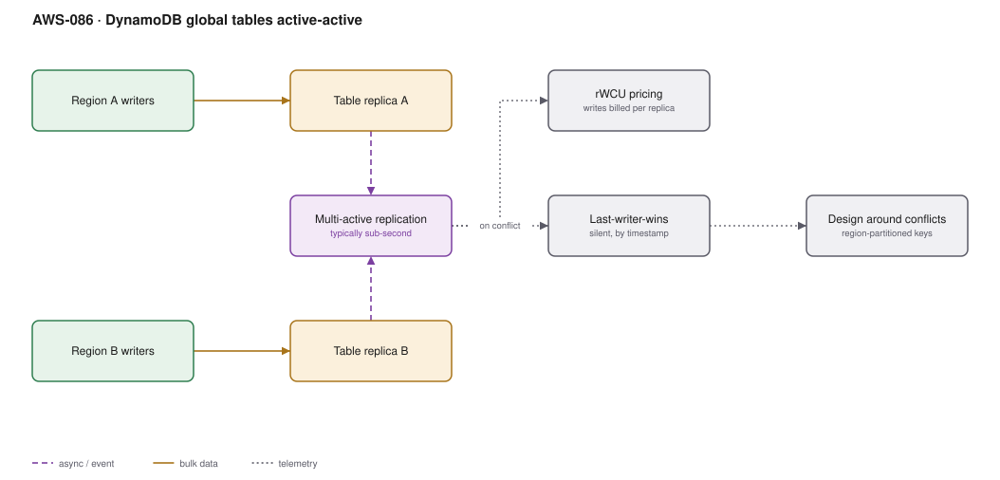

# AWS-086 · DynamoDB global tables active-active

> **Category:** [10 · Storage, Backup & Resilience](readme.md#10) · **Maturity:** Production · **Effort:** M

## The problem

Aurora Global Database gives you one writer and several readers. Some workloads genuinely
need **writes in multiple regions at once** — a globally distributed user base where
everyone expects local write latency, or an availability requirement that cannot tolerate
a failover window. DynamoDB global tables replicate multi-actively: every replica accepts
writes, and changes propagate to the others typically within a second.

**Use it when** you need local write latency in several regions, or near-zero RTO.

**Don't use it when** your data has contention across regions. Multi-active replication
resolves conflicts with **last-writer-wins**, silently. If two regions can legitimately
update the same item, you will lose data and not be told.

## The conflict problem, stated plainly

Two users update the same item in two regions within the replication window. Both writes
succeed. One is silently discarded. There is no error, no conflict event, no reconciliation
hook — the item simply has one of the two values, decided by timestamp.

This is acceptable when items are naturally partitioned by region (a user's data is written
in their home region) and unacceptable for a shared counter or an inventory level. **Design
for it, or do not use this.**

## Components

| Service | Role | The setting that actually matters |
|---|---|---|
| Table replicas | One per region, all writable | Same table name, same key schema everywhere |
| Replication | Multi-active, via streams internally | Typically sub-second; not transactional across regions |
| **Conflict resolution** | Last-writer-wins by timestamp | Not configurable; design around it |
| **rWCU** | Replicated write capacity units | A write is billed in **every** replica region |
| Global secondary indexes | Replicated too | Must exist identically in all regions |
| Point-in-time recovery | Per replica | Enable in every region |
| Auto scaling | Per replica | Capacity must be provisioned in each region |

## Flow

1. An application writes to its local regional replica and gets a local-latency
   acknowledgement.
2. DynamoDB replicates the change to every other replica, typically within a second.
3. A read in another region sees the change once it arrives — this is **eventual
   consistency across regions**, even though reads within a region can be strongly
   consistent.
4. If two regions wrote the same item concurrently, the one with the later timestamp wins
   and the other is discarded with no notification.
5. If a region fails, applications fail over to another replica with no promotion step —
   every replica is already a writer.
6. The failed region catches up automatically when it returns.

## Cost (us-east-1 + eu-west-1 + ap-southeast-2 — order of magnitude)

| Line item | Small · 10M writes/mo | Medium · 500M/mo | Large · 10B/mo |
|---|---|---|---|
| rWCU, 3 regions @ ~$1.875/M per region | $56.25 | $2,812.50 | $56,250.00 |
| *Same workload, single region @ $1.25/M* | $12.50 | $625.00 | $12,500.00 |
| Reads (eventually consistent, 3 regions) | $7.50 | $375.00 | $7,500.00 |
| Storage, 3 replicas (100 GB each) | $75.00 | $75.00 | $750.00 |
| Cross-region replication data transfer | $20.00 | $1,000.00 | $20,000.00 |
| **Total** | **~$159** | **~$4,263** | **~$84,500** |

**Cost cliff:** **a write is billed in every region, at a premium rate.** Three regions
means roughly 4.5× the write cost of a single region, not 3× — replicated writes are
charged at a higher unit rate than local ones. At 10 billion writes a month that is the
difference between $12,500 and $56,250, plus transfer.

**Biggest lever:** the number of replica regions. Two regions covers the overwhelming
majority of availability requirements; the third and subsequent regions are usually about
latency, and should be justified by measured user distribution rather than a map.

## Failure modes

| Failure | Symptom | Mitigation |
|---|---|---|
| Concurrent cross-region writes | Silent data loss, discovered by a customer | Partition write ownership by region; never share a mutable item across regions |
| Counters in a global table | Increments lost under concurrency | Counters do not survive last-writer-wins — use per-region counters summed on read |
| Clock-based resolution assumptions | "Later" is not always what you expect | Do not rely on ordering between regions for correctness |
| Capacity provisioned in one region only | Throttling in the others | Auto scaling configured per replica |
| GSI mismatch | Replica creation fails or behaves oddly | Identical indexes in every region |
| Transactions assumed global | `TransactWriteItems` is region-local | Cross-region atomicity does not exist here |

## Security notes

- Each replica is a full copy of the data, in a different jurisdiction. Verify that is
  permitted before adding a region — this is the most common compliance mistake with
  global tables.
- IAM policies, encryption keys and PITR must be configured in every region; a replica with
  weaker controls is the weak link.
- `dynamodb:LeadingKeys` conditions for tenant isolation need to be applied in all regions.
- A deletion request must be satisfied in every replica; replication will propagate the
  delete, but verify it.

## What people miss

- **Last-writer-wins is silent and non-negotiable.** There is no conflict log, no merge
  hook, no vector clocks. The design must prevent conflicts rather than resolve them.
- **Write-ownership partitioning is the pattern that makes this work**: each item has a home
  region, and only that region writes it. Other regions read locally and route writes home.
  That gives local reads everywhere with no conflicts.
- **There is no failover step.** Every replica is already a writer, so RTO is just DNS or
  client configuration. That is the real advantage over Aurora Global Database.
- **Replicated writes cost more per unit than local writes**, which surprises people
  modelling the cost as a simple multiple.
- **Strong consistency is region-local only.** A strongly consistent read in one region
  tells you nothing about what another region has written in the last second.

## See also

- [`aws-085`](aws-085-aurora-global.md) — the relational, single-writer alternative
- [`aws-010`](aws-010-serverless-crud.md) — the single-region table design
- [`aws-087`](aws-087-dr-pilot-light.md) — where this fits in a DR strategy
- [`aws-054`](aws-054-realtime-counters.md) — why counters need different treatment
