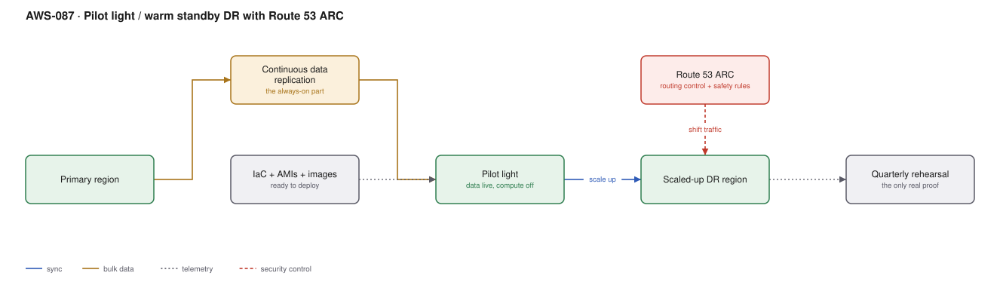

# AWS-087 · Pilot light / warm standby DR with Route 53 ARC

> **Category:** [10 · Storage, Backup & Resilience](readme.md#10) · **Maturity:** Production · **Effort:** L

## The problem

"What is our disaster recovery plan?" usually has one of two answers: a document nobody has
tested, or an active-active architecture that costs twice as much as necessary. The useful
version starts from two numbers the business owns — **RTO** (how long can we be down) and
**RPO** (how much data can we lose) — and picks the cheapest strategy that meets them.

**Use this page when** you need to choose a DR strategy, or justify the one you have.

**Don't** pick a strategy before someone with budget authority has stated the RTO and RPO.
Engineering cannot choose these; they are business decisions with a price tag.

## The four strategies

| Strategy | RTO | RPO | Relative cost | What is running |
|---|---|---|---|---|
| **Backup & restore** | Hours–days | Hours | ~5% | Nothing. Backups only |
| **Pilot light** | 10s of minutes | Seconds–minutes | ~15% | Data replicating; compute off |
| **Warm standby** | Minutes | Seconds | ~40% | Everything, scaled down |
| **Active-active** | Near zero | Near zero | **~100%+** | Full capacity, both regions |

Most organisations need pilot light and buy warm standby. Very few genuinely need
active-active, which also doubles the operational burden, not just the bill.

## Components

| Service | Role | The setting that actually matters |
|---|---|---|
| Data replication | Always on, in every strategy | Aurora Global ([`aws-085`](aws-085-aurora-global.md)), DynamoDB global tables, S3 CRR |
| IaC + AMIs + images | The ability to create the compute | Must be **tested in the DR region**, not assumed portable |
| Pilot light resources | The minimum that must pre-exist | VPC, subnets, security groups, load balancers, secrets |
| **Route 53 ARC routing controls** | The traffic switch | Safety rules prevent turning both off, or both on |
| ARC readiness checks | Continuous verification | Confirms capacity and quotas exist in the DR region |
| Scaling automation | Pilot light → full capacity | The step that determines your real RTO |
| **Rehearsal** | The only thing that makes it real | Quarterly, with a stopwatch |

## Flow

1. Data replicates continuously to the DR region — this is always on, whatever the strategy.
2. Networking, security groups, secrets, images and IaC are maintained in the DR region so
   nothing needs creating from scratch.
3. In pilot light, no compute runs. Readiness checks continuously verify that the capacity,
   quotas and configuration needed are actually available.
4. On a declared disaster, automation scales compute up from zero (or from minimal, for
   warm standby).
5. The database secondary is promoted ([`aws-085`](aws-085-aurora-global.md)), or is already
   writable ([`aws-086`](aws-086-ddb-global-tables.md)).
6. An **ARC routing control** shifts traffic. Safety rules make it impossible to end up with
   both regions off, or an inconsistent intermediate state.
7. The whole sequence is rehearsed quarterly and the actual elapsed time recorded.

## Cost (order of magnitude, relative to a $10,000/month primary)

| Line item | Backup & restore | Pilot light | Warm standby | Active-active |
|---|---|---|---|---|
| Data replication | $200 | $800 | $800 | $1,500 |
| DR compute | $0 | $0 | $3,000 | $10,000 |
| DR networking, NAT, LBs | $150 | $400 | $400 | $500 |
| Route 53 ARC (cluster) | — | $260 | $260 | $260 |
| Rehearsal cost (transient) | $50 | $150 | $100 | $0 |
| **Monthly DR cost** | **~$400** | **~$1,610** | **~$4,560** | **~$12,260** |

**Cost cliff:** **Route 53 ARC is around $260/month for a routing control cluster** — five
redundant regional endpoints, which is what makes it reliable during a regional failure.
That is real money for a small estate, and the honest alternative for smaller workloads is
a Route 53 health-check failover ([`aws-033`](aws-033-route53-strategies.md)) at a fraction
of the cost, with weaker guarantees.

**Biggest lever:** choosing pilot light over warm standby when the RTO allows it — typically
a 65% reduction in DR cost. The second lever is scaling automation quality, because that is
what lets you choose pilot light at all.

## Failure modes

| Failure | Symptom | Mitigation |
|---|---|---|
| Never rehearsed | The plan fails on the day | Quarterly rehearsal with a stopwatch; this is the only control that matters |
| Service quotas not raised in DR | Scale-up fails at 20% of required capacity | ARC readiness checks, and request quota increases in advance |
| AMIs or images not in the DR region | Nothing can start | Replicate images as part of the build pipeline |
| Secrets not replicated | Applications start and cannot authenticate | Multi-region secrets, replicated automatically |
| DNS TTL too long | Traffic keeps going to a dead region | 60-second TTLs on failover records |
| Capacity not available in DR | Everyone fails over to the same region at once | Capacity reservations for the critical tier |
| DR config drift | DR region silently diverges over months | Same IaC, deployed to both; detect drift continuously |

## Security notes

- The DR region needs the same controls as production — same guardrails, same logging,
  same detection. It is frequently weaker, and attackers notice.
- Failover is a privileged operation. ARC routing controls support safety rules and
  separate IAM, so a single mistaken action cannot black-hole traffic.
- Test failover includes testing that security controls follow: are CloudTrail, GuardDuty
  and Config enabled and alarming in the DR region?
- Document who can declare a disaster. A decision made under pressure with no named
  authority goes badly.

## What people miss

- **ARC readiness checks continuously verify the DR region is actually capable** — quotas,
  capacity, configuration — rather than discovering gaps during the event. This is the most
  valuable and least-known part of the service.
- **Safety rules are the real feature.** They make it impossible to turn off both regions,
  or to perform a partial failover that leaves the system inconsistent.
- **Service quotas are per-region and default low.** The most common DR failure is scaling
  up and hitting a quota at a fraction of the needed capacity.
- **Your RTO is dominated by whatever is slowest**, which is rarely the database. DNS
  propagation, cache warming, connection pools and quota increases usually dominate.
- **Rehearsal is the deliverable.** A tested pilot light beats an untested warm standby,
  every time, at a third of the cost.

## See also

- [`aws-085`](aws-085-aurora-global.md) — the database layer
- [`aws-084`](aws-084-aws-backup-org.md) — the backup-and-restore end of the spectrum
- [`aws-070`](aws-070-chaos-fis.md) — proving it works without waiting for a disaster
- [`aws-033`](aws-033-route53-strategies.md) — the cheaper DNS-based failover
