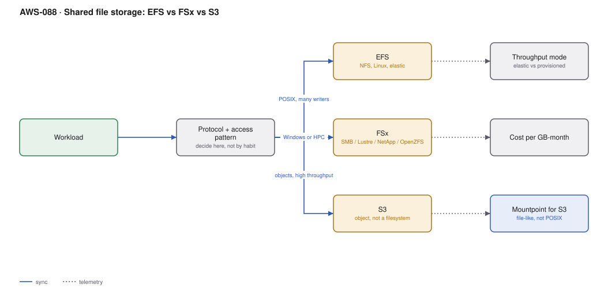

# AWS-088 · Shared file storage: EFS vs FSx vs S3

> **Category:** [10 · Storage, Backup & Resilience](readme.md#10) · **Maturity:** Production · **Effort:** S

## The problem

"We need shared storage" is not a requirement — it is three different requirements that
look alike. Choosing by habit (EFS because it is the default, or S3 because it is cheap)
produces either a surprising bill or a workload that does not work. The decision is driven
by **protocol** and **access pattern**, not by price alone.

**Use this page when** multiple compute instances need to see the same data.

## The decision

| | EFS | FSx for Windows | FSx for Lustre | FSx for NetApp ONTAP | S3 |
|---|---|---|---|---|---|
| Protocol | NFS | **SMB** | Lustre | NFS + SMB + iSCSI | HTTP API |
| Clients | Linux | **Windows** | Linux HPC | Both | Anything |
| Latency | ~ms | ~ms | **sub-ms** | ~ms | ~10s of ms |
| Throughput | Elastic, to GB/s | High | **Hundreds of GB/s** | High | Very high, parallel |
| POSIX semantics | Full | Windows ACLs | Full | Full | **No** |
| $/GB-mo (standard) | $0.30 | $0.13 | $0.145 | $0.19 | **$0.023** |
| Scales to zero | n/a | no | no | no | n/a |

The short version: **Windows → FSx for Windows. HPC → FSx for Lustre. POSIX on Linux →
EFS. Everything else → S3**, which is 13× cheaper than EFS and is what most "shared
storage" requirements actually want.

## Components

| Service | Role | The setting that actually matters |
|---|---|---|
| EFS | Elastic NFS | **Throughput mode** (Elastic vs Provisioned) and storage class |
| EFS Infrequent Access | Lifecycle tiering | $0.016/GB-mo — a 94% reduction, with a per-GB read fee |
| FSx for Windows | Managed SMB with AD integration | Deployment type (single vs multi-AZ), throughput capacity |
| FSx for Lustre | Parallel filesystem for HPC | Can be linked to an S3 bucket and hydrated on demand |
| S3 | Object storage | [`aws-082`](aws-082-s3-lifecycle.md) |
| **Mountpoint for S3** | File-like access to S3 | Not POSIX — no random writes, no renames |

## Flow

1. Identify the **protocol** the application actually requires. Windows applications need
   SMB; most Linux applications can be changed to use an S3 SDK if they are yours.
2. Identify the **access pattern**: sequential bulk reads, random small reads, concurrent
   writes to the same file.
3. If the application can be modified and does not need POSIX semantics, use S3 — it is an
   order of magnitude cheaper and scales without configuration.
4. If POSIX is genuinely required on Linux, use EFS with Elastic throughput and lifecycle
   management to IA.
5. For Windows workloads, FSx for Windows with AD integration.
6. For HPC, FSx for Lustre linked to an S3 bucket, hydrated on demand and released after
   the job.

## Cost (10 TB, us-east-1 — order of magnitude)

| Option | Monthly |
|---|---|
| EFS Standard | $3,072 |
| **EFS with lifecycle to IA (80% cold)** | **$778** |
| FSx for Windows (multi-AZ, SSD) | $2,662 |
| FSx for Lustre (persistent, 125 MB/s/TiB) | $1,485 |
| FSx for NetApp ONTAP | $1,945 |
| **S3 Standard** | **$236** |
| S3 with Intelligent-Tiering | ~$150 |

**Cost cliff:** **EFS Provisioned Throughput.** Provisioning throughput you do not need is
billed whether used or not, and it is easy to set during a performance panic and never
revisit. Elastic throughput — now the default — charges for what you actually use and is
almost always correct. The older Bursting mode had a credit system that silently throttled
when credits ran out, which is why many teams moved to Provisioned in the first place.

**Biggest lever:** EFS lifecycle management to Infrequent Access. Most files in a shared
filesystem are never read again after a few weeks; IA is roughly 94% cheaper, with a small
per-GB read charge when something is accessed.

## Failure modes

| Failure | Symptom | Mitigation |
|---|---|---|
| EFS for a database | Terrible performance, corruption risk | EFS is not block storage; use EBS or a managed database |
| Provisioned throughput left high | Four-figure monthly line for idle capacity | Elastic throughput; review any provisioned setting quarterly |
| Mountpoint for S3 used as POSIX | Renames and partial writes fail | Mountpoint supports sequential writes to new objects only |
| S3 as a filesystem via a FUSE layer | Slow, surprising semantics, failure under load | Change the application to use the S3 API, or use a real filesystem |
| Single-AZ FSx for production | AZ failure takes the filesystem offline | Multi-AZ for anything that matters |
| Lustre data not persisted | Scratch filesystem deleted, results lost | Link to S3 and export results; scratch is scratch |

## Security notes

- EFS access points enforce a POSIX user and a root directory per application — the right
  way to share one filesystem between workloads without them seeing each other's data.
- Encrypt in transit as well as at rest; EFS and FSx both support it and neither enforces it.
- FSx for Windows integrates with AD, which means filesystem permissions follow your
  existing group model — a significant advantage, and a significant dependency.
- A shared filesystem is a lateral-movement path. Security groups should restrict mount
  targets to the specific compute that needs them.

## What people miss

- **S3 is the answer more often than it is chosen.** Most "shared storage" requirements are
  "several machines need to read the same files", which is exactly what S3 does, at a
  thirteenth of the EFS price.
- **EFS Elastic throughput replaced the burst-credit model** that caused most historical
  EFS performance complaints. If your mental model of EFS includes burst credits, it is out
  of date.
- **EFS lifecycle to IA is close to free money** for any filesystem with a long tail of
  rarely-read files, which is nearly all of them.
- **FSx for Lustre links to S3**, hydrating files on demand and writing results back. You
  keep data cheaply in S3 and pay for Lustre only while a job runs.
- **Mountpoint for S3 is not a filesystem.** It gives file-like access for read-heavy and
  append-only workloads, and it will fail anything expecting POSIX.

## See also

- [`aws-082`](aws-082-s3-lifecycle.md) — the S3 option in depth
- [`aws-089`](aws-089-bulk-data-transfer.md) — getting data in
- [`aws-026`](aws-026-aws-batch.md) — the HPC workloads Lustre serves
- [`aws-019`](aws-019-ecs-fargate-alb.md) — EFS volumes mounted into containers
