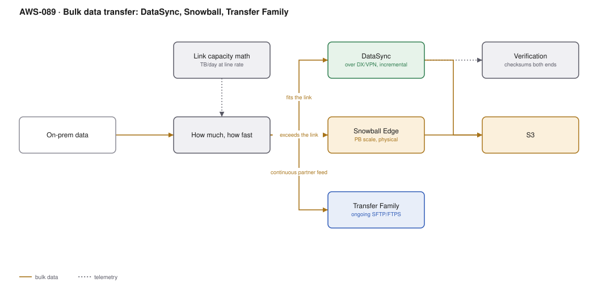

# AWS-089 · Bulk data transfer: DataSync, Snowball, Transfer Family

> **Category:** [10 · Storage, Backup & Resilience](readme.md#10) · **Maturity:** Production · **Effort:** M

## The problem

You have 500 TB on-premises and a 1 Gbps link. Someone says "just copy it to S3". The
arithmetic says that takes **46 days at 100% line utilisation**, which you will not get,
and which would saturate the link your business runs on. Choosing a transfer mechanism is
first a bandwidth calculation and only then a product choice.

**Use this page when** moving more than a few terabytes, or setting up a recurring feed.

## Do the arithmetic first

Usable throughput, assuming ~70% of line rate:

| Link | TB/day | 100 TB takes | 1 PB takes |
|---|---|---|---|
| 100 Mbps | ~0.75 | 133 days | 3.6 years |
| 1 Gbps | ~7.5 | 13 days | 133 days |
| 10 Gbps | ~75 | 1.3 days | 13 days |

**Rule of thumb:** if the online transfer takes longer than about a week, or would consume
bandwidth you need for production, use physical transfer. The sneakernet still wins at
scale — a Snowball device moves data at whatever rate a courier achieves, which for
petabytes is very fast indeed.

## The options

| | DataSync | Snowball Edge | Transfer Family | S3 CLI / SDK |
|---|---|---|---|---|
| Best for | TB-scale over the network | **PB-scale, or poor connectivity** | **Ongoing partner feeds** | Ad hoc, small |
| Mechanism | Managed agent, parallel, incremental | Physical device shipped to you | Managed SFTP/FTPS/FTP endpoint | Your own scripts |
| Incremental sync | **Yes, built in** | No | n/a | With `sync` |
| Verification | **Built in, end-to-end** | Built in | n/a | Manual |
| Cost | $0.0125/GB | ~$300/job + daily | ~$0.30/hr + $0.04/GB | Free (transfer in is free) |
| Scheduling | **Yes** | n/a | Continuous endpoint | Your cron |

## Components

| Service | Role | The setting that actually matters |
|---|---|---|
| DataSync agent | On-prem VM or EC2 | Bandwidth throttle — protects your production link |
| DataSync task | Source, destination, options | **Verification mode** and incremental transfer settings |
| Snowball Edge | Physical device, 80–210 TB usable | Ordering lead time; plan weeks ahead |
| Transfer Family | Managed SFTP endpoint | Identity provider integration; billed per hour the endpoint exists |
| Direct Connect | The link itself | [`aws-032`](aws-032-hybrid-dx-vpn.md) |
| Verification | Checksums both ends | Non-negotiable for a migration |

## Flow

1. Measure the data: total size, file count, average file size, daily change rate.
2. Calculate transfer time at realistic throughput against the available link.
3. **If it fits the window**: deploy a DataSync agent, throttle it to protect production,
   run an initial full transfer, then scheduled incrementals until cutover.
4. **If it does not**: order Snowball Edge devices, copy locally at LAN speed, ship them,
   and use DataSync for the delta accumulated since the copy.
5. Verify with end-to-end checksums — DataSync does this natively.
6. For ongoing partner feeds, stand up a Transfer Family SFTP endpoint writing directly
   into S3.

## Cost (order of magnitude)

| Scenario | Mechanism | Cost |
|---|---|---|
| 10 TB, 1 Gbps link | DataSync | $125 transfer, ~1.5 days |
| 100 TB, 1 Gbps link | DataSync | $1,250 transfer, ~13 days |
| 100 TB, 1 Gbps link | **Snowball Edge (2 devices)** | **~$1,200, ~1 week door to door** |
| 1 PB | DataSync over 10 Gbps | $12,500, ~13 days |
| 1 PB | **Snowball Edge (~8 devices)** | **~$5,000, ~2 weeks** |
| Ongoing 500 GB/mo partner feed | Transfer Family | $219/mo endpoint + $20 transfer |

**Cost cliff:** **Transfer Family is billed per hour the endpoint exists** — about
$219/month per protocol, whether anyone connects or not. For an occasional partner upload
that is expensive; presigned S3 URLs ([`aws-015`](aws-015-s3-upload-pipeline.md)) cost
nothing and serve the same purpose when the partner can use HTTPS.

**Biggest lever:** choosing physical transfer when the arithmetic says so. Data transfer
**into** AWS is free, so online transfer cost is the DataSync per-GB fee and the
opportunity cost of your link — the latter usually dominates.

## Failure modes

| Failure | Symptom | Mitigation |
|---|---|---|
| No bandwidth throttle | DataSync saturates the link, production suffers | Set a bandwidth limit; schedule heavy transfer outside business hours |
| Millions of small files | Transfer takes far longer than the size suggests | File count matters more than size; consider archiving into larger objects first |
| No delta plan | Weeks-old data at cutover | Initial bulk transfer, then incrementals until the switchover |
| Snowball lead time | Device arrives after the deadline | Order weeks ahead; include shipping in the plan |
| No verification | Silent corruption discovered later | End-to-end checksum verification, always |
| Transfer Family left running | Hundreds a month for an unused endpoint | Delete the endpoint when the feed ends; alarm on zero connections |

## Security notes

- Snowball Edge encrypts with a key you hold; AWS never has it, and the device is erased
  to NIST standards after ingestion.
- DataSync traffic should go over Direct Connect or VPN with a VPC endpoint rather than the
  public internet.
- Transfer Family supports custom identity providers, so partner credentials live in your
  system rather than as IAM users.
- Verify what you are copying: a bulk migration is the moment stale, forgotten, sensitive
  data gets copied into a new system and inherits weaker controls.
- Apply the destination bucket's encryption and access policy before the transfer, not
  after.

## What people miss

- **File count matters more than data volume** for online transfer. Ten million small files
  can take longer than a hundred terabytes in large ones, because per-file overhead
  dominates.
- **Transfer into AWS is free**, so the "cost" of online transfer is DataSync's per-GB fee
  plus the business cost of consuming your link.
- **Snowball Edge can run compute**, so you can filter, compress or transform data on the
  device before it ships — useful when only part of the dataset needs to go.
- **DataSync moves data between AWS services too** — S3 to EFS, EFS to FSx, cross-region,
  cross-account — not just from on-premises. It is a general-purpose copier.
- **Presigned URLs replace Transfer Family** for many partner-upload cases at no fixed
  cost, if the partner can use HTTPS rather than SFTP.

## See also

- [`aws-032`](aws-032-hybrid-dx-vpn.md) — the link this depends on
- [`aws-096`](aws-096-migration-7rs.md) — the migration this usually serves
- [`aws-015`](aws-015-s3-upload-pipeline.md) — the presigned-URL alternative
- [`aws-088`](aws-088-shared-file-storage.md) — where the data lands
