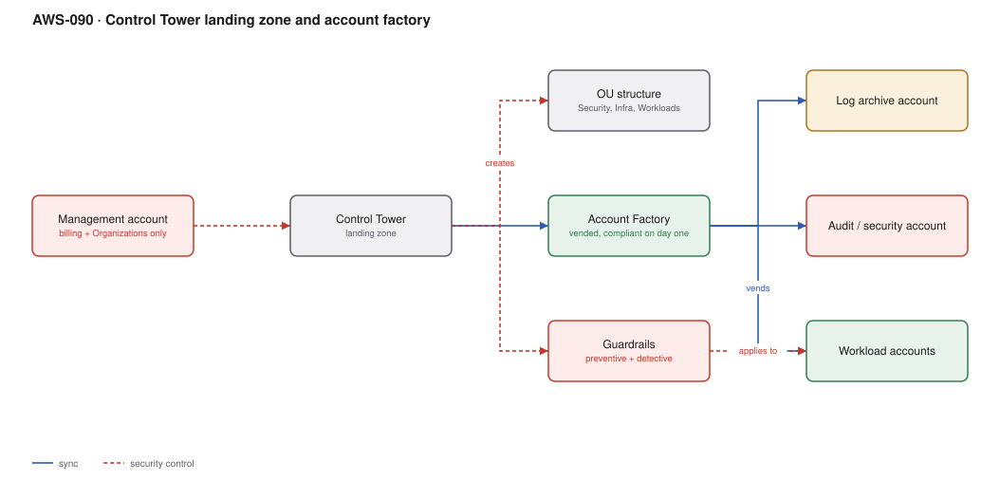

# AWS-090 · Control Tower landing zone and account factory

> **Category:** [11 · Cost, Governance & Multi-Account](readme.md#11) · **Maturity:** Production · **Effort:** L

## The problem

The first account was created by someone who has left. Production and development share it.
The root user has no MFA. There are twelve IAM users with access keys. Every new project
gets a new account configured by hand, differently each time, and nobody can say which
accounts have CloudTrail enabled.

A landing zone makes a new account **compliant on minute one**, by construction.

**Use it when** you will have more than about five accounts, which is almost everyone
eventually. Doing it early is dramatically cheaper than retrofitting.

**Don't** try to retrofit Control Tower onto a chaotic estate in one step. Enroll
incrementally, starting with new accounts.

## The account structure

| Account | Purpose | Who has access |
|---|---|---|
| **Management** | Organizations, billing, Control Tower. **Nothing else** | Almost nobody |
| **Log archive** | Immutable CloudTrail and Config history | Nobody interactively |
| **Audit / Security** | Security tooling, cross-account read | Security team |
| Network | Transit Gateway, egress, DNS | Network team |
| Shared services | CI/CD, artifact registries, directory | Platform team |
| Workload (×N) | One per application per environment | Owning team, via Identity Center |

The critical rule: **nothing runs in the management account.** It holds the keys to the
organisation and should be the most boring account you own.

## Components

| Service | Role | The setting that actually matters |
|---|---|---|
| AWS Organizations | The account container | Consolidated billing, SCP enforcement point |
| Control Tower | Landing zone orchestration | Landing zone **version** — it needs periodic updates |
| OU structure | The policy boundary | Design by **policy need**, not by org chart |
| Account Factory | Vends accounts | Customisations (AFC) to apply your own baseline |
| Guardrails | Preventive (SCP) and detective (Config) | Mandatory, strongly recommended, elective |
| IAM Identity Center | Human access | [`aws-060`](aws-060-identity-center-abac.md) |
| IPAM | Address allocation | [`aws-035`](aws-035-ipam-ipv6.md) — set up before accounts proliferate |

## Flow

1. Control Tower is deployed from the management account, creating the log archive and
   audit accounts and the baseline OU structure.
2. OUs are designed around policy: Security, Infrastructure, Workloads (with Prod and
   Non-Prod beneath), Sandbox, and Suspended.
3. Guardrails are applied per OU — preventive SCPs that make actions impossible, detective
   Config rules that report drift.
4. A new account is requested through Account Factory; it is created with CloudTrail,
   Config, Identity Center access, VPC baseline and tags already in place.
5. Account Factory Customizations apply organisation-specific baselines — IPAM allocation,
   security tooling, standard roles.
6. The account lands in the correct OU and inherits its guardrails immediately.

## Cost (us-east-1 — order of magnitude)

| Line item | Small · 10 accounts | Medium · 60 accounts | Large · 300 accounts |
|---|---|---|---|
| Control Tower service | $0 | $0 | $0 |
| AWS Config (required by guardrails) | $150.00 | $900.00 | $4,500.00 |
| CloudTrail (management events, first copy) | $0 | $0 | $0 |
| S3 for logs and Config history | $20.00 | $120.00 | $700.00 |
| IAM Identity Center | $0 | $0 | $0 |
| Baseline VPC per account (NAT, if created) | $990.00 | $5,940.00 | $29,700.00 |
| **Total** | **~$1,160** | **~$6,960** | **~$34,900** |

**Cost cliff:** **a NAT gateway in every vended account.** Account Factory can create a VPC
per account; if that VPC has NAT gateways, you have just added ~$99/month per account
before anything runs. At 300 accounts that is $29,700/month of baseline networking. Vend
accounts with **no VPC** and attach them to centralised networking instead
([`aws-030`](aws-030-centralized-egress.md)).

**Biggest lever:** the account baseline. Everything Account Factory creates is multiplied
by your account count — that is the point, and it is also the risk.

## Failure modes

| Failure | Symptom | Mitigation |
|---|---|---|
| Workloads in the management account | A compromise there is total, and SCPs do not apply to it | Nothing runs there. Move anything that does, first |
| OUs mirror the org chart | Reorganisation breaks the policy model | Design OUs around policy requirements, not reporting lines |
| Guardrails too strict at launch | Builders blocked, shadow accounts appear | Start with mandatory plus a few strongly recommended; add over time |
| Landing zone never updated | Drift, missing features, unsupported version | Landing zone updates are a scheduled maintenance task |
| Manual account creation continues | Inconsistent accounts outside the model | Account Factory as the only path; deny `CreateAccount` elsewhere |
| NAT per account | Enormous baseline networking cost | Vend without a VPC; use centralised egress |

## Security notes

- The management account cannot be constrained by SCPs — they do not apply to it. That is
  why nothing should run there and why access to it must be tightly held.
- The log archive account is the evidence store; it should have no interactive human
  access at all outside break-glass
  ([`aws-057`](aws-057-immutable-audit-trail.md)).
- Secure the root user of every account: MFA, no access keys, a monitored email alias,
  and an alarm on any root login.
- A **Suspended** OU with a deny-all SCP is the correct destination for a compromised or
  decommissioned account — it preserves evidence while removing capability.
- Control Tower's detective guardrails are Config rules; they cost money per evaluation at
  scale ([`aws-061`](aws-061-config-compliance.md)).

## What people miss

- **Account Factory Customizations (AFC)** apply your own CloudFormation or Terraform
  baseline to every vended account, which is what turns Control Tower from "an account" into
  "an account ready for use".
- **OU design is the hardest and most permanent decision.** Moving accounts between OUs
  changes their effective permissions instantly, which can break things. Design for policy.
- **Control Tower itself is free**; the cost is Config, and the baseline resources you
  choose to vend.
- **A Sandbox OU with a budget action** that disables the account at a spend threshold lets
  people experiment safely ([`aws-094`](aws-094-budgets-anomaly.md)).
- **If you already have an organisation, enroll incrementally.** Control Tower can adopt
  existing accounts and existing OUs; a big-bang migration is unnecessary and risky.

## See also

- [`aws-091`](aws-091-scp-guardrails.md) — the guardrails in detail
- [`aws-060`](aws-060-identity-center-abac.md) — human access into these accounts
- [`aws-057`](aws-057-immutable-audit-trail.md) — the log archive account
- [`aws-035`](aws-035-ipam-ipv6.md) — address planning before accounts multiply
