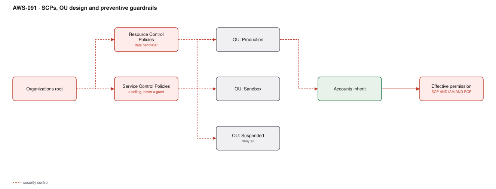

# AWS-091 · SCPs, OU design and preventive guardrails

> **Category:** [11 · Cost, Governance & Multi-Account](readme.md#11) · **Maturity:** Production · **Effort:** M



## The problem

Detective controls tell you someone disabled CloudTrail. Preventive controls mean they
could not. Service Control Policies are the organisation-wide permission ceiling: no
identity in an affected account can exceed them, including the account's own
administrators and, in most respects, its root user.

**Use them when** certain actions must be impossible rather than merely detectable:
disabling logging, deleting backups, creating resources in unapproved regions, leaving the
organisation.

**Don't** use them for fine-grained application permissions. SCPs are blunt instruments
applied to whole accounts; IAM is where nuance belongs.

## The mental model that prevents mistakes

An SCP **never grants** anything. Effective permission is the **intersection**:

```
effective = SCP ∩ IAM identity policy ∩ resource policy ∩ permissions boundary ∩ RCP
```

An action is allowed only if every layer allows it. A single explicit `Deny` anywhere wins.
This is why "I added an SCP allowing S3 and now nothing works" — the SCP was a ceiling and
the IAM policy underneath never granted anything.

## The starter set

| Guardrail | Why |
|---|---|
| Deny leaving the organisation | Stops an account escaping governance |
| Deny disabling CloudTrail, Config, GuardDuty | Protects the evidence and detection layer |
| Deny deleting backup vaults and recovery points | Ransomware resilience |
| Deny unapproved regions | Shrinks the attack surface and the compliance scope |
| Deny root user actions | Root should never be used operationally |
| Deny disabling EBS/S3 default encryption | Keeps the baseline |
| Require IMDSv2 on new instances | Removes a credential-theft primitive |

Those seven are low-risk and high-value. Start there.

## Components

| Service | Role | The setting that actually matters |
|---|---|---|
| Service Control Policies | Permission ceiling for principals | Attached to OUs, inherited down |
| **Resource Control Policies** | Ceiling on access **to resources** | The newer counterpart — a data perimeter, including external principals |
| Declarative policies | Enforce a service configuration estate-wide | Newer; sets a baseline configuration rather than denying an API |
| OU structure | Where policies attach | Design around policy need |
| Permissions boundaries | Delegated role creation | Lets teams create roles without escalating |
| Exception path | Pragmatism | A documented way to request a carve-out |

## Flow

1. OUs are designed around policy requirements: Production, Non-Prod, Sandbox, Security,
   Infrastructure, Suspended.
2. A baseline SCP is attached at the root — the deny-list of actions nobody should ever
   perform.
3. OU-specific SCPs layer on: Sandbox denies expensive instance types; Production denies
   deleting data stores; Suspended denies everything.
4. **RCPs** apply at the resource side, enforcing that only principals from your
   organisation can access your S3 buckets and KMS keys, regardless of resource policies.
5. Every policy change is tested in a non-production OU first, because the blast radius is
   an entire OU.
6. Exceptions go through a documented request with an owner and an expiry.

## Cost (order of magnitude)

| Line item | Cost |
|---|---|
| Service Control Policies | **$0** |
| Resource Control Policies | **$0** |
| Declarative policies | **$0** |
| AWS Organizations | **$0** |
| **Total** | **$0** |

**Cost cliff:** none financially. The cost is **operational**: an overly aggressive SCP
blocks legitimate work across an entire OU, and the failure mode is an opaque
`AccessDenied` that nobody can self-diagnose. Budget the effort to test and to support
exceptions.

**Biggest lever:** cost *avoidance*. A region-restriction SCP prevents resources being
created where nobody is watching; a sandbox instance-type restriction prevents a $30,000
GPU experiment. These are among the cheapest controls in AWS.

## Failure modes

| Failure | Symptom | Mitigation |
|---|---|---|
| Expecting an SCP to grant | "I allowed it and it still fails" | SCPs only restrict; the IAM policy must grant |
| Too strict, too fast | Builders blocked, shadow IT appears | Roll out per OU, starting with non-production |
| Opaque denials | `AccessDenied` with no explanation | Document the guardrails publicly; teach people to check the SCP first |
| Locking out the management account | SCPs do not apply there — but a bad OU move can isolate others | Never attach a deny-all to an OU containing accounts you need |
| Forgetting service-linked roles | Autoscaling and other services break mysteriously | Exclude `aws:PrincipalArn` for service-linked roles in deny statements |
| Policy size limits | Cannot add another rule | SCPs are capped (5,120 characters); consolidate and use condition keys |

## Security notes

- SCPs **do not apply to the management account**. That account must therefore have almost
  nothing in it and almost nobody with access ([`aws-090`](aws-090-landing-zone.md)).
- Service-linked roles are generally not restricted by SCPs, which is both a safety feature
  and a gap worth understanding.
- **RCPs close a real hole**: an S3 bucket policy allowing an external account was
  previously outside SCP control. RCPs let you enforce "only our organisation's principals,
  ever" at the resource side.
- Combine with a Suspended OU: moving a compromised account there applies a deny-all
  immediately, preserving evidence while removing capability.
- Region restriction is a genuine security control — unmonitored regions are where
  cryptomining and data staging happen.

## What people miss

- **Resource Control Policies are the missing half** and are much newer than SCPs. Many
  organisations have a careful SCP strategy and no data perimeter at all.
- **Declarative policies** enforce a *configuration* (for example, EBS encryption on by
  default, or restricted AMI sharing) rather than denying an API call, which covers cases
  SCPs handle awkwardly.
- **SCPs apply to the root user of member accounts** for most actions, which is what makes
  them stronger than any IAM control.
- **A Suspended OU is an incident response tool.** One account move is faster and more
  complete than revoking credentials one at a time ([`aws-062`](aws-062-ir-automation.md)).
- **Test in a sandbox OU.** The blast radius of a bad SCP is every account beneath it, and
  the error messages give the affected teams no clue what happened.

## See also

- [`aws-090`](aws-090-landing-zone.md) — where the OU structure comes from
- [`aws-061`](aws-061-config-compliance.md) — the detective counterpart
- [`aws-060`](aws-060-identity-center-abac.md) — what operates inside the ceiling
- [`aws-094`](aws-094-budgets-anomaly.md) — budget actions that apply an SCP automatically
