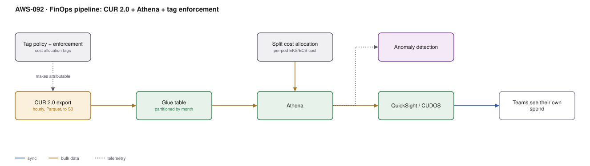

# AWS-092 · FinOps pipeline: CUR 2.0 + Athena + tag enforcement

> **Category:** [11 · Cost, Governance & Multi-Account](readme.md#11) · **Maturity:** Production · **Effort:** M

## The problem

The bill went up 18% and nobody can say why or whose it is. Cost Explorer shows "EC2 –
Other" as your largest line. Finance asks which product costs what and the answer is a
spreadsheet someone maintains by hand.

The Cost and Usage Report is the only complete, hourly, resource-level record of AWS
spend. Everything else is a summary of it.

**Use it when** more than one team spends money in AWS, which is the moment attribution
becomes a question.

**Don't** start with the dashboard. Start with **tagging**, because untagged resources
cannot be attributed no matter how good the pipeline is.

## Components

| Service | Role | The setting that actually matters |
|---|---|---|
| **Tag policy** | Enforces tag keys and values | Organisation-level, so `Team` is not also `team` and `TEAM` |
| Cost allocation tags | Makes a tag appear in billing data | **Must be activated** in the billing console — a tag not activated is invisible |
| CUR 2.0 export | The data | Hourly granularity, Parquet, to S3 |
| Glue table | Schema over the export | Partitioned by billing period |
| **Split cost allocation** | Per-pod EKS and ECS cost | Turns a shared cluster into attributable spend |
| Athena | Query | Partition pruning; the CUR is large |
| QuickSight / CUDOS | Dashboards | CUDOS is a free, well-built AWS dashboard pack |
| Cost Anomaly Detection | Alerts | [`aws-094`](aws-094-budgets-anomaly.md) |

## Flow

1. A tag policy defines the mandatory keys — `Team`, `Environment`, `Product`, `CostCenter`
   — with allowed values and casing.
2. An SCP denies resource creation without them where practical; Config reports where it is
   not.
3. Those tags are **activated as cost allocation tags**, after which they appear as columns
   in the CUR.
4. CUR 2.0 exports hourly to S3 in Parquet with resource IDs.
5. A Glue table makes it queryable; Athena queries it with partition pruning.
6. Split cost allocation data attributes shared EKS and ECS cluster cost down to the pod
   and namespace.
7. Dashboards present each team its own spend, trend and top drivers — and finance a
   consolidated view.

## Cost (us-east-1 — order of magnitude)

| Line item | Small · $50K/mo spend | Medium · $500K/mo | Large · $5M/mo |
|---|---|---|---|
| CUR export to S3 | $0 | $0 | $0 |
| S3 storage for CUR history (Parquet) | $5.00 | $30.00 | $200.00 |
| Glue crawler / table | $5.00 | $10.00 | $20.00 |
| Athena queries (partitioned) | $10.00 | $50.00 | $250.00 |
| QuickSight (3 authors, 20 readers) | $144.00 | $200.00 | $400.00 |
| Cost Anomaly Detection | $0 | $0 | $0 |
| **Total** | **~$164** | **~$290** | **~$870** |

**Cost cliff:** **querying the CUR without partition pruning.** The CUR is enormous —
hourly, per-resource, per-line-item — and a dashboard that scans the full history on every
refresh can cost more than it saves. Partition by billing period, and materialise
frequently-used aggregates into summary tables.

**Biggest lever:** the pipeline typically costs under 0.1% of the spend it illuminates, and
simply showing teams their own numbers reliably produces a 10–20% reduction without any
mandate. Visibility is the cheapest optimisation in FinOps.

## Failure modes

| Failure | Symptom | Mitigation |
|---|---|---|
| Tags not activated | Tags exist on resources, absent from the CUR | Activate them in the billing console; they only apply **going forward** |
| Inconsistent tag values | `team=Platform`, `Team=platform`, `TEAM=plat` | Tag policies with allowed values, enforced |
| Untaggable costs | Data transfer, support, shared services unattributed | Define a documented allocation rule for the remainder; do not pretend it is zero |
| Shared clusters unattributed | One EKS line item, twelve teams | Enable **split cost allocation data** |
| Dashboard nobody opens | Pipeline built, behaviour unchanged | Push monthly showback into team channels, do not wait for them to visit |
| Full-history scans | Athena bill becomes a line item itself | Partition pruning plus summary tables |

## Security notes

- The CUR contains resource names and IDs across the whole organisation — a reasonably
  complete inventory. Restrict access to the bucket.
- Cost data reveals architecture and scale; it is commercially sensitive even if not
  personal data.
- Cost allocation tags are not a security boundary. Do not put sensitive values in tag
  values; they appear in bills, exports and many APIs.
- Give teams access to **their own** cost data through row-level security in QuickSight
  ([`aws-045`](aws-045-quicksight-rls.md)) rather than the whole organisation's.

## What people miss

- **Activating a cost allocation tag is not retroactive.** It applies from activation
  onward, so the earlier you do it the better. This catches every organisation once.
- **Split cost allocation data** is the answer to shared container platforms. Without it, a
  multi-tenant EKS cluster is one unattributable line
  ([`aws-023`](aws-023-eks-multi-tenancy.md)).
- **CUDOS and the Cloud Intelligence Dashboards** are free, AWS-maintained QuickSight
  dashboards built on exactly this pipeline. Deploy them before building your own.
- **CUR 2.0 is a different schema** from the legacy CUR, with a more usable nested
  structure. New pipelines should use it.
- **"EC2 – Other" is usually NAT gateway and EBS.** That mysterious line item is nearly
  always data processing charges ([`aws-028`](aws-028-three-tier-vpc.md)) — resource-level
  CUR data is how you prove it.

## See also

- [`aws-094`](aws-094-budgets-anomaly.md) — alerting on what this measures
- [`aws-093`](aws-093-commitment-strategy.md) — the commitment decisions this informs
- [`aws-095`](aws-095-rightsizing-waste.md) — acting on what it reveals
- [`aws-045`](aws-045-quicksight-rls.md) — per-team dashboards
