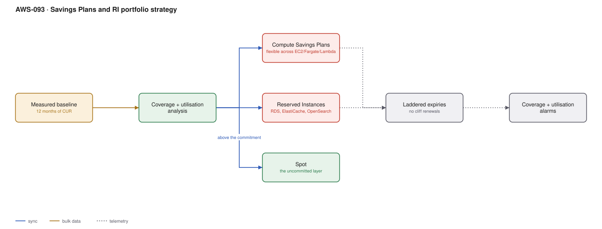

# AWS-093 · Savings Plans and RI portfolio strategy

> **Category:** [11 · Cost, Governance & Multi-Account](readme.md#11) · **Maturity:** Production · **Effort:** M

## The problem

On-demand pricing is the most expensive way to buy compute. Committing to a baseline saves
30–70%. The risk runs both ways: commit too little and you leave money on the table;
commit too much and you pay for capacity you do not use — which is strictly worse than
on-demand.

**Use it when** you have at least 6–12 months of usage history showing a stable floor.

**Don't** commit based on last month's peak, or before a migration that will change your
usage shape, or on workloads you plan to re-architect.

## The instruments

| | Compute Savings Plans | EC2 Instance SP | Reserved Instances |
|---|---|---|---|
| Covers | EC2, Fargate, **Lambda**, SageMaker | EC2 in one family/region | Per service |
| Flexibility | **Highest** — any family, region, OS | Family + region locked | Most locked |
| Discount | Up to ~66% | Up to ~72% | Up to ~72% |
| Still needed for | — | — | **RDS, ElastiCache, OpenSearch, Redshift, DynamoDB** |
| Commitment | $/hour | $/hour | Instance count |

**Savings Plans do not cover RDS, ElastiCache, OpenSearch or Redshift.** Those still need
Reserved Instances, and that gap is the single most commonly missed saving in a mature
estate.

## Components

| Service | Role | The setting that actually matters |
|---|---|---|
| CUR history | The measured baseline | 12 months, by service and family |
| Cost Explorer recommendations | A starting point | Treat as input, not instruction — it optimises for one scenario |
| Compute Savings Plans | The flexible layer | Term (1 or 3 year) and payment option |
| Reserved Instances | The services SPs do not cover | Convertible RIs where the shape may change |
| **Laddering** | Staggered expiry dates | Avoids a single enormous renewal decision |
| Coverage and utilisation metrics | Ongoing management | Both must be monitored; they measure different failures |

## Flow

1. Measure 12 months of usage from the CUR, by service, family and region. Identify the
   **floor** — the level sustained even in the quietest week.
2. Commit to roughly 70–80% of that floor, not to the average and certainly not to the peak.
3. Cover EC2, Fargate and Lambda with Compute Savings Plans; cover RDS, ElastiCache,
   OpenSearch and Redshift with RIs.
4. Leave the variable layer above the commitment on on-demand and Spot
   ([`aws-022`](aws-022-karpenter-spot.md)).
5. **Ladder** purchases across quarters so commitments expire at different times.
6. Monitor two metrics continuously: **utilisation** (is the commitment used?) and
   **coverage** (what fraction of eligible spend is covered?).
7. Re-evaluate quarterly; buy incrementally rather than annually.

## Cost (order of magnitude, $100,000/month of eligible on-demand)

| Strategy | Monthly | Saving |
|---|---|---|
| All on-demand | $100,000 | — |
| 70% covered, 1-year no-upfront Compute SP (~27%) | $81,000 | 19% |
| 70% covered, 3-year no-upfront Compute SP (~45%) | $68,500 | 31% |
| 70% SP + 20% Spot on the remainder (~70% off Spot) | $54,500 | 45% |
| **Over-committed by 30%, 3-year** | **$85,000** | **15% — worse than a correct 1-year** |

**Cost cliff:** **over-commitment.** An unused Savings Plan commitment is pure waste —
you pay the hourly rate regardless. A three-year over-commitment locks that waste in for
three years. This is why the floor, not the average, is the right basis, and why
laddering matters.

**Biggest lever:** term length, if your confidence justifies it — three-year commitments
are substantially cheaper than one-year. But confidence is the binding constraint, and a
correct one-year commitment beats an over-sized three-year one.

## Failure modes

| Failure | Symptom | Mitigation |
|---|---|---|
| Committing to the average | Utilisation below 100% in quiet periods | Commit to the floor; the variable layer stays on-demand and Spot |
| Forgetting RDS and ElastiCache | Large uncovered spend hiding in plain sight | Separate RI analysis per service; Savings Plans do not cover them |
| All commitments expire together | A single huge renewal decision under time pressure | Ladder purchases across quarters |
| Buying before a migration | Committed to instance families you are leaving | Wait until the architecture is stable, or buy Compute SPs for flexibility |
| Coverage monitored, utilisation not | Covered but wasting | Track both; they fail in opposite directions |
| Spot and commitments conflated | Over-commit, then move workloads to Spot | Decide the Spot strategy **first**, commit to what remains |

## Security notes

- Commitment purchases are financial decisions taken in the management account; restrict
  who can make them and require approval above a threshold.
- Savings Plans apply organisation-wide by default. Decide deliberately whether to share
  the discount across accounts, since it changes each account's apparent cost.
- Keep the commitment portfolio documented — which plan, when it expires, who approved it.
  Expiries that nobody owns are how coverage silently drops.

## What people miss

- **Savings Plans cover Lambda and Fargate**, not just EC2. Serverless estates frequently
  leave this on the table entirely because they assume commitments are an EC2 concept.
- **The RDS/ElastiCache/OpenSearch gap** is the biggest missed saving in mature estates.
  Those are often a large share of spend and are not covered by any Savings Plan.
- **Laddering is risk management.** Staggered expiries turn one high-stakes annual decision
  into four low-stakes quarterly ones.
- **Decide the Spot strategy before committing.** Moving 40% of your compute to Spot after
  committing to it means paying for both.
- **No-upfront costs more but preserves cash.** The discount difference between no-upfront
  and all-upfront is usually small; the cash-flow difference is not.

## See also

- [`aws-092`](aws-092-finops-cur-pipeline.md) — the data this decision needs
- [`aws-022`](aws-022-karpenter-spot.md) — the Spot layer above the commitment
- [`aws-095`](aws-095-rightsizing-waste.md) — right-size **before** committing
- [`aws-094`](aws-094-budgets-anomaly.md) — alarming on coverage and utilisation
