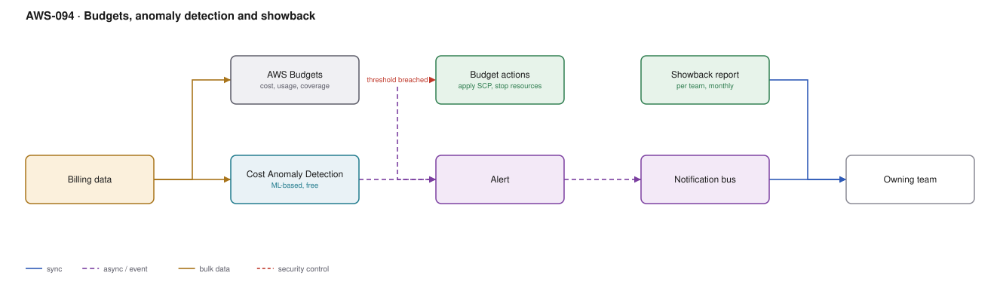

# AWS-094 · Budgets, anomaly detection and showback

> **Category:** [11 · Cost, Governance & Multi-Account](readme.md#11) · **Maturity:** Production · **Effort:** S

## The problem

A misconfigured job runs for three weeks before anyone notices, and the bill arrives after
the money is spent. AWS bills in arrears, so by the time the invoice is wrong it is too
late. Budgets and anomaly detection are the controls that compress that feedback loop from
a month to hours.

**Use it when** you spend money on AWS. This is the cheapest governance you can deploy and
it takes an afternoon.

**Don't** set one organisation-wide budget and call it done — nobody owns it, so nobody
acts on it.

## Budgets vs anomaly detection

| | Budgets | Cost Anomaly Detection |
|---|---|---|
| Mechanism | Threshold you set | **ML baseline of normal** |
| Catches | "We are over plan" | "This is unusual for this service" |
| Needs you to know the right number | **Yes** | No |
| Can take action | **Yes** — apply an SCP, stop resources | No, alerts only |
| Cost | First 2 free, then $0.02/day | **Free** |

They complement each other. Anomaly detection catches the surprise; budgets enforce the
plan. Anomaly detection is free and should be on everywhere, unconditionally.

## Components

| Service | Role | The setting that actually matters |
|---|---|---|
| Cost Anomaly Detection | ML-based detection | Monitor by **service** and by **cost allocation tag**, not just by account |
| AWS Budgets | Threshold alerts | **Forecasted** alerts as well as actual — forecast warns earlier |
| **Budget actions** | Automated response | Apply a restrictive SCP, or stop EC2/RDS instances |
| Budget types | Cost, usage, RI/SP coverage and utilisation | Coverage budgets catch commitment drift ([`aws-093`](aws-093-commitment-strategy.md)) |
| Showback report | Monthly, per team | Pushed to the team, not waiting on a dashboard |
| Notification bus | Routing | [`aws-065`](aws-065-notification-bus.md) |

## Flow

1. Cost Anomaly Detection monitors are created per service and per cost-allocation-tag
   value, with a dollar-impact threshold so small fluctuations stay quiet.
2. Budgets are created per team and per environment, using the same tags, with alerts at
   80% actual and 100% **forecasted**.
3. Coverage and utilisation budgets watch the commitment portfolio.
4. Alerts flow to the notification bus and are routed to the **owning team**, resolved from
   the tag — not to a central finance alias.
5. For sandbox and non-production accounts, a **budget action** applies a restrictive SCP
   or stops instances at a hard threshold.
6. A monthly showback is pushed into each team's channel: their spend, the change, and
   their top three drivers.

## Cost (order of magnitude)

| Line item | Small · 10 budgets | Medium · 100 budgets | Large · 500 budgets |
|---|---|---|---|
| Budgets (first 2 free, then $0.02/day) | $4.80 | $58.80 | $298.80 |
| Cost Anomaly Detection | **$0** | **$0** | **$0** |
| Budget actions | $0 | $0 | $0 |
| SNS / EventBridge notifications | $0.10 | $1.00 | $5.00 |
| Showback report generation (Athena + Lambda) | $5.00 | $15.00 | $50.00 |
| **Total** | **~$10** | **~$75** | **~$354** |

**Cost cliff:** none — this is among the cheapest things in AWS and routinely prevents
four- and five-figure surprises. The only real cost is **alert fatigue**: budgets set too
tight produce noise, teams mute the channel, and the one that mattered is missed.

**Biggest lever:** routing alerts to the team that caused the spend. A central alias
produces a queue nobody owns; the owning team fixes it the same day.

## Failure modes

| Failure | Symptom | Mitigation |
|---|---|---|
| One organisation-wide budget | Nobody owns it, nobody acts | Budget per team, per environment, routed by tag |
| Only actual-spend alerts | You learn at 100% that you will hit 160% | **Forecasted** alerts catch it days earlier |
| Budget actions on production | Automation stops a production database | Actions on sandbox and non-prod only; alerts for production |
| Thresholds too tight | Alert fatigue, channel muted | Tune to a level that means something; use anomaly detection for the unknown |
| No anomaly detection | Only catches what you thought to budget for | It is free; enable it on everything |
| Alerts to finance only | The people who can fix it never hear | Route to engineering owners, copy finance |

## Security notes

- Budget actions can apply an SCP, which is a privileged capability — a misconfigured
  action can disable an account. Restrict who can configure them.
- Cost data exposes architecture and scale; scope access per team
  ([`aws-045`](aws-045-quicksight-rls.md)).
- An unexpected cost spike is sometimes a **security incident** — cryptomining in an
  unmonitored region is often first visible as an anomaly in the bill. Route significant
  anomalies to security as well as finance.
- Budget alerts in the management account need care: that is where consolidated spend sits,
  and access to it is broader insight than most people should have.

## What people miss

- **Cost Anomaly Detection is free and most accounts have it switched off.** It is machine
  learning on your own spend patterns, costs nothing, and catches the class of problem
  budgets cannot — the unexpected.
- **Budget actions are the only automated enforcement** in the cost toolkit. A sandbox that
  disables itself at $500 lets you give people real freedom safely.
- **Forecasted alerts are more useful than actual alerts.** By the time actual spend
  crosses the threshold, the month is largely spent.
- **A cost anomaly can be your first breach signal.** Cryptomining shows up in the bill
  before it shows up anywhere else, for many organisations.
- **Showback changes behaviour; chargeback changes organisations.** Start with showback —
  simply telling teams their number produces most of the benefit without the political cost.

## See also

- [`aws-092`](aws-092-finops-cur-pipeline.md) — the tagging that makes this attributable
- [`aws-093`](aws-093-commitment-strategy.md) — coverage and utilisation budgets
- [`aws-065`](aws-065-notification-bus.md) — routing alerts to owners
- [`aws-091`](aws-091-scp-guardrails.md) — the SCP a budget action applies
