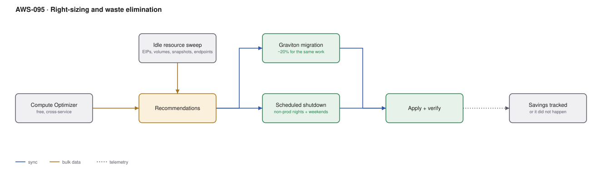

# AWS-095 · Right-sizing and waste elimination

> **Category:** [11 · Cost, Governance & Multi-Account](readme.md#11) · **Maturity:** Production · **Effort:** S

## The problem

Most AWS estates are 30–45% waste: instances sized for a load test that never happened,
development environments running at 3am on a Sunday, unattached EBS volumes from instances
terminated two years ago, Elastic IPs that now cost money, and `x86` instances doing work
`arm64` would do for 20% less.

None of this is clever. It is a checklist, and it is usually the largest single saving
available.

**Do this before committing** to Savings Plans ([`aws-093`](aws-093-commitment-strategy.md))
— otherwise you commit to your waste for three years.

## The checklist, in order of return

| Action | Typical saving | Effort |
|---|---|---|
| **Shut down non-prod outside working hours** | **65–70% of non-prod** | Low |
| Delete unattached EBS volumes and old snapshots | 2–5% of storage | Low |
| Release unused Elastic IPs | Small but pure waste | Trivial |
| Right-size over-provisioned instances | 10–25% of compute | Medium |
| **Migrate to Graviton** | **~20% for the same work** | Medium |
| Delete idle load balancers, NAT gateways, endpoints | 1–3% | Low |
| Delete idle SageMaker endpoints | Can be large | Low |
| S3 lifecycle and expiry | 20–60% of storage | Low |

Non-production scheduling is first because the arithmetic is overwhelming: a weekday
8am–8pm schedule runs 60 hours instead of 168, which is a 64% reduction, and almost nobody
needs a development environment at 2am on a Saturday.

## Components

| Service | Role | The setting that actually matters |
|---|---|---|
| **Compute Optimizer** | Right-sizing recommendations | **Free**; enable org-wide, and turn on enhanced metrics for memory |
| Trusted Advisor | Idle resource checks | Some checks need a support plan |
| Cost Explorer resource recommendations | Rightsizing with cost impact | Cross-check against Compute Optimizer |
| **EventBridge Scheduler** | Start/stop automation | Universal targets call `ec2:StopInstances` with no code ([`aws-014`](aws-014-eventbridge-scheduler.md)) |
| Instance Scheduler solution | Tag-driven schedules | AWS-published; tag `Schedule=office-hours` |
| Graviton | ARM-based instances | Multi-arch images; most managed services support it |
| Savings tracking | Proving it worked | Otherwise the saving quietly reverses |

## Flow

1. Enable Compute Optimizer across the organisation and let it gather two weeks of data.
2. Run an idle-resource sweep: unattached volumes, snapshots with no parent, unassociated
   Elastic IPs, load balancers with no targets, NAT gateways with no traffic, idle
   SageMaker endpoints.
3. Tag non-production resources with a schedule and let EventBridge Scheduler stop them
   outside working hours, starting them again in the morning.
4. Apply right-sizing recommendations, starting with the largest instances.
5. Migrate workloads to Graviton where the image supports it.
6. Verify performance after each change — a right-sized instance that throttles is not a
   saving.
7. Track realised savings monthly, or the estate drifts straight back.

## Cost (order of magnitude, a $100,000/month estate)

| Action | Monthly saving |
|---|---|
| Non-prod scheduled off (30% of estate, 64% reduction) | **$19,200** |
| Right-sizing (15% of compute) | $9,000 |
| Graviton migration (40% of eligible, 20% off) | $4,800 |
| Idle resource cleanup | $2,500 |
| S3 lifecycle | $3,000 |
| **Total** | **~$38,500 (38%)** |
| Tooling cost | **$0** |

**Cost cliff:** the tools are free. The cliff is **not doing it before committing** —
buying a three-year Savings Plan covering waste locks in the waste. Clean up first, measure
the new floor, then commit.

**Biggest lever:** non-production scheduling, by a wide margin, and it is one of the
easiest things on this list to implement.

## Failure modes

| Failure | Symptom | Mitigation |
|---|---|---|
| Scheduling production by accident | An outage caused by cost optimisation | Tag-driven, opt-in, and never applied to a production tag |
| Right-sizing without headroom | Throttling or OOM under peak load | Size on p95 or p99, not the average; verify after |
| Deleting "unused" snapshots | Losing the only copy of something | Check for AMI references and retention requirements first |
| No memory metrics | Right-sizing on CPU alone misses memory-bound instances | CloudWatch agent for memory; Compute Optimizer enhanced metrics |
| One-off cleanup | Waste returns within two quarters | Monthly recurring sweep, with the savings tracked |
| Graviton without testing | Architecture-specific dependencies fail | Multi-arch build and a real test pass before migrating |

## Security notes

- Stopped is not deleted. A stopped instance still has its EBS volume, its data and its
  IAM role — and still needs patching when it starts again.
- Unattached EBS volumes and old snapshots are an often-forgotten data store containing
  production data. Deleting them is a security improvement as well as a cost one.
- Unassociated Elastic IPs that are released go back to a shared pool; make sure nothing
  (a partner firewall rule, a DNS record) still depends on them.
- The automation that stops and starts instances has real power over production
  infrastructure — scope it to the tags it should touch.

## What people miss

- **Compute Optimizer is free and most organisations have never enabled it**
  organisation-wide. It covers EC2, Auto Scaling groups, EBS, Lambda and ECS on Fargate.
- **EventBridge Scheduler needs no code** to stop and start instances — a universal target
  calls the EC2 API directly, which removes the Lambda everyone writes for this
  ([`aws-014`](aws-014-eventbridge-scheduler.md)).
- **Graviton is roughly 20% cheaper for equivalent performance** and is supported by RDS,
  ElastiCache, OpenSearch, Lambda and Fargate as well as EC2. For interpreted languages it
  is often a one-line change.
- **Idle SageMaker endpoints are a classic** — experiments deployed and forgotten, each
  costing hundreds a month ([`aws-077`](aws-077-inference-selection.md)).
- **Track the savings or they reverse.** Without a tracked number, the estate drifts back
  within two quarters and the exercise is repeated from scratch next year.

## See also

- [`aws-093`](aws-093-commitment-strategy.md) — do this **first**, then commit
- [`aws-092`](aws-092-finops-cur-pipeline.md) — finding the waste
- [`aws-014`](aws-014-eventbridge-scheduler.md) — the scheduling mechanism
- [`aws-082`](aws-082-s3-lifecycle.md) — the storage equivalent
