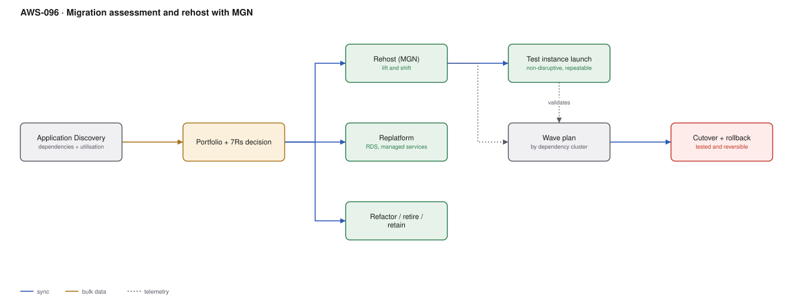

# AWS-096 · Migration assessment and rehost with MGN

> **Category:** [12 · Migration, Hybrid & Edge](readme.md#12) · **Maturity:** Production · **Effort:** L

## The problem

"Move 400 servers to AWS" is not a plan. Some of those servers should be refactored, some
replatformed, some rehosted unchanged, and a surprising number should simply be switched
off because nothing has used them for two years. Getting the **portfolio decision** right
determines whether the migration delivers value or just relocates the problem.

**Use it when** you have a data centre exit, a lease expiry, or a hardware refresh forcing
the question.

**Don't** refactor everything. "Migrate then modernise" is usually right: rehost to meet
the deadline, modernise what earns it afterwards, with the clock no longer running.

## The 7 Rs

| | What it means | When | Effort |
|---|---|---|---|
| **Retire** | Switch it off | Nothing uses it — typically 10–20% of a portfolio | None |
| **Retain** | Leave it where it is | Mainframe, licensing, latency, or regulation | None |
| **Rehost** | Lift and shift, unchanged | Deadline-driven, no appetite for change | Low |
| **Relocate** | Move VMware as-is | VMware estates, bulk move | Low |
| **Replatform** | Small changes for managed services | Self-managed DB → RDS | Medium |
| **Repurchase** | Move to SaaS | Email, CRM, ticketing | Medium |
| **Refactor** | Rebuild for cloud-native | High-value, high-change applications | **High** |

Retire first. It is free, it is the fastest win, and discovery usually finds more
candidates than anyone expects.

## Components

| Service | Role | The setting that actually matters |
|---|---|---|
| Application Discovery Service | Inventory, utilisation, **dependencies** | Agent-based discovery for dependency mapping |
| Migration Hub | Portfolio tracking | One view of wave progress |
| **MGN (Application Migration Service)** | Block-level replication and cutover | Continuous replication; cutover is minutes |
| Test instance launch | Non-disruptive rehearsal | Launch a test copy without affecting the source — do this repeatedly |
| Wave plan | Grouping by dependency | Migrate dependency clusters together, never split them |
| DMS / SCT | Database migration | [`aws-097`](aws-097-heterogeneous-db-migration.md) |
| Cutover + rollback | The event | Rollback must be tested, not assumed |

## Flow

1. Discovery agents collect inventory, utilisation and **network dependencies** over at
   least 4–6 weeks, including a month-end close.
2. The portfolio is classified against the 7 Rs. Retire candidates go first.
3. MGN agents are installed on rehost candidates; block-level replication begins and
   continues continuously.
4. **Test instances are launched** from the replicated data — repeatedly — without
   disrupting the source. This is the rehearsal that de-risks the cutover.
5. Waves are planned around dependency clusters, smallest and least critical first.
6. At cutover, replication is finalised, the target is launched, DNS is switched, and the
   source is kept running but isolated until confidence is established.
7. Rollback is switching DNS back — which is why the source stays available.

## Cost (order of magnitude, 200 servers)

| Line item | Cost |
|---|---|
| Application Discovery Service | $0 |
| Migration Hub | $0 |
| **MGN: free for 90 days per server**, then ~$0.042/hr | $0 (within window) |
| Replication staging area (EBS, ~2 TB) | $200/mo |
| Data transfer in | $0 |
| Direct Connect for replication | [`aws-032`](aws-032-hybrid-dx-vpn.md) |
| Target infrastructure (runs in parallel during migration) | **2× during overlap** |

**Cost cliff:** **the parallel run.** During migration you pay for both the source and the
target. A migration that slips from six months to eighteen pays that double cost for a
year longer, which usually exceeds every other line in the programme. Schedule discipline
is the cost control.

Second: MGN is free for 90 days per server. A server replicating for eight months because
its wave slipped starts billing.

**Biggest lever:** retiring aggressively. Every retired server is 100% saved, needs no
migration effort, and reduces the target estate forever.

## Failure modes

| Failure | Symptom | Mitigation |
|---|---|---|
| No dependency mapping | A migrated app cannot reach a database still on-prem | Agent-based discovery; migrate dependency clusters as a unit |
| Rehosting without right-sizing | Cloud bill matches the over-provisioned data centre | Use discovery utilisation data to size targets ([`aws-095`](aws-095-rightsizing-waste.md)) |
| Cutover never rehearsed | Surprises during the real event | MGN test launches are non-disruptive — do several |
| No rollback plan | A failed cutover becomes an outage | Keep the source running and isolated; rollback is a DNS change |
| Refactoring during migration | Timeline doubles, risk compounds | Migrate then modernise |
| Discovery window too short | Month-end and quarter-end load missed | At least one full business cycle |

## Security notes

- Migration is the moment to fix inherited security debt — but doing it during cutover adds
  risk. Land in a compliant landing zone ([`aws-090`](aws-090-landing-zone.md)) so the
  baseline is right by construction, then remediate the application layer afterwards.
- MGN replication traffic should travel over Direct Connect or VPN, not the public
  internet.
- Replicated volumes in the staging area are full copies of production data — encrypt them
  and restrict the staging subnet.
- Decommission properly: a migrated server left running on-prem is an unpatched,
  unmonitored copy of production.
- Credentials and secrets usually come across unchanged. Rotate them after migration.

## What people miss

- **MGN test launches are free of disruption and repeatable.** You can rehearse the cutover
  as many times as you like against real replicated data. Teams treat cutover as a one-shot
  event when it does not have to be.
- **Discovery finds servers nobody knew existed**, and a meaningful share of them are
  retire candidates. Budget time to chase down ownership.
- **Right-size during the move, using the discovery data.** Rehosting an 80%-idle physical
  server onto an equivalently sized instance imports the waste.
- **Migrate then modernise** is not a compromise — refactoring under a data-centre exit
  deadline is how migrations fail.
- **The parallel-run cost is the real budget risk**, and it is driven by schedule, not by
  technology.

## See also

- [`aws-097`](aws-097-heterogeneous-db-migration.md) — the database half
- [`aws-090`](aws-090-landing-zone.md) — where the workloads should land
- [`aws-089`](aws-089-bulk-data-transfer.md) — moving the data
- [`aws-101`](aws-101-strangler-fig.md) — the modernise half, afterwards
