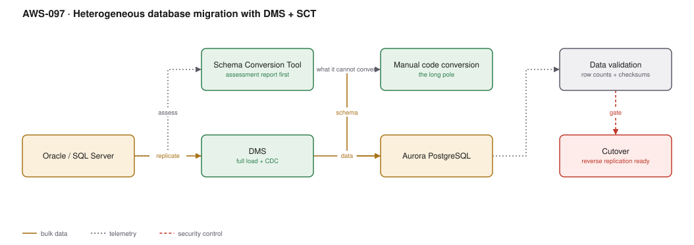

# AWS-097 · Heterogeneous database migration with DMS + SCT

> **Category:** [12 · Migration, Hybrid & Edge](readme.md#12) · **Maturity:** Production · **Effort:** L

## The problem

Oracle or SQL Server licensing is a large recurring cost and a constraint on where
workloads can run. Moving to PostgreSQL removes it. The data movement is the easy part —
DMS does that well. The hard part is everything expressed in the database's own dialect:
stored procedures, packages, triggers, proprietary functions, and application SQL written
against vendor-specific behaviour.

**Use it when** licensing cost, vendor lock-in or a cloud strategy justifies the effort.

**Don't** underestimate the code conversion. For a database with thousands of lines of
PL/SQL, conversion and testing dominate the project — data migration is a rounding error
on the timeline.

## Where the effort actually goes

| Phase | Share of effort |
|---|---|
| Schema conversion (largely automated) | ~10% |
| **Code conversion — procedures, triggers, packages** | **~40%** |
| **Application SQL changes** | **~25%** |
| Testing and validation | ~20% |
| Data migration and cutover | ~5% |

Run the SCT assessment report first. It tells you what converts automatically and what
does not, and that number is the project estimate.

## Components

| Service | Role | The setting that actually matters |
|---|---|---|
| **SCT assessment report** | What converts, what does not | **Run this first**; it is the go/no-go input |
| Schema Conversion Tool | Schema and code conversion | Action items list is the manual work queue |
| DMS replication instance | Moves the data | Sized for CDC throughput; memory matters for wide tables |
| **Full load + CDC task** | Snapshot then continuous changes | One task, not two, or you lose changes in the gap |
| Data validation | Confirms correctness | DMS validation plus your own reconciliation |
| Reverse replication | Rollback capability | Target → source, configured **before** cutover |
| Babelfish (SQL Server only) | T-SQL compatibility layer on Aurora | Avoids most application SQL changes |

## Flow

1. SCT assesses the source and produces a report: objects that convert automatically, and
   action items requiring manual work.
2. Schema is converted and applied to Aurora PostgreSQL; action items are worked through by
   engineers.
3. Application SQL is reviewed and changed — this is usually the largest single task.
4. A DMS task performs a full load, then switches to CDC, keeping the target continuously
   current.
5. The application is tested against the target while CDC keeps it fresh. This phase can
   run for weeks.
6. Data validation compares row counts and checksums continuously.
7. At cutover, the application stops, CDC drains, the application restarts against the
   target. **Reverse replication** is already running so rollback is possible.

## Cost (order of magnitude)

| Line item | Small · 500 GB | Medium · 5 TB | Large · 50 TB |
|---|---|---|---|
| DMS replication instance (r6i.large → 2xlarge) | $153.30 | $613.20 | $1,226.40 |
| DMS storage | $23.00 | $57.50 | $115.00 |
| Target Aurora PostgreSQL (parallel run) | $409.00 | $1,635.00 | $6,540.00 |
| Source database (still running) | unchanged | unchanged | unchanged |
| SCT | $0 | $0 | $0 |
| **Engineering effort** | **dominant** | **dominant** | **dominant** |
| *Oracle/SQL Server licence saved, annually* | *$50K–$500K+* | | |

**Cost cliff:** the **parallel run plus engineering time**. A migration budgeted at six
months and delivered in eighteen pays for two databases and a team for an extra year. The
licence saving is real and often large, but it only begins at cutover.

**Biggest lever:** the SCT assessment report, run before committing. If 40% of your PL/SQL
does not auto-convert, that is the project, and knowing it up front is the difference
between a plan and a surprise.

## Failure modes

| Failure | Symptom | Mitigation |
|---|---|---|
| Full load and CDC as separate tasks | Changes lost in the gap between them | One task doing both — DMS handles the handover |
| No primary key | DMS cannot apply updates or deletes | Every replicated table needs one |
| LOB columns | Truncated data or very slow replication | Configure LOB mode and limits explicitly |
| Dialect differences missed | Subtle wrong results in production | Empty-string vs NULL, date handling, implicit casts, `ROWNUM` — test against real data |
| No reverse replication | Cutover cannot be undone | Configure target → source before cutover |
| Validation skipped | Silent data divergence | DMS validation plus independent reconciliation |
| Source logs too short | Task fails after an outage, full reload required | Extended retention on binlog or archive logs |

## Security notes

- A PostgreSQL replication slot that stalls prevents WAL cleanup and can **fill the source
  disk and take production down**. Alarm on replication slot lag; this is the most dangerous
  failure in the architecture ([`aws-044`](aws-044-cdc-dms.md)).
- Credentials for both endpoints live in Secrets Manager, not in the DMS console.
- The target database is a full copy of production and needs equivalent controls from day
  one, not after cutover.
- Point DMS at a replica rather than the primary where the engine supports CDC from a
  replica.
- Audit and logging configuration rarely transfers automatically — rebuild it on the target.

## What people miss

- **Babelfish changes the economics for SQL Server.** It provides a T-SQL-compatible
  endpoint on Aurora PostgreSQL, so much of the application SQL — the 25% line in the effort
  table — may need no changes at all. Evaluate it before planning a full rewrite.
- **The SCT assessment report is free and takes days, not months.** Running it before
  committing to the project is the single highest-value step on this page.
- **Dialect differences are where correctness bugs hide.** Oracle treats an empty string as
  NULL and PostgreSQL does not. That difference alone has produced production incidents.
- **CDC lets you test for weeks against live data.** The target stays current while you
  validate, which turns cutover into a short switch rather than a long outage.
- **Reverse replication is the rollback plan.** Without it, cutover is one-way and the
  pressure on the go/no-go decision is enormous.

## See also

- [`aws-096`](aws-096-migration-7rs.md) — the wider migration programme
- [`aws-044`](aws-044-cdc-dms.md) — DMS for analytics rather than migration
- [`aws-085`](aws-085-aurora-global.md) — what the target can become afterwards
- [`aws-018`](aws-018-lambda-rds-proxy.md) — connecting to the new database
