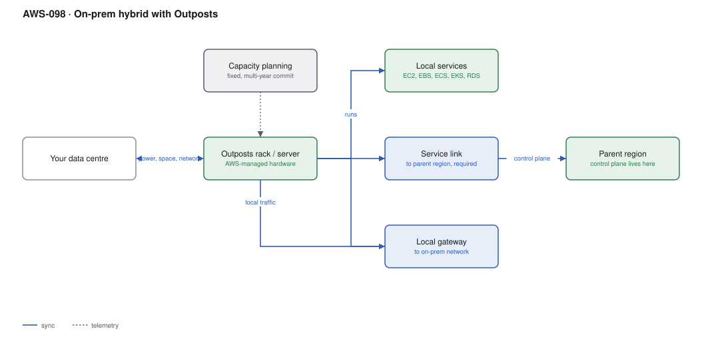

# AWS-098 · On-prem hybrid with Outposts

> **Category:** [12 · Migration, Hybrid & Edge](readme.md#12) · **Maturity:** Specialist · **Effort:** L

## The problem

Some workloads cannot move. A factory control system needs single-digit-millisecond latency
to machinery on the floor. A regulator requires data to remain on premises. A legacy
application depends on hardware that exists in exactly one building. Outposts puts
genuine AWS infrastructure — the same APIs, the same control plane — inside your data
centre.

**Use it when** there is a hard constraint: latency to local equipment, data residency
that cloud regions cannot satisfy, or a local dependency that cannot be moved.

**Don't** use it to avoid a migration, or because "hybrid" sounds prudent. It is expensive,
capacity is fixed, and the commitment is multi-year. Local Zones
([`aws-099`](aws-099-local-zones-wavelength.md)) solve the latency case far more cheaply
when the requirement is proximity rather than premises.

## Outposts vs the alternatives

| | Outposts | Local Zones | Region | Snowball Edge |
|---|---|---|---|---|
| Location | **Your data centre** | AWS metro facility | AWS region | Anywhere, temporary |
| Latency to your floor | **Sub-millisecond** | Single-digit ms | 10s of ms | Local |
| Capacity | **Fixed**, purchased | Elastic | Elastic | Fixed, small |
| Commitment | **3 years typically** | None | None | Per job |
| Cost | **Very high** | Premium on region | Standard | Low |
| Data residency on-prem | **Yes** | No | No | Yes |

## Components

| Service | Role | The setting that actually matters |
|---|---|---|
| Outposts rack or server | The hardware | **Capacity is fixed** — you choose the instance mix up front |
| **Service link** | Connection to the parent region | **Required.** The control plane lives in the region |
| Local gateway (LGW) | Connection to your on-prem network | How local traffic reaches the floor |
| Local services | EC2, EBS, S3 on Outposts, ECS, EKS, RDS | A **subset** of AWS services, not all of them |
| Parent region | Where the control plane runs | Choose for latency and for data residency implications |
| Capacity planning | The hard part | Changing the instance mix is an AWS-assisted operation |

## Flow

1. You provide power, cooling, space and network; AWS installs and thereafter manages the
   hardware, including firmware and replacement.
2. The **service link** connects the Outpost to its parent region. The control plane —
   APIs, console, orchestration — runs in the region.
3. EC2 instances, EBS volumes, containers and local S3 run on the Outpost, in a subnet of
   a VPC that extends from the region.
4. The **local gateway** routes traffic between the Outpost and your on-premises network at
   local latency.
5. Workloads use the same APIs, SDKs and IaC as in a region.
6. Data can stay entirely local where residency requires it, while the control plane and
   any non-local services run in the region.

## Cost (order of magnitude)

| Line item | Outposts server (1U/2U) | Outposts rack (small) | Outposts rack (large) |
|---|---|---|---|
| 3-year commitment, amortised monthly | ~$500–1,500 | ~$7,000–15,000 | ~$30,000+ |
| Payment options | All/partial/no upfront | All/partial/no upfront | All/partial/no upfront |
| Data transfer to the region | Standard rates | Standard rates | Standard rates |
| Your power, cooling, space, hands | **Your cost** | **Your cost** | **Your cost** |
| Equivalent capacity in a region | ~30–50% less | ~30–50% less | ~30–50% less |

**Cost cliff:** **fixed capacity on a multi-year commitment.** You pay for the whole
Outpost whether you use 10% or 100%, for three years, and you cannot scale beyond what you
bought without ordering more hardware with a lead time measured in weeks. The elasticity
that makes cloud economics work is exactly what you are giving up.

**Biggest lever:** running only what *must* be local on the Outpost, and bursting
everything else to the parent region. An Outpost sized for peak local demand is enormously
wasteful; one sized for the irreducible local workload is defensible.

## Failure modes

| Failure | Symptom | Mitigation |
|---|---|---|
| Service link down | **No control plane** — cannot launch, modify or scale | Redundant links; existing instances keep running but you cannot manage them |
| Capacity exhausted | Cannot launch instances, weeks of lead time | Conservative capacity planning with headroom; burst to the region |
| Expecting all AWS services | A service you depend on is not available locally | Check the supported service list **before** designing |
| Data centre facilities inadequate | Installation blocked on power or cooling | AWS specifies requirements precisely; survey early |
| Single Outpost treated as HA | Site failure takes everything | Two Outposts, or region failover |
| Parent region chosen carelessly | Latency or residency problems with the control plane | Choose deliberately; it affects both |

## Security notes

- The hardware is in your building but managed by AWS. The shared responsibility model
  shifts: physical security is yours, hardware and firmware are AWS's.
- Data on Outposts stays local, which is the point for residency — but **control plane
  metadata flows to the parent region** over the service link. Confirm that satisfies your
  regulator; it usually does, but it should be checked and documented, not assumed.
- Nitro Security Keys mean data on local EBS is cryptographically inaccessible if the
  hardware is removed from your site.
- The local gateway is a route into your corporate network; apply the same controls as any
  other hybrid connection ([`aws-032`](aws-032-hybrid-dx-vpn.md)).

## What people miss

- **The service link is a hard dependency.** Lose connectivity to the parent region and
  running workloads continue, but you cannot launch, stop, scale or modify anything. For
  many "we need on-prem for resilience" arguments this is disqualifying, and it surprises
  people.
- **Outposts servers (1U/2U) are far cheaper than racks** and suit edge sites — retail
  stores, branch offices, small factories — where a full rack is absurd.
- **Only a subset of services runs locally.** Check the list against your architecture
  before committing; the gap is usually larger than expected.
- **Local Zones solve most latency requirements** at a fraction of the cost, with no
  commitment and no hardware in your building. Rule them out before choosing Outposts.
- **ECS and EKS work on Outposts**, which is often the cleanest way to run the local
  workload with the same tooling as the region.

## See also

- [`aws-099`](aws-099-local-zones-wavelength.md) — the cheaper latency answer
- [`aws-032`](aws-032-hybrid-dx-vpn.md) — the connectivity underneath
- [`aws-096`](aws-096-migration-7rs.md) — "retain" as a legitimate decision
- [`aws-100`](aws-100-greengrass-edge-ml.md) — when the edge is a device, not a rack
