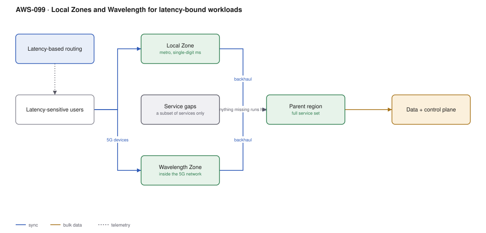

# AWS-099 · Local Zones and Wavelength for latency-bound workloads

> **Category:** [12 · Migration, Hybrid & Edge](readme.md#12) · **Maturity:** Specialist · **Effort:** M

## The problem

Some workloads are bounded by the speed of light. A cloud gaming session, a live video
production workflow, a trading front end, an AR headset, a remote desktop for 3D CAD —
all of these degrade noticeably above roughly 20 ms round trip, and the nearest AWS region
may be 60 ms away. Local Zones put compute in a metro area near your users; Wavelength
puts it inside a telecom operator's 5G network.

**Use it when** you have measured a latency requirement that the nearest region cannot
meet.

**Don't** use them as a general-purpose region. They offer a subset of services, no
multi-AZ resilience within the zone, and a price premium. CloudFront
([`aws-003`](aws-003-cloudfront-s3-oac.md)) solves latency for cacheable content far more
cheaply, and Global Accelerator ([`aws-034`](aws-034-global-accelerator.md)) improves the
network path without moving compute at all.

## Which one, and when

| | Local Zone | Wavelength | Region | CloudFront |
|---|---|---|---|---|
| Location | Metro area | **Inside a 5G network** | Region | Global edge |
| Typical latency | Single-digit ms | **~10 ms to 5G devices** | 10s of ms | Sub-10 ms for **cached** content |
| Compute | **Yes** | **Yes** | Yes | Edge functions only |
| Service set | Subset | Smaller subset | Full | N/A |
| Use for | Media, gaming, CAD, trading | Mobile AR/VR, connected vehicles, IoT | Everything else | Cacheable content |

The order to evaluate: CloudFront → Global Accelerator → Local Zone → Wavelength →
Outposts. Stop at the first that meets the requirement.

## Components

| Service | Role | The setting that actually matters |
|---|---|---|
| Local Zone | Metro compute, storage, some services | **Opt-in per zone**, and check the available service list |
| Wavelength Zone | Compute inside a carrier network | Carrier-specific; reachable from that carrier's devices |
| Parent region | Everything the zone lacks | The zone is an extension of a VPC in the parent region |
| Carrier gateway | Wavelength ingress from the mobile network | The only path from 5G devices |
| Latency-based routing | Sends users to the right place | [`aws-033`](aws-033-route53-strategies.md) |
| Backhaul link | Zone to parent region | Managed by AWS; data transfer is charged |

## Flow

1. Measure actual latency from users to the nearest region. Confirm there is a real,
   quantified problem.
2. Opt in to the relevant Local Zone; it appears as an additional subnet in an existing
   VPC in the parent region.
3. Latency-sensitive components — the game server, the video encoder, the rendering
   session — are deployed into the zone.
4. Everything else stays in the parent region: databases of record, batch processing,
   analytics, CI/CD, and any service the zone does not offer.
5. Route 53 latency-based routing sends each user to the nearest capable location.
6. For Wavelength, devices on the carrier's 5G network reach the zone through a carrier
   gateway, without traversing the public internet.

## Cost (order of magnitude)

| Line item | Local Zone | Wavelength | Parent region |
|---|---|---|---|
| EC2 instance premium vs region | **~+20–30%** | ~+20–30% | baseline |
| EBS | Available, premium | Limited | standard |
| Data transfer zone ↔ region | Charged per GB | Charged per GB | — |
| Service availability | Subset | Smaller subset | Full |
| Minimum commitment | **None** | **None** | None |

**Cost cliff:** **backhaul data transfer.** A workload in a Local Zone that reads from a
database in the parent region pays per-GB transfer on every query, in both directions. A
chatty application moved to a Local Zone for latency can spend more on backhaul than it
saves in user experience. Keep the latency-sensitive path local and the data path short.

**Biggest lever:** moving only the latency-critical component. The common failure is lifting
an entire three-tier application into a Local Zone and paying a premium on everything,
including the parts nobody notices the latency of.

## Failure modes

| Failure | Symptom | Mitigation |
|---|---|---|
| Assuming full service parity | A service you need is simply not there | Check the per-zone service list before designing |
| Expecting multi-AZ | A zone failure takes the workload out | Local Zones are single-location; resilience comes from the parent region or a second zone |
| Chatty backhaul | Transfer charges exceed the benefit | Cache locally; keep the hot path within the zone |
| No latency measurement | Expensive solution to an unmeasured problem | Measure first; the region may already be fast enough |
| Wavelength on the wrong carrier | Users on other networks get no benefit | Wavelength is per-carrier; it is not a general edge |
| Quota surprises | Cannot launch; zone capacity is finite | Request quotas early; zones are smaller than regions |

## Security notes

- A Local Zone subnet is part of your VPC and inherits its security groups, NACLs and flow
  logs. The security model is unchanged, which is a genuine advantage over bespoke edge
  infrastructure.
- Wavelength's carrier gateway is a distinct ingress path — traffic from mobile devices
  does not traverse the public internet, which is a security property worth understanding
  and documenting.
- Guardrails, logging and detection should extend to these zones; they are easy to leave
  out of a Config or GuardDuty scope and become unmonitored compute.
- Data residency: a Local Zone is in a specific metro, which may be a different
  jurisdiction from the parent region. Check.

## What people miss

- **CloudFront or Global Accelerator usually solves it.** Most "we need lower latency"
  requirements are about content delivery or network path, not compute location, and both
  are far cheaper ([`aws-003`](aws-003-cloudfront-s3-oac.md),
  [`aws-034`](aws-034-global-accelerator.md)).
- **Local Zones are a subnet in an existing VPC**, not a separate region. That makes
  adoption much simpler than people expect — same VPC, same security groups, same IaC.
- **There is no commitment and no minimum**, unlike Outposts. You can try a Local Zone for
  a month and stop.
- **Wavelength is carrier-specific.** It helps devices on that operator's network and
  nobody else, which makes it a narrow but genuinely unique capability.
- **Not every Local Zone offers the same services.** The list varies by zone and changes
  over time; verify for the specific zone, not in general.

## See also

- [`aws-034`](aws-034-global-accelerator.md) — improving the path without moving compute
- [`aws-098`](aws-098-outposts-hybrid.md) — when it must be in your building
- [`aws-003`](aws-003-cloudfront-s3-oac.md) — the cheapest latency answer
- [`aws-100`](aws-100-greengrass-edge-ml.md) — when the compute belongs on the device
