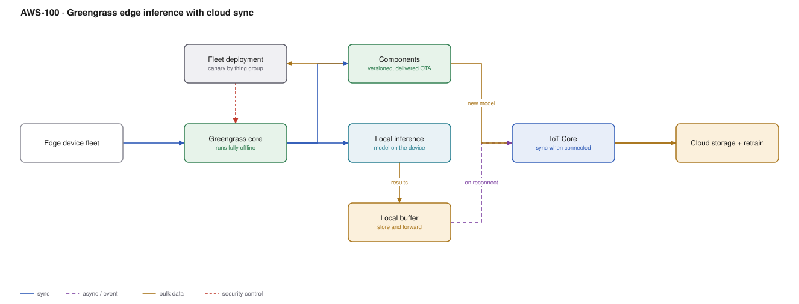

# AWS-100 · Greengrass edge inference with cloud sync

> **Category:** [12 · Migration, Hybrid & Edge](readme.md#12) · **Maturity:** Specialist · **Effort:** L

## The problem

A camera on a production line inspects 30 frames a second. Sending that to the cloud is
impossible on the available connection, too slow for the reject actuator, and far too
expensive. The model has to run **on the device** — and the device is offline half the
time, physically inaccessible, and one of ten thousand.

Three distinct problems: running inference locally, surviving disconnection, and deploying
software to a fleet you cannot touch.

**Use it when** bandwidth, latency or connectivity make cloud inference impractical.

**Don't** use it when the device has reliable connectivity and the latency budget allows a
round trip. Cloud inference is far easier to update, monitor and debug.

## Components

| Service | Role | The setting that actually matters |
|---|---|---|
| Greengrass core | Local runtime on the device | **Runs fully offline**, indefinitely |
| Components | Versioned units of software | Recipes and artifacts; dependency graph between them |
| **Fleet deployment** | OTA updates by thing group | **Canary by group** — never the whole fleet at once |
| Local inference | The model on the device | Hardware acceleration varies wildly by device |
| Local message broker | Device-to-device without cloud | MQTT locally, so devices cooperate when offline |
| **Store and forward** | Buffer while disconnected | Local disk limits, and what to drop when full |
| IoT Core | Cloud sync | [`aws-052`](aws-052-iot-telemetry.md) |

## Flow

1. Greengrass core runs on the device with the inference component, the model artifact and
   any local processing components.
2. Inference happens locally, in milliseconds, with no network involved. Actuation is
   immediate.
3. Only **results** — detections, anomalies, aggregates — are buffered, not raw frames.
4. When connectivity exists, the buffer drains to IoT Core; when it does not, the device
   keeps working and keeps buffering.
5. Results land in the cloud, where they inform retraining and fleet-wide analytics.
6. A new model version is packaged as a component and deployed **by thing group** — a
   canary group first, then progressively wider.
7. Deployment health is monitored per group; a bad rollout stops before it reaches the
   fleet.

## Cost (order of magnitude)

| Line item | Small · 100 devices | Medium · 5,000 | Large · 100,000 |
|---|---|---|---|
| Greengrass @ ~$0.16/device-month | $16.00 | $800.00 | $16,000.00 |
| IoT Core messages (results only) | $5.00 | $250.00 | $5,000.00 |
| *Same workload streaming raw frames to cloud* | *impossible* | *impossible* | *impossible* |
| Cloud inference equivalent (if it were possible) | $500.00 | $25,000.00 | $500,000.00 |
| S3 for results and retraining data | $10.00 | $200.00 | $3,000.00 |
| Device hardware (capex, per device) | varies | varies | varies |
| **Total cloud cost** | **~$31** | **~$1,250** | **~$24,000** |

**Cost cliff:** the cliff is on the other side — **bandwidth**. Streaming 30 fps of video
from 100,000 devices is not a cost problem, it is a physical impossibility. Edge inference
turns an unbuildable architecture into a buildable one; the comparison is not cloud-versus-
edge cost but whether the workload exists at all.

**Biggest lever:** what you send. Sending detections instead of frames is a reduction of
several orders of magnitude, and it is the entire design.

## Failure modes

| Failure | Symptom | Mitigation |
|---|---|---|
| Bad deployment to the whole fleet | 100,000 bricked devices, no remote access | **Always canary by thing group**; this is the failure that ends projects |
| Buffer fills during a long outage | Data loss, or the device stops | Explicit retention policy: what to drop first, and a hard disk limit |
| Model too large for the device | Fails after deployment, in the field | Test on representative hardware, not a developer laptop |
| No rollback path | A broken version cannot be recovered remotely | A known-good component version and automatic rollback on health check failure |
| Clock drift offline | Timestamps unusable, certificates fail | NTP on reconnect, and tolerance for skew in the cloud |
| Certificate expiry offline | Device cannot reconnect, ever | Long-lived certs with a rotation strategy that tolerates long offline periods |

## Security notes

- Devices are **physically accessible to attackers**. Assume the certificate and the model
  can be extracted; design the blast radius accordingly.
- Per-device X.509 certificates with policy variables scope each device to its own topics
  ([`aws-052`](aws-052-iot-telemetry.md)).
- Greengrass supports secure secret storage locally, but a determined attacker with the
  hardware will get it eventually. Do not put shared credentials on devices.
- Signed components ensure a device only runs software you published — the equivalent of
  image signing ([`aws-027`](aws-027-container-supply-chain.md)) for the edge.
- Device Defender detects anomalous behaviour across the fleet, which is how you notice a
  compromised device among thousands.
- The model itself may be intellectual property; shipping it to devices is publishing it to
  anyone who owns one.

## What people miss

- **Canary deployments by thing group are the control that matters.** A fleet-wide bad
  deployment to devices you cannot physically reach is the single catastrophic failure in
  this architecture, and it is entirely preventable.
- **Greengrass runs ordinary code**, including Lambda functions, containers and native
  processes, with a local MQTT broker so devices can cooperate without the cloud.
- **Store-and-forward needs an explicit policy.** When the buffer fills — and it will —
  something must be dropped. Decide what, deliberately, in advance.
- **The cloud side is for retraining and fleet analytics**, not for inference. Results flow
  up, better models flow down.
- **Test on the real hardware.** Edge devices have wildly varying accelerators, memory and
  thermal limits; a model that runs on a developer machine may not run on the device at all.

## See also

- [`aws-052`](aws-052-iot-telemetry.md) — the cloud ingestion side
- [`aws-081`](aws-081-mlops-pipelines.md) — retraining from the results
- [`aws-098`](aws-098-outposts-hybrid.md) — when the edge is a rack, not a device
- [`aws-027`](aws-027-container-supply-chain.md) — signing what you deploy
